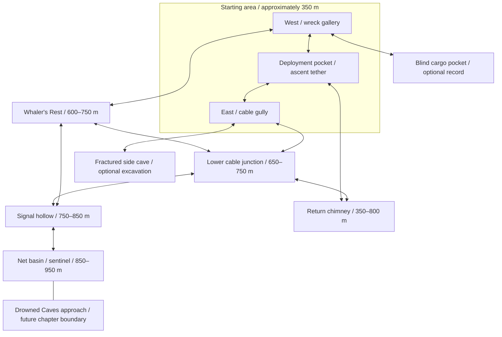

# Chapter 2 design proposal — The Twilight Shelf

**Status:** design proposal incorporating the user-agreed chapter handoff, deep deployment and bidirectional exploration revisions. Narrative canon remains the Story Bible; remaining design decisions are identified below. This document does not authorise implementation by itself.
**Main expedition target:** 30–45 minutes, selected by the user; optional exploration adds approximately 10–15 minutes. These are human-playtest targets, not measured completion times.
**Proposed expedition subtitle:** *The Severed Line.*
**Agreed flow:** optional Chapter 1 finish at the buoy → short debrief/preparation → fully supplied Chapter 2 deployment at approximately 350 m. A starting-area ascent tether offers deliberate Halcyon refitting; substantial exploration routes lead both left and right.

## Sources and boundaries

The canonical reference is [the Story Bible](../story/Below_the_Abyss_Story_Bible.pdf), especially pp. 2, 5–6, 9, and 11–12, alongside [its alignment notes](../story/README.md). Current systems were reviewed at PR #36 source/evidence commit `9053847`: narrative/mission resources, StoryState, scanning, research talents, resource tuning and the atomic expedition schema.

**Canon:** Twilight Shelf spans 200–1,000 m. The pilot follows severed sensor cables through a wreck field spanning centuries, including a whaling ship with symbols scratched into its hull. Cable cuts suggest intelligence. A luminous, eel-like Warden sentinel watches. The player finds Mara's first field log and the first Vael glyph. A sentinel caught in a Tethys drift net can be freed or captured for Crane. Release earns future guidance in Zone 3; capture earns a bounty/sonar advantage and the Wardens' hostility.

**Proposals below:** place names, exact layout, dialogue, encounter choreography, pacing, pressure refit, research-point amounts and technical delivery sequence. None are quotations from or additions already accepted into the Bible. The Bible's credits reward is adapted to the user's existing research-point preference, without adding a second currency.

Do not reveal Mara's fate, the identity/purpose of the Choir, the later Lantern-1 location, Crane's secret or the broader civilization's explanation. The historic wrecks are not Lantern-1. A guardian animal is not a full introduction to the civilization behind it.

## Player promise

“Follow a human cable into water where something has been deliberately cutting it.”

The first chapter taught operating the submarine. This chapter asks the player to read an environment: follow a cable until it ends, compare cuts, look beneath a wreck, notice a repeated light shape and decide what to do with a vulnerable unknown animal. Navigation and interpretation create the challenge. The player should finish thinking **these events are connected, and something is responding to us**.

Keep the strongest existing systems: weighty movement, deliberate scanner use, useful passive listening, expensive active pings, readable resources, optional excavation, compact radio with portraits and intentional station access through the starting-area ascent tether.

## Agreed chapter handoff and deep deployment

### Chapter 1: finish at the buoy or keep exploring

After the buoy recording and the other required chapter-one investigation/choice are committed, offer a small, controller-accessible panel:

- **Finish chapter** — save the recording, discoveries and bloom decision, acknowledge the expedition once, then show a short Halcyon debrief. The return voyage and servicing happen off-screen. Offer continuation into the Twilight Shelf without requiring the long manual swim home.
- **Keep exploring** — remain in the shallows. Preserve the finish option through the expedition log or the buoy's read-only interaction; the player may also return and dock normally.

Reaching the buoy is not enough before recovering its recording. If the bloom choice is still unresolved, retain the recovered recording and show the outstanding investigation rather than inventing a choice or prematurely claiming completion. Both bloom outcomes support the same finish option.

The two finish routes share the existing one-time acknowledgement/reward authority. A scripted return is an explicit supported narrative transition, not a forged physics/base-entry signal. If the checkpoint fails, stay in the current scene with progress intact, grant nothing and offer retry. Reopening the panel, Continue or docking after completion cannot pay again.

### Chapter 2: arrive ready, underwater

The first playable frame is in a sheltered deployment pocket at **approximately 350 m**. Halcyon's exterior, the ocean surface and surface-wave art are not visible. A brief caption/radio line establishes that Lantern-2 was serviced and prepared between expeditions; there is no mandatory surface commute or repeated long briefing.

Fresh chapter deployment starts with **full hull, battery and oxygen, ten torpedoes, and a pressure configuration suitable for the chapter**. Existing research allocations and permanent records carry over. This provision happens at intentional chapter commissioning or legitimate station servicing, never on an ordinary Continue or by crossing the entry area's boundary. Loading a mid-expedition save preserves its actual reserves.

The start is safe: no immediate ambush, adequate braking room and readable exits to both sides. The main 30–45-minute budget begins with this deep arrival and includes exploration, the return to its tether and the short debrief.

### Starting-area station access

Place a recognisable **ascent tether / survey anchor** beside the deployment pocket, with a cable disappearing upward into darkness. It is an access point, not an underwater rendering of Halcyon or a free refill aura.

Use the existing remappable Interact action to offer **Return to Halcyon** and **Stay here**. A deliberate return saves the expedition and opens the established station/refit presentation after an off-screen voyage. The player can use services, adjust research and refit. **Resume expedition** returns to the safe Chapter 2 deployment pocket with supplies from station service, without resetting discovered terrain, records, the sentinel decision, mission objectives or earned rewards.

Walking/swimming past the tether never refills, completes an objective or moves the vessel. Returning is available only from the designated safe access area; it is not an unrestricted teleport or a remote escape button during a distant encounter. Give station access priority over scanning only inside its interaction radius, as in existing station/scan arbitration.

### Exploration in both directions

The deployment pocket is central rather than at the far-left edge. The first view offers an unmistakable **western wreck passage** and **eastern cable passage**, both large enough for the full hull and both leading to substantial interconnected space. Neither is a token dead end before the player must turn east again.

Both approaches contain useful evidence and connect at multiple depths. Logs, glyph evidence and the sentinel may be encountered in different orders. Use existing persistent evidence when reconciling objectives; never withhold a valid scan/choice merely because the player took the other branch first. Keep the objective summary responsive without imposing a fixed left-to-right itinerary.

## Main expedition beats

| Beat | Intended time | Play and purpose |
| --- | --- | --- |
| Deep arrival and orientation | 2–3 min | Begin fully supplied at approximately 350 m. A short radio establishes the cable investigation; identify the nearby ascent tether and choose the western or eastern approach. |
| Trace the broken line | 7–9 min | Follow cable anchors through branching approaches. Scan an unmistakably clean severance and recover Mara's first field log from a survey instrument. |
| Read the wreck field | 9–13 min | Navigate around/under historic hulls, locate the whaler's scratched marking and record the first glyph. A distant living light pattern resembles its structure without being translated. |
| The trapped sentinel | 7–10 min | Approach from more than one direction, identify the net and its living occupant, then deliberately release or capture it. Observe an immediate, nonnumeric response. |
| Return and debrief | 5–8 min | Use a discovered loop to regain the deployment tether and deliberately return to Halcyon off-screen. Debrief changes with the decision and establishes the Drowned Caves as the next direction. |

Total intended range: **30–43 minutes**, leaving modest variation inside the selected 30–45-minute target. Long mandatory dialogue and empty travel must not be used to fill the budget. Reading/learning time and experienced repeat-run time are measured separately.

## Layout: a descending network

Use three major spaces and two substantial loops, with vertical changes and recognisable silhouettes. The following names are working labels, not canonical new lore. Depth bands are approximate authoring targets.

The solid line to the future chapter boundary is a visual destination, **not playable Zone 3**.

- **Deep central deployment:** start underwater at approximately 350 m, with the ascent tether and substantial western/eastern approaches. The chapter transition accounts for off-screen transport. Preserve the existing shallows landmarks and optional vent; neither is a mandatory commute into Chapter 2.
- **First loop:** a wider exposed wreck gallery and a narrower basalt gully meet below. Players can change approaches if debris or navigation becomes uncomfortable. Neither requires torpedoes.
- **Second loop:** Whaler's Rest, the lower junction and signal hollow can be approached from either side. Sightlines reveal a destination before revealing how to reach it.
- **Return chimney:** a readable vertical route reconnects to the first junction, making the return materially different from retracing every outbound bend. It is always usable; the peaceful choice can make its entrance easier to recognise, but does not own the only exit.
- **Dead ends:** include approximately three short pockets, each with an identifiable feature or small observation. A wrong turn should normally take less than a minute to recognise and reverse. Do not put meaningless black corridors behind every fork.
- **Optional excavation:** warm ochre plugs open a side cave or convenience connection. Protected basalt remains distinct. Zero-ammunition completion is mandatory.

No arrows painted in the level, perfect route line or undiscovered POIs on the map. Cables, hull silhouettes, changes in rock and occasional station hardware provide environmental direction. The objective tracker explains the current task without giving coordinates.

## Investigation and readable navigation

A cable is a physical clue, not a glowing quest trail. It follows terrain, disappears under debris and has occasional anchored fragments visible from the next safe viewpoint. At the cut, the player can compare a weathered surface with a clean, deliberate-looking edge.

Visible objects remain directly scannable. Active sonar identifies occluded or hard-to-see subjects when the wave reaches them; the original outward-only visual stays. Passive contacts can help locate creaking wrecks and acoustic sources but never permanently discover a glyph, reveal a secret or emit a gameplay event merely by listening.

Main progression should require a small number of meaningful records:

1. Evidence from the severed sensor line and Mara's first field log.
2. The whaler's scratched symbol, stored as an **untranslated/unclassified marking** in the player-facing log.
3. A resolved sentinel encounter.
4. A deliberate ascent-tether return to Halcyon with that evidence, acknowledged through the same station/debrief authority.

Include **three short Mara field logs** across the chapter: one required record and two optional records that develop her observations. The Bible does not supply their dialogue; all wording needs narrative review. Optional logs must not confirm later revelations. The main log/objective summary must let someone who skips optional text understand the expedition.

The current objective tracker should show one short instruction at a time, chosen from remaining work: trace the line; examine the wreck markings; investigate the living contact; return to the ascent tether. This is a responsive summary, not an enforced objective order. Do not add another permanently expanded checklist or HUD glyph instrument in this chapter. The Bible leaves the Resonance glyph's introduction open, potentially for Zone 3.

## Encounter: the living net

The sentinel is a long, luminous guardian animal with a strong illustrated silhouette and convincing body motion. It must not be a recoloured hammerhead. An early view through the wreck gives a partial glimpse; a second approach reveals that it is entangled. It watches and responds to the vessel, but the scene begins with uncertainty rather than an automatic attack.

Scanning establishes the Tethys net and the animal's condition. Okafor asks for release; Crane asks for a living specimen. Both should sound like believable scientists with different priorities. Crane's hidden affiliation is not exposed.

Use the existing Interact/contextual-choice pattern. Show the two physical intentions plainly:

| Choice | Immediate consequence | Persistent consequence |
| --- | --- | --- |
| **Carefully release the sentinel** | Perform a short, interruptible release using the existing scanner/interaction language. Once released, it briefly holds alongside the sub and moves toward the local return route. | One positive story decision; future Zone 3 guidance flag. |
| **Secure a living specimen for Crane** | Require explicit confirmation, then show the net's cradle securing the living animal. The light pattern contracts and other distant lights withdraw. | One negative story decision; capture/delivery eligibility and later Warden reaction flag. Bounty only after a legitimate station return. |

The exact release/capture durations are tuning proposals; approximately 5–8 seconds is enough for a tangible action without a new minigame. Movement out of range cancels progress before commitment. Pause freezes progress. Once the checkpoint commits, repeat interaction becomes a read-only status rather than another reward opportunity.

The player can back out and return before choosing. Essential records must remain recoverable. Disturbance from a sonar ping may change local behaviour, but must not silently select the capture branch or charge repeated Resonance penalties.

**Weapon edge case to settle before implementation:** deliberate attacks cannot destroy the only route to story completion, magically count as a live capture or create reward farming. Specify an honest damage/flee/failure outcome for the critical animal before building the scene; do not quietly make it immortal or let a dead specimen satisfy a live-capture reward. This needs a narrowly scoped encounter rule, not a general combat overhaul.

## Resonance and rewards

Use the current StoryState and authored ChoiceData, with one mutually exclusive encounter ID. Proposed deltas are **+15 release / −15 capture**, matching the Bible's provisional ordinary-zone balancing. No numeric alignment or “good/evil” label appears in gameplay.

With only the two main zone choices, normal totals can be −30, 0 or +30. **Neither chapter-two path alone reaches the current ±40 tier thresholds.** Immediate dialogue and sentinel reactions must therefore read the actual encounter decision rather than incorrectly expecting Listener/Hostile tiers. Leave endings and global wildlife scoring out of this milestone.

Reward proposal, using existing research points rather than adding the Bible's separate credits currency:

- A common, finite chapter acknowledgement for either completed path; suggested **2 RP**, subject to economy review.
- Optional science uses the existing unique-record XP rules and cap. Do not create a second parallel optional-research payout or pay again for previously credited scans.
- Capture has a proposed **one-time +1 RP bounty plus a modest authored sonar calibration**, awarded after delivery. The calibration should be a unique installed ID with a small additive range benefit, not repeated multiplication or a free rank that becomes worthless if the player already bought that rank. Keep ping cost/cooldown unchanged unless separately agreed.
- Release earns the local safer-route response and the future guide flag. Zone 3 will honour that flag in its own milestone; do not build that region now.

Exact bounty/calibration values remain a balancing decision. The aggressive option should be tempting without making the peaceful path feel mechanically punished. Both paths must be able to finish this chapter on a legal loadout and reach the next investigation. No kill rewards, materials, new currency or mandatory harvesting.

## Pressure, supplies and challenge

The existing authored hull ratings are 300/400/450/500 m. A 200–1,000 m chapter cannot simply assume that current players can survive it.

**Recommended pressure specification for the agreed deep start:** commission a **1,000 m expedition pressure refit** during the Chapter 1-to-2 preparation transition. Explain it explicitly; choosing to begin Chapter 2 confirms commissioning and starts with the suitable fit already installed. No additional station detour or research-point tax is required. Preserve purchased hull ranks as bonuses reconstructed over the validated baseline; keep the damage system's maximum-depth API as the sole authority. Old saves retain their prior fit until commissioning. The exact profile/ID remains a future implementation detail.

Keep the required course below that rating, with clear caution near its deepest points. Difficulty should come from debris, choosing an approach, managing visibility and recognising clues rather than forcing untelegraphed pressure damage. Reserve extra hull margin and conveniences for player builds. Do not force a respec to unlock the story.

Current oxygen drain is 0.03 units/s: 45 minutes of uninterrupted simulation consumes **81 of 100 oxygen**, before detours. A new chapter needs an actual resource budget, not an assumption that old short-route tuning scales. Measure a 30–45-minute novice route with reserve for a wrong turn and a return; tune the existing configurable rates if necessary. A reasonable initial test target is at least **25% battery/oxygen remaining** after a representative main route using 6–10 pings and no mandatory torpedoes. This is a proposed target, not a measured result.

Fresh Chapter 2 commissioning provides full supplies; subsequent repair/refill/rearm uses deliberate ascent-tether return and station service. There are no refills from ordinary Continue, passing the anchor or re-entering its radius, and no resource loss while reading a paused choice. The route must remain reversible if supplies are low. Navigation, limited visibility and a well-telegraphed optional threat provide challenge; rapid battery bleed does not.

## Visual, sound and dialogue direction

Carry PR #36's illustrated materials into a colder, less sunlit palette. Use worn timber, corroded metal, sagging cables, hanging debris and natural rock, not rectangular corridors. Distinguish solid foreground from distant wreck silhouettes. Keep real openings readable. There are no surface waves or above-water mountains in the deep background.

Use a small set of memorable compositions: the cable descending into blue-black; the ribbed whaler hull; a long animal's light visible through wreck ribs; the net basin; the first upward view through the return chimney. Open dark water between detailed scenes gives scale without becoming empty commuting.

Audio: restrained low music, stressed cable, distant wreck movement and a changing animal pattern. Every useful cue has a visual equivalent. No inference or choice depends on hearing a note correctly. Radio retains speaker portraits, optional automatic previews, readable archive and current typography. Large Text, High Contrast, Reduced Motion/Effects/Particles and muted audio must preserve the entire chapter.

**Example dialogue direction — newly proposed text, not canonical quotations:**

- Okafor, on the cut: “Don't pull the line yet. Let me see the edge.”
- Wick, on the whaler: “The same arrangement appears more than once. I can't translate it.”
- Crane, at the net: “A living specimen could answer questions a recording cannot.”
- Okafor, after release: “It had room to leave. It chose to wait.”

Keep these exchanges brief and leave the environment visible. Debrief explains what evidence supports and what remains unknown. Do not call the century-old whaler or any shallow prototype submarine Lantern-1.

## Persistence and delivery plan

At design time, checkpoint validation accepted only `continental_shelf` and fixed authored catalogues. A second region therefore needs a small, explicit compatibility milestone before final art/narrative. Do not append unvalidated region strings, duplicate the mission ledger, add a chapter save file or replace the campaign architecture.

Recommended implementation sequence, with BTA numbers reserved only after checking the tracker:

1. **Chapter handoff, region/checkpoint foundation and graybox:** buoy Finish/Keep Exploring flow; one-time explicit scripted-return/debrief adapter; validated new-region identity/catalogues; atomic fully supplied deep deployment; old-save migration; ascent-tether station/refit/resume; two collision-safe loops with meaningful west/east starts. Keep Sunlit Shallows and development fixtures functional.
2. **Cable/wreck investigation:** explicit discovery/scan signals, three logs, first glyph, objective projection and one-time debrief. Prove that missing optional logs do not block the main route.
3. **Sentinel encounter:** resolve weapon edge cases, implement one bounded encounter, both choices, idempotent StoryState/save effects and delivery reward. No full language/stealth/combat framework.
4. **Illustrated art/audio:** new environment and sentinel artwork, original provenance, readable animation and low-cost lighting; preserve collision truth and comfort modes.
5. **Complete chapter playtest:** full regressions, native captures and real input-driven routes, then actual unfamiliar human playtests to validate understanding and 30–45-minute pacing.

Continue must restore region/pose, actual reserves, all chapter-one records, new evidence, choice, capture/delivery state and claims without replaying signals. Persist chapter commissioning and the designated resume anchor so Continue cannot be mistaken for a new fully stocked deployment. Both Chapter 1 finish routes use the same completion/reward state. A failed chapter or station-transfer write must leave the prior checkpoint and current expedition usable. Persisting the decision and its associated evidence must be transactional. Corruption/backup handling remains the existing checkpoint's responsibility. Refit baselines and calibration IDs must reconstruct capabilities without stacking after reload. Returning to the shallows or restarting a test route must not undo a committed story choice.

## Acceptance before calling the chapter complete

- After recovering the buoy recording and resolving the required bloom decision, keyboard/controller players can Finish chapter or Keep exploring; manual return remains available. Either completion route acknowledges/rewards once, even across quit/Continue.
- First Chapter 2 deployment begins at approximately 350 m with full hull/battery/oxygen, ten torpedoes and a suitable pressure fit. Halcyon exterior, sky and ocean surface are absent from the starting view.
- An ordinary mid-expedition Continue restores its saved supplies without healing or rearming.
- The starting ascent tether supports intentional Return to Halcyon, refit/services and safe Resume expedition. Passing it does nothing; repeat trips preserve all world/story progress and cannot repeat rewards.
- Both western and eastern exits lead to meaningful exploration, reconnect at different depths and accept evidence/choices in different orders. Test a west-first and an east-first full expedition.
- An unfamiliar player can explain the next task from the opening and environmental clues.
- The main expedition takes 30–45 minutes in representative human playtests; report automation and human timing separately.
- Both main approaches and the return loop are usable with the full hull; blind pockets can be reversed without torpedoes.
- Zero rounds, either sentinel decision and non-hull research builds can finish safely.
- The player learns that the interference appears intentional, without receiving later campaign answers.
- All required evidence, glyph, decision and reward survive save/quit/Continue at intermediate stages; repeated scanning/choices/docking cannot pay twice.
- Legacy saves, Sunlit Shallows, current weapons/research/station services and prototype fixtures remain functional.
- Keyboard/controller, remapping, audio mute, all comfort settings and 800×600 are covered; critical clues have equivalent visual information.
- Tests cover both buoy finish options, manual/scripted completion equivalence, commissioning versus Continue, full starting supplies, tether boundaries and scan priority, refit/resume preservation, west-first/east-first mission ordering, early evidence, both sentinel decisions, atomic transition rollback, save migration/recovery, boundary clearance, pauses, reward idempotence and 30/60/120-step consistency.
- Full pinned Godot/GUT/import/parser/startup/Linux export checks pass, with actual native graphical evidence. No art or performance acceptance is inferred solely from tests.

## Remaining design decisions

1. Review the implemented BTA-053 deep starting pocket, west/east graybox connections and ascent-tether transfer before authoring the full investigation.
2. Finalise release/capture physical actions and the honest response to deliberate weapon attacks.
3. Set the capture bounty/calibration magnitude against the shared finite research budget.
4. Review actual Mara log wording and the first glyph's artwork/recognition; full translation remains later.

**Design history:** this proposal was originally prepared without gameplay changes or game tests. BTA-053 now implements delivery step 1 only; the later content and complete-chapter acceptance criteria above remain planned. See [implementation, migration and verification](../testing/bta-053/README.md).
