# Expedition presentation and research progression — feedback round two

This implements the user's second playtest revision, including their explicit
choice of **free research-point reassignment at the station**. It builds on merged
PR #26 (`ac8995887f05a0fabc701d9630a293a45bedd4d4`), on a separate review branch.

## Acceptance matrix

| Requested behavior | Implemented behavior |
| --- | --- |
| Clean loading menu with title/submarine graphic | Paused title screen with spaced illustrated title treatment, original shaded NERIS portrait, Begin/Continue, Options and Quit. Options return to the title without starting piloting. |
| Torpedoes fire only where the sub faces | Launch direction comes from the same horizontal-facing API as the visible submarine. Vertical input never launches vertically; inertial facing remains consistent while braking/reversing. |
| Slow launch then high speed | Authored launch speed 80 units/s, acceleration 500 units/s², cruise 1,100 units/s, lifetime 5s. Distance integrates analytically, including the cruise boundary, with swept collision. |
| Fading wake | Bounded world-space bubble/wake samples fade over 1.2 simulation seconds and remain briefly after impact. Pause freezes them. |
| Bright explosion/distorted surroundings | Bright layered core/glow, pressure ring/debris and local screen-space refraction extending beyond the excavated crater. Damage radius remains 150; optical refraction spans 600×600 world units. Comfort preferences suppress flash/refraction/wakes appropriately. |
| Limited torpedoes/counter | Ten rounds, explicit HUD counter/readiness/empty/low-energy states, 1.2s cooldown and existing 2-battery launch cost. Failed shots spend nothing. Save/Continue and effect resets cannot manufacture ammunition. |
| Slower submarine acceleration | Separate authored production motion Resource: 120 units/s² acceleration, 240 maximum speed, 1.2 exponential damping. Approximately two seconds to full thrust speed; the old development fixture retains its previous tuning. |
| Filled/shaded seascape and fauna | Original layered filled relief, collision-sampled rooted growth, shaded mineral chimneys, rock material with strata/mineral variation, and shaded animated fish bodies/fins/scales. Decorative background relief is visually behind collision-bearing foreground. |
| Docking overhaul/interior | Original shaded operations-room illustration, discrete Research technology / Expedition logs / Radio archive pages, clean navigation and a clear Depart button. Long text has pinned controller-accessible Text ↑/↓ controls and Page Up/Down. |
| Automatic docking services | Deliberate, validated E/A docking automatically repairs, charges, refills oxygen and rearms. Merely crossing or hovering in base restores nothing; excessive speed remains rejected with readable feedback. Existing service APIs/clamping remain authoritative. |
| Clear mission acceptance through radio | Depart base, read the paused transmission and choose **Accept investigation**. Read later/Escape/B defers it. The production mission board and old manual-accept path are removed from player flow; existing MissionService still owns progression. |
| Last-known position on map | Accepted radio dispatch adds an explicitly unconfirmed base report at Twin Spires, independently of sonar discovery. It does not reveal the wreck or mark the POI discovered. Existing route arrows remain hidden. |
| Scared NPC at wreck | One harmless scavenger uses the existing body, receiver, navigation and shared FSM's new FLEE state. Vessel approach triggers an escape to a bounded refuge away from approach; no teleporting, attacks or player blocking. Pause/restart are respected. |
| Recover logs, decode at base, next story lead | Wreck scanning stores encrypted logs; research UI withholds their contents until returning to dock. Base uploads/decodes once, awards a research point, acknowledges completed expedition objectives and opens the Twilight Reef receiver-trail dossier. The next region is explicitly not playable yet. |
| Research-point currency/talent tree | Six illustrated sequential ranks across Acoustic Array and Pressure Hull. Each rank costs one point. A finite **four-point prototype budget** prevents buying every rank. Allocations persist; refunds/reassignment are free while docked. No kill/farming rewards. |

## Research budget and capabilities

| Source | Lifetime points |
| --- | ---: |
| Initial scientific commissioning allocation | 2 |
| Completed outer hydrophone + chimney survey | 1 |
| Bring the scanned expedition recorder home for decoding | 1 |
| **Total in this prototype** | **4** |

Awards are stable IDs, not an incrementable bank balance. Available points are
`sum(unique authored awards) - allocated ranks`. Duplicate scans, repeated signals,
re-docking, reloading and reassigning cannot duplicate awards. Earlier completed
objectives count deterministically. Survey completion is also acknowledged by radio.

| Branch | Baseline | Rank I | Rank II | Rank III |
| --- | ---: | ---: | ---: | ---: |
| Acoustic Array / maximum active-sonar radius | 900 | 1,200 | 1,500 | 1,800 |
| Pressure Hull / rated safe depth, meters | 300 | 400 | 450 | 500 |

Ranks are sequential, one point each, with stable branch/rank identities. Sonar
cost/cooldown, active pulse identity/history and pressure-damage APIs retain their
existing behavior. Capabilities reconstruct from baseline plus allocation, never
multiply/stack. The old free-install API is guarded in production; old development
fixtures retain it. Legacy installed upgrade IDs migrate to Rank I allocations
against the two commissioning points, preserving their actual capabilities.

The six ranks and four points are an authored **prototype**, not a claim that the
entire campaign's final technology tree or research budget is complete.

## Architecture and persistence

- `ExpeditionRevision` is a scene-owned adapter for the existing mission, discovery,
  research, service, upgrade and save APIs. No new global singleton or dispatcher.
- `ResearchTree` Resource, `CampaignData` pure validation/earned-state model and
  `ExpeditionInterface` separate tuning, rules and presentation. `SubmarineUpgrades`
  exposes a capability projection hook rather than duplicating sonar/depth systems.
- `TorpedoLauncher` owns ammunition and projectiles. `TorpedoProjectile` integrates
  accelerated motion; `TorpedoTrail` owns bounded cosmetic samples independently of
  impact. Existing AcousticEmitter/Bus explosion delivery/history stays unchanged.
- `WreckScavenger` supplies approach sensing to the existing CreatureState/navigation;
  FLEE ignores acoustic distraction, has bounded timeout/unreachable behavior and
  holds at refuge until the temporary encounter is reset.
- All art/shaders are original code-drawn prototype illustrations. No third-party
  assets/dependencies, online services, combat progression or extra playable region.

Canonical expedition schema **4** adds strict `prototype` state with remaining
ammunition and the campaign's ranks, unique award/message IDs and decoded flag.
Versions 1/2/3 migrate in memory without rewriting source files on read. Old
completed endings/discoveries/research/claims remain. Missing/invalid/incompatible
files retain the established explicit backup/recovery flow; rejected bytes remain
preserved. Recovery merges earned flags monotonically while allowing intentional
allocation changes. JSON whole-number ranks/ammunition normalize to integers.

Allocations commit atomically before affecting capabilities. Failed writes retain
previous ranks/points. Ammo and temporary encounter state are distinct from permanent
research. Continue restores remaining ammo; Reset Test Route clears effects/creatures
but does not rearm. New Expedition preserves permanent progress and remaining ammo;
only actual docking rearms. Unsaved shots may be rolled back by loading an older
explicit checkpoint, consistent with the existing manual-save policy.

The original shelf and round-one revision remain explicit regression contexts.
Old milestone integrations use their existing fixture; round-one integrations and
external driver set `revised_expedition = false`. New production MAIN is exercised
by the revision integrations and complete controller-driven expedition. This keeps
historical explicit-service/free-upgrade assertions meaningful while testing the
user's intentionally changed production behavior separately.

## Manual playthrough and verification

1. Launch `godot --path .`. Confirm the clean title, submarine artwork and stopped
   simulation. Navigate Begin/Continue, Options and Quit using keyboard or controller.
   Open/close input, audio, help and accessibility options without starting the game.
2. Begin. At base press E/A to dock. Confirm operations-room artwork and automatic
   resource/torpedo restoration. Visit Research technology: two commissioning points.
   Buy pressure-hull Rank I and sonar Rank I; verify rated depth 400m and range 1,200.
   Refund/reassign freely, then restore those two allocations for the route.
3. Depart. The base radios the missing-expedition request. Choose Read later once,
   confirm no mission acceptance/map discovery, then accept the re-offered briefing.
   The map shows a labeled last-contact report at Twin Spires, not the wreck.
4. Scan the reference plate near (760,480), follow the original cave to Twin Spires
   near (3560,650), and ping to discover it. Read research for subsequent clues.
   Continue to the hydrophone at (6500,800) and mineral chimneys at (12800,1120).
   Complete both scans, receive the survey's one-time research point/radio acknowledgement.
5. Observe slower acceleration/coasting and the shaded seascape/fauna. Optionally fire
   Space/RT in open water while moving vertically: the launch must remain horizontal,
   matching the visible hull's facing. Watch slow initial motion, cruise acceleration,
   fading wake and HUD count. Pause freezes motion/effects. Empty ten rounds; an
   eleventh shot must fail. Docking rearms; resetting effects or Continue cannot add rounds.
6. Optional plug: approach x19400–19600 around y1100. Fire to excavate it and observe
   the bright local refractive explosion. The upper y600 bypass remains usable without
   weapons. Comfort options suppress flash/refraction/wakes; player movement and
   collision must remain usable. The player is blast-immune as in the prior prototype.
7. Approach the wreck from the west near (21100,1220). The shaded scavenger should
   flee toward a clear refuge and avoid trapping the submarine. Pause/resume and
   restart the route to check repeatable encounter reset. Existing observer/predator remain.
8. Ping/scan the wreck near (21600,1390), from above around y1240–1290. Map → Research
   must show **encrypted recovered logs**, with no plaintext story yet. Accept the
   return transmission. Return west via the original lower passage to Shelf Base.
9. Dock. Resources automatically restore, logs decode once and another research point
   is awarded. The complete prototype budget is four points. Read decoded records
   and the next investigation dossier; revisit without earning again. The next region
   is labeled unimplemented. Use controller Text ↑/↓ or keyboard Page Up/Down for long text.
10. Allocate all four points across the six ranks, verify gameplay values and freely
    reassign. Save, relaunch and Continue: allocations, awards, logs, discoveries,
    research and remaining ordnance must agree. Repeated docking/scan/reload cannot
    farm currency. In a disposable profile corrupt the primary checkpoint, recover
    the valid backup explicitly and check preserved rejected bytes/progress.
11. Repeat UI checks at 800×600/Large and 1280×800. All buttons remain reachable and
    long records can be scrolled with keyboard/controller. Tutorial OFF persists;
    critical mission radio is distinct from optional tutorial cards.

## Exact commands

```bash
# Godot 4.6.3.stable.official.7d41c59c4; GUT pinned at 9.6.1
python3 tools/install_gut.py
godot --headless --path . --editor --import
python3 tools/validate_godot.py
python3 tools/run_tests.py
python3 tools/verify_expanded_expedition.py  # retained round-one regression route
python3 tools/verify_revision_two.py         # production title/radio/dock/research route
python3 -m unittest discover -s tests/python -v

# Graphical evidence on an available X11 display; :99/llvmpipe used here.
mkdir -p docs/feedback-two/screenshots
BTA_EVIDENCE_DIR="$PWD/docs/feedback-two/screenshots" \
  godot --path . --audio-driver Dummy --rendering-method gl_compatibility \
  --script res://tests/fixtures/capture_revision_two.gd --quit-after 4000

python3 tools/install_export_templates.py
python3 tools/build_playtest.py
python3 tools/smoke_playtest.py build/below-the-abyss-playtest-linux-<commit>.zip
# Unzip the package, then run its included executable; no editor is needed:
chmod +x below-the-abyss.x86_64
./below-the-abyss.x86_64
```

CI retains engine import/parser/startup, the complete GUT suite, both full routes,
Python checks, and dependent Linux export/smoke artifacts. Expanded real-time tests
have a bounded 600s runner budget; the validation job allows 25 minutes.

## Actual graphical evidence

The captures are actual Godot 4.6.3 Compatibility/llvmpipe frames. Positions are
staged for framing; the separate controller route proves connectivity without
teleporting. Native captures use Dummy audio and injected inputs, not physical
controller or hardware-audio verification.

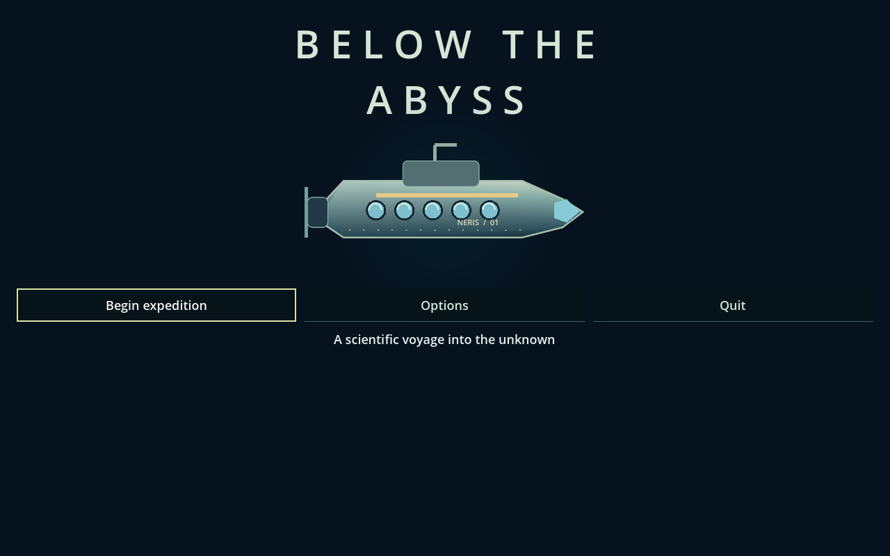
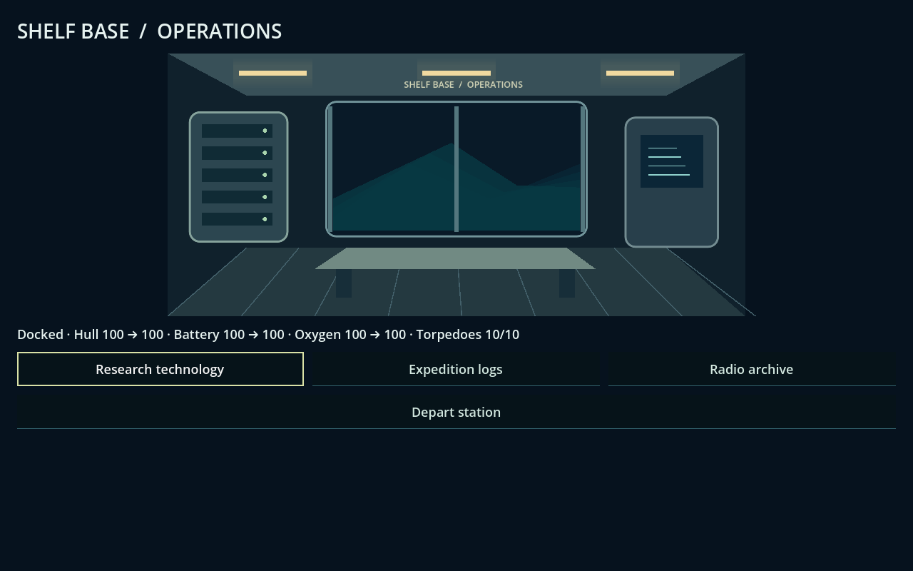
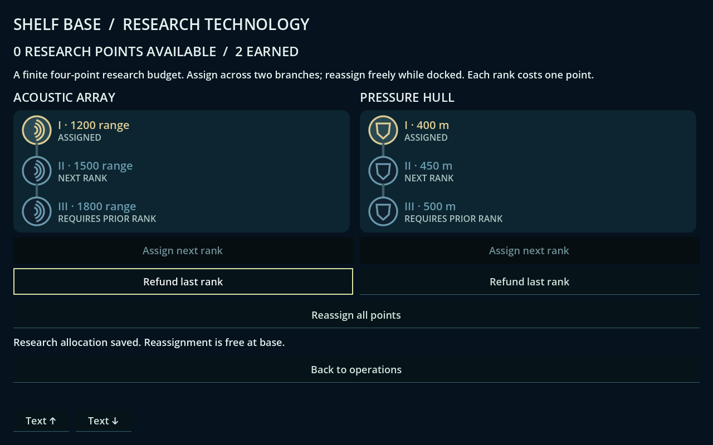
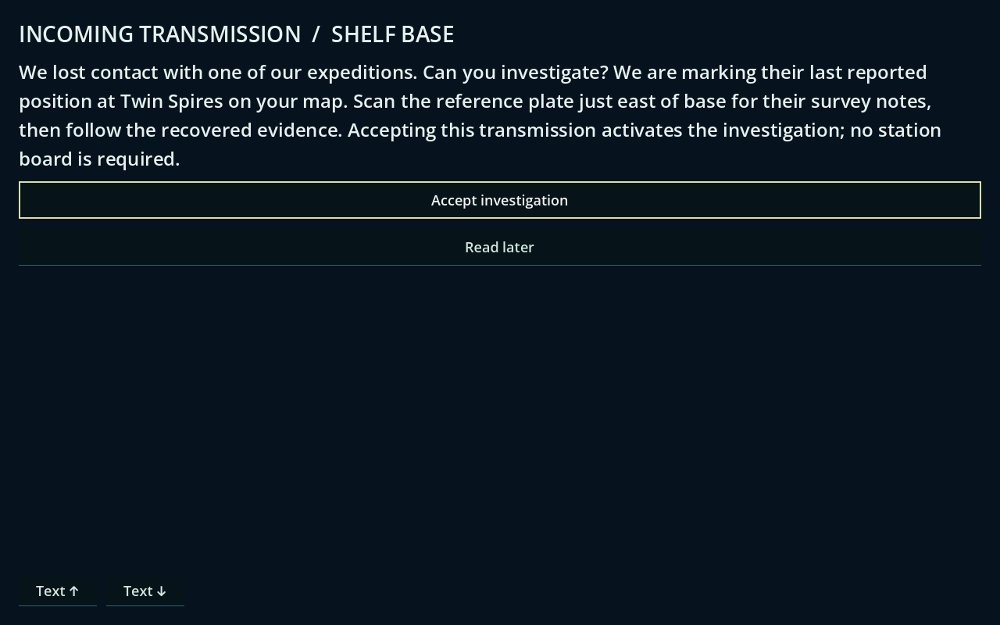
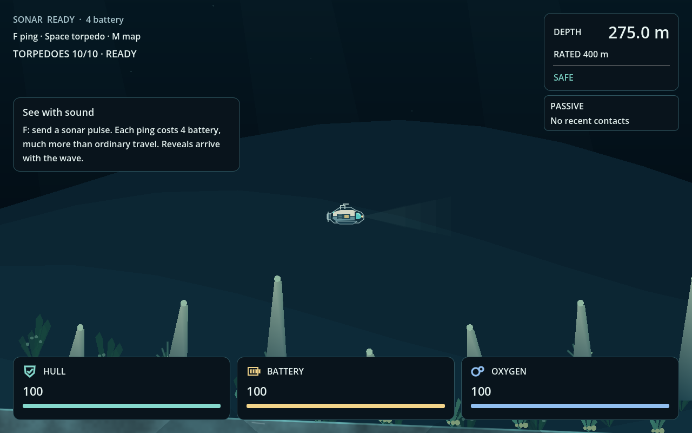
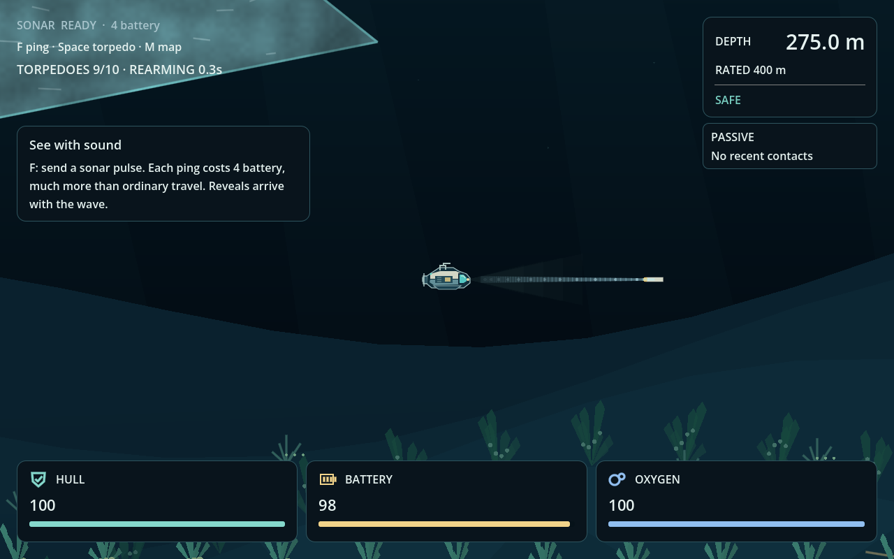
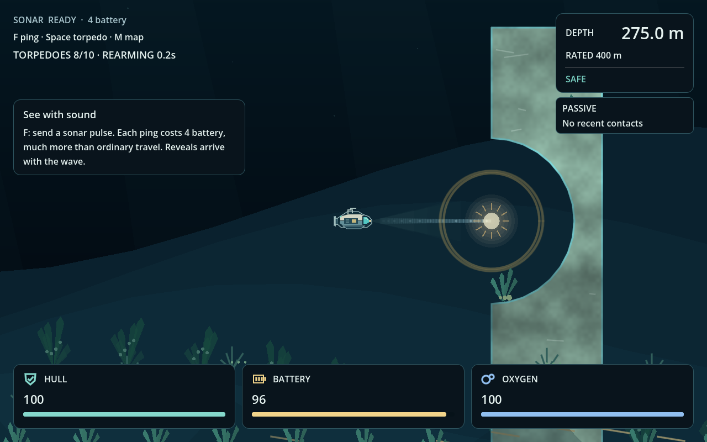
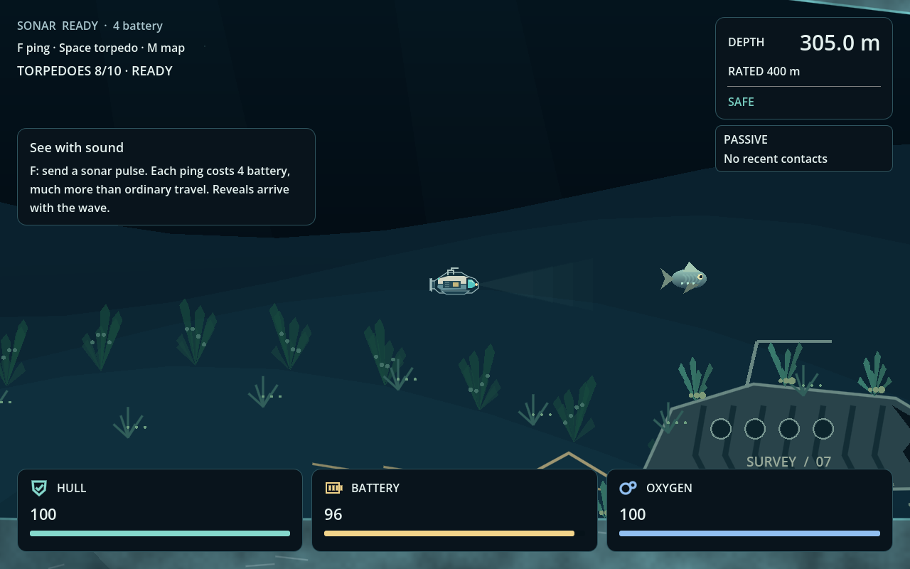
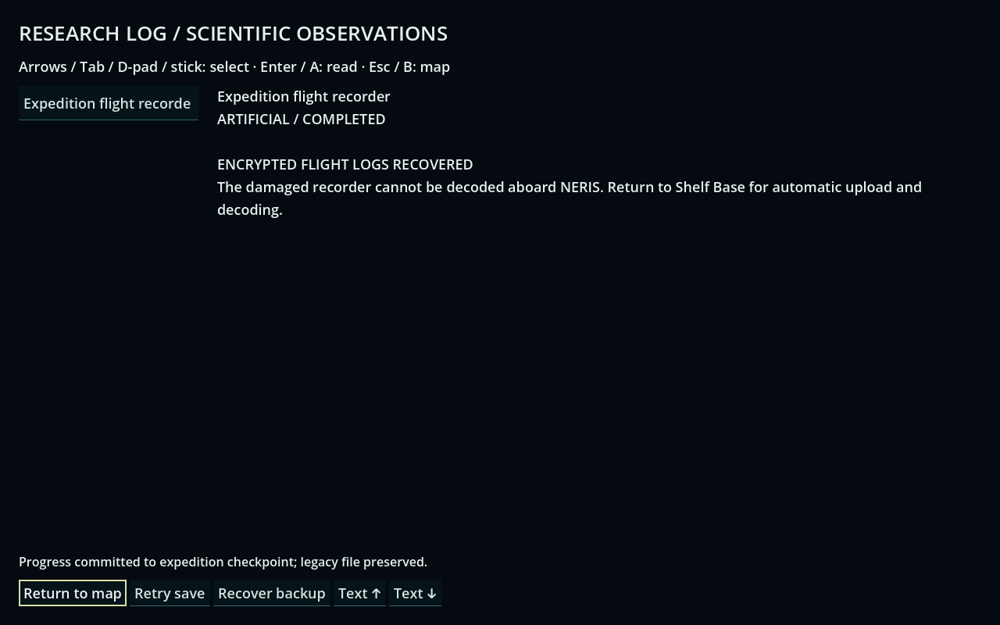
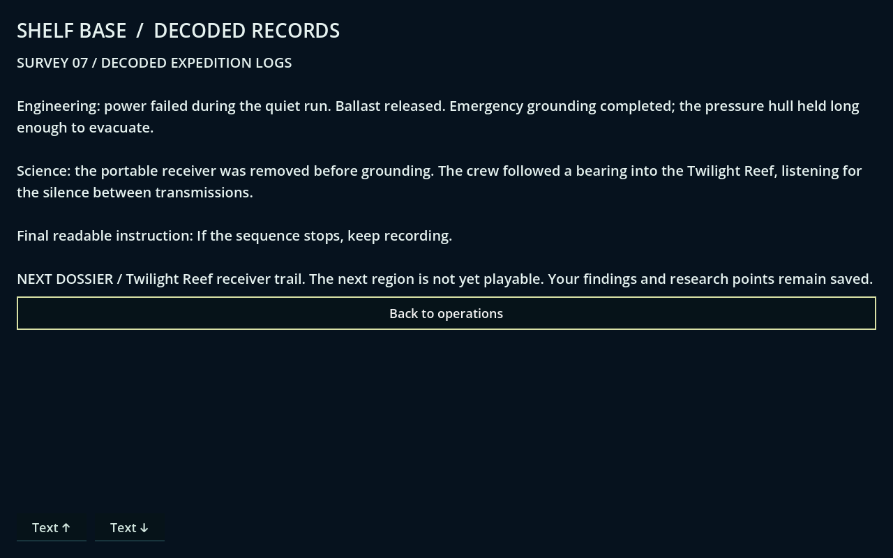
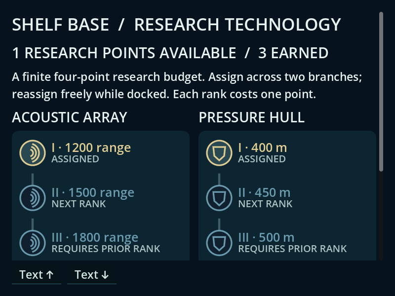
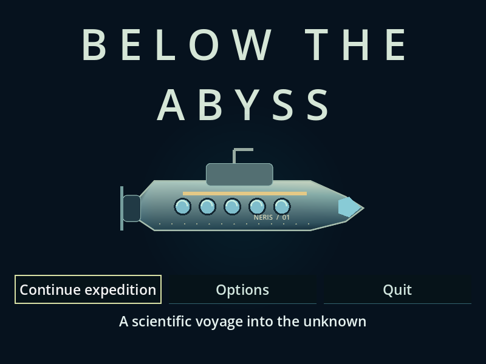

## Limits and results

[Verification, logs and changed files](verification.md). The known controller route
was 467.73 simulation seconds with 100 hull and about 72.6 battery before docking;
after docking battery/ammunition restored and all four research points were earned.
That is not a human 20–40 minute playtime claim. No five-person study, physical
controller/audio hardware, Windows/macOS runtime, final artwork, subsequent region
or complete campaign technology tree is claimed. Existing bounded terrain/acoustic
history limits and temporary wildlife deaths remain. Optical distortion is cosmetic;
it does not enlarge the damage/excavation radius. Projectile collision uses swept
center-line rays, and creature navigation remains conservative on excavated terrain.
