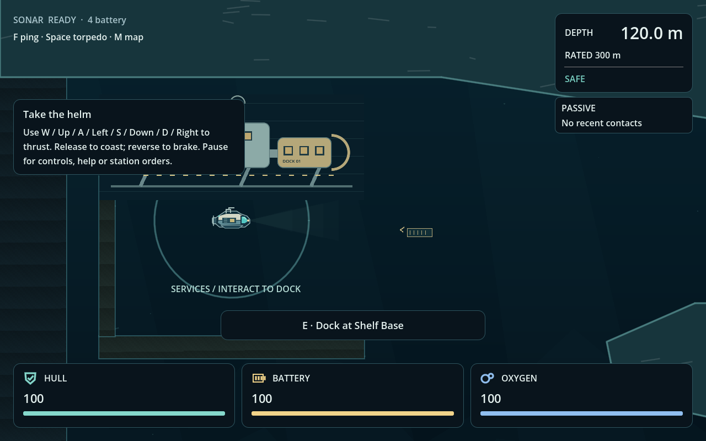
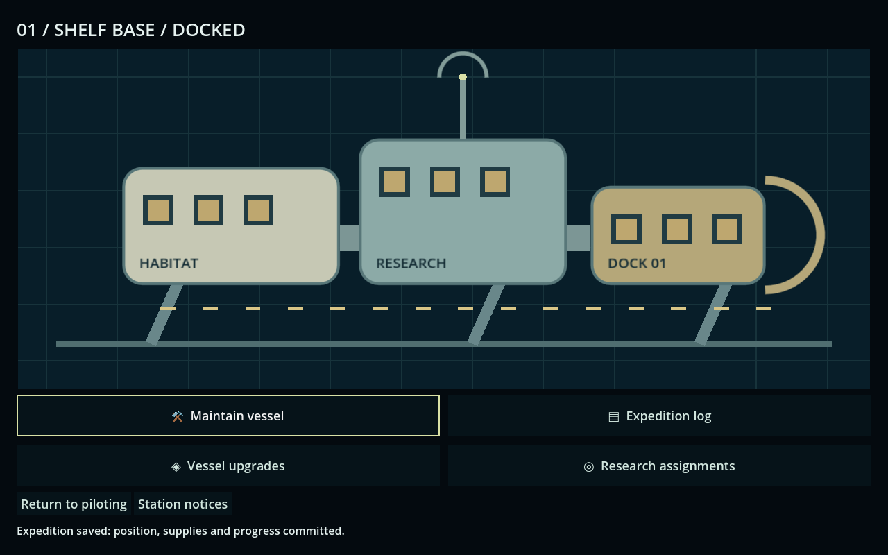
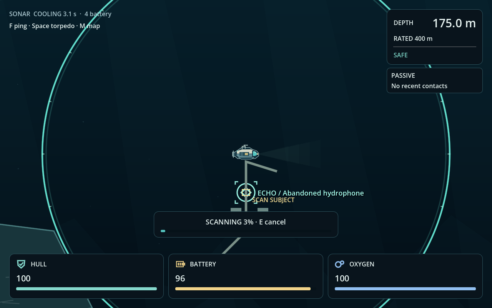
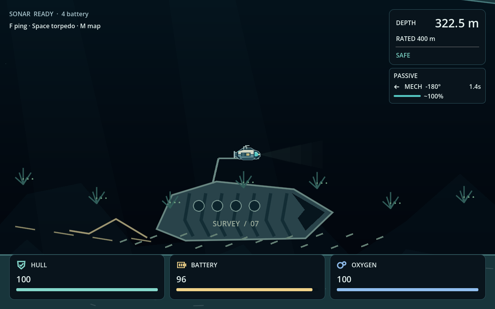
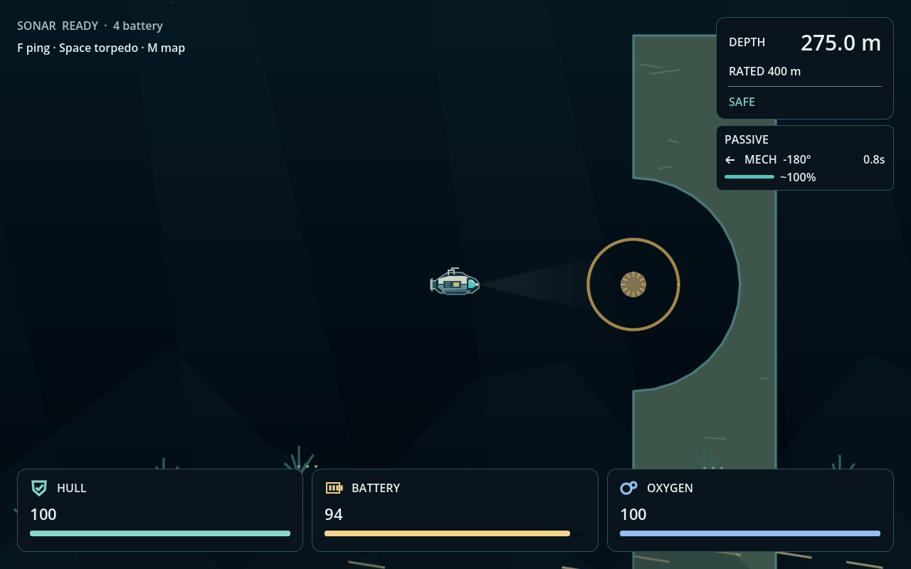
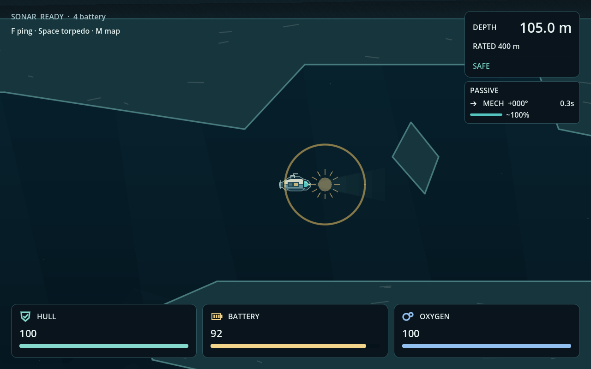
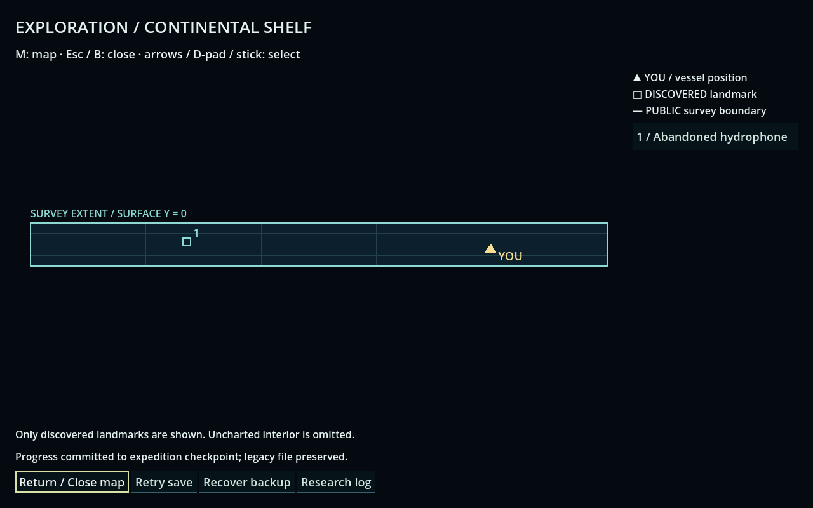
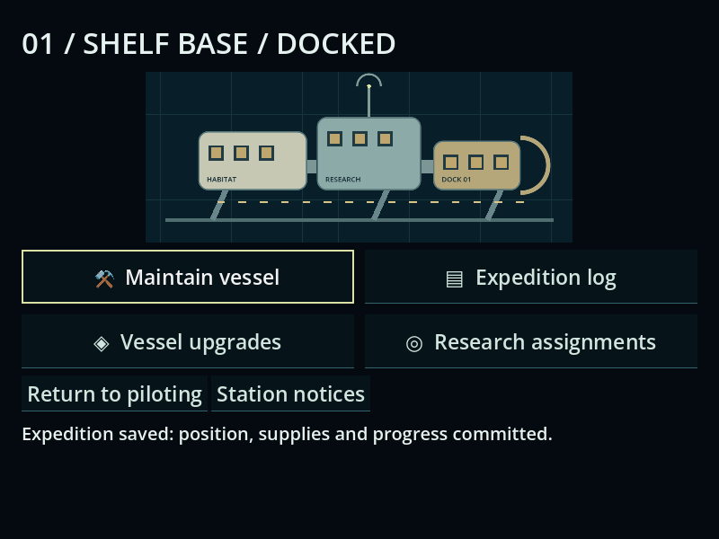
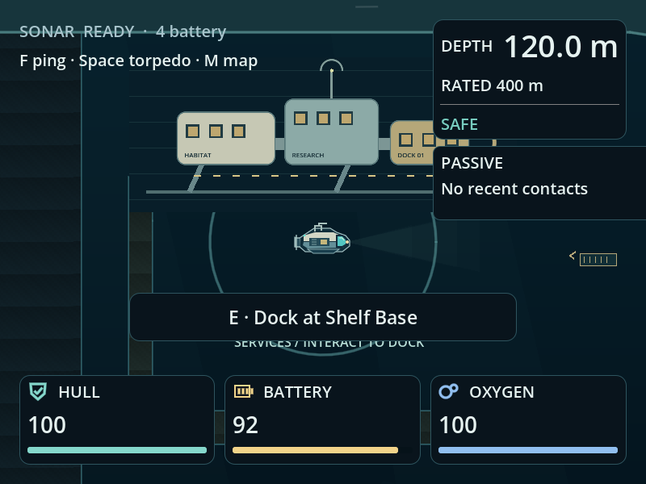

# Playtest feedback iteration

This is the user's requested revision after BTA-044, including their explicit choices
of **excavatable terrain** and **substantial region/chapter expansion**. It is not a
claim that the external five-person study has finished. It depends on PR #25's
playtest/export tooling, which was still unmerged when this branch was created.

## Feedback and resulting behavior

| Feedback | Change / acceptance check |
| --- | --- |
| No idea how to start | Starting the expedition accepts the scientific orders. One optional mechanic card at a time explains movement, sonar, scanning, map, station, depth, wildlife and torpedoes. Pause → Help & tutorials explains them again. |
| Disable popups | Help & tutorials → Tutorial messages OFF; saved independently of control defaults. Completed hint IDs persist; non-modal hints expire after 12 active seconds. Critical pressure/threat feedback remains operational. |
| Too much text | Production HUD hides the permanent route/mission/scanner paragraph block and AI state captions. Numerical gauges remain, with context-only docking/scan progress and compact passive readings. |
| Busy docking UI / more graphics | Illustrated station overview with four large tiles. Services, assignments, upgrades and log have separate pages; Back returns to the overview. Docking does not apply services. |
| Fish have no purpose | Harmless grazers visibly investigate sounds and return to feeding. The original grazer is a moving biological research subject with an optional assignment. Two additional grazers inhabit the outer shelf. No kill reward; passive listening never attracts them. |
| Short chapter | Region expands from 4,100 to 24,000 world units, with additional passages, hydrophone, chimney field, optional excavatable shortcut and a wreck investigation. Fresh profiles require the original survey plus the outer records and flight recorder before debrief. |
| Missing old submarine | Original vector wreck geometry, fractured bow, ribs, windows, aerial, identification and debris on the deep sea floor. Its hull is solid and its recorder is scannable from outside. |
| Map tells me where to go | Numbered world route signs/arrows are hidden in production. The exploration map shows discovered sites/player only; narrative clues remain in recovered research/logs. No route line is added. |
| Torpedoes / explosions / terrain / NPC damage | Remappable weapon, swept collision, visible bounded blast, radial wildlife damage and genuine collision-matching rock removal. Multiple shots can open the optional plug. Hard perimeter/station/wreck remain protected. |
| Battery drains too quickly | Idle 0.005/s + up to 0.025/s thrust; sonar 4/ping; torpedo 2/shot. Oxygen 0.03/s supports the longer return. Existing upgrade costs/cooldowns and intentional free base services remain. |
| More detail | Shared world/menu station illustration, wreck/debris, hydrophone equipment, chimney silhouettes, strata, benthic flora and additional reactive wildlife. These are original code-drawn prototype illustrations, not third-party artwork. |

## Mechanics and implementation contracts

`BlastProfile` is a validated Resource, copied into the scene-owned `TorpedoLauncher`:
800 units/s, 3s lifetime, 1.2s cooldown, 150-unit blast radius, 60 peak damage, 2 battery.
No shot is created/charged on invalid aim, insufficient energy, cooldown or pause.
At most eight projectiles exist. Input is armed only after release on resuming a
menu, preventing Space-confirm/right-trigger carryover from firing accidentally.
Last thrust determines aim; the prototype has no separate aiming stick or reticle.

`TorpedoProjectile` sweeps a center-line ray against terrain and wildlife. Impact or
lifetime expiry resolves exactly once. `BlastReceiver` applies linear radial damage
from 100% at the origin to 25% at the inclusive radius edge; outside receives zero.
Damage clamps to remaining health. NPC health is 40. Each receiver remembers up to
2,048 blast IDs, then refuses additional IDs until session reset. The player takes
no self-blast damage. There are no gore effects, weapon rewards, ammo or upgrades.
Dead wildlife stops moving/listening/scanning; it returns on Continue/restart/new
expedition, as part of temporary encounter state. Optional biology can be recovered
on such a reset if its subject was killed. Permanent research is never removed.

Blasts emit `explosion`/`mechanical` through an ordinary registered `AcousticEmitter`
on the existing scene-owned bus. Grazers/predator include that type in their existing
hearing/priority profiles. IDs use a session epoch plus monotonic shot number and
`/blast`, never instance IDs; restart does not rewind sequence numbers. No bus
history, duplicate, ordering, capacity or active-sonar contract changes. If the
bounded bus is full, it rejects further sound events as before; blast physics and
visuals still resolve. Passive listening emits nothing.

`DestructibleRock` subtracts a 32-sided circle from authored polygons. Splitting at
the blast center avoids enclosed-hole contours unsupported by Godot's solid polygon
collision. Rendered pieces and CollisionPolygon2D pieces share the same geometry;
internal seams are omitted from outlines. Per rock: at most 64 pieces/2,048 vertices.
Edits exceeding that budget are refused; the existing rock remains valid.
`ExcavationSystem` records up to 256 successful per-rock cuts. Protected static
bedrock prevents leaving the region; station/wreck are excluded from excavation.
Once the cut budget is exhausted, blasts still work but no more rock is removed.
Creature navigation remains conservative on its authored grid; swept bodies still
collide correctly, but creatures do not replan into newly excavated shortcuts.

`ShelfChapterData` composes cloned base Resources with stable authored definitions;
base catalogs remain usable by the original fixture. The new outer search, wreck
recovery and optional biological study reuse MissionService, DiscoveryRegistry,
ResearchRegistry, sonar wavefronts and the existing narrative evidence adapter.
The quiet HUD changes presentation only. `PilotContext` shows nearby interactions,
active scan progress and short scanner feedback without route instructions.

## Saves and restart policy

Expedition schema **3** adds a strict authored terrain-cut journal and boolean
`legacy_conclusion`. Version 1/2 checkpoints migrate in memory without overwriting
the original on read. Full valid old two-mission records expand to five records;
new objectives begin available. Existing discoveries/scans/upgrades/claims survive.
Old completed chapters keep their earned conclusion; new outer work can still be
undertaken. Fresh profiles require outer search and wreck recovery to conclude.

Writes continue through ExpeditionStore's atomic replacement, backup and explicit
recovery rules. Unknown IDs, malformed numbers/fields or incompatible versions
block restoration/writes rather than silently resetting progress. Terrain replays
before vessel clearance is checked, so a checkpoint inside an excavated tunnel
loads against the saved geometry. Invalid positions use the established safe base
fallback. Old binaries cannot read schema 3; retain the existing legacy files and
backups when comparing builds.

Pause Save / safe station service / permanent progress checkpoints capture current
cuts. Unsaved shots/cuts may be lost on application exit. Continue, route restart,
station services and New expedition preserve committed discoveries, research,
upgrades, mission claims and cuts; temporary creatures/projectiles/effects reset.
The development fixture (`scenes/main/shelf_prototype_fixture.tscn`) retains the old
4,100-unit scene, route signs and regression UI and is excluded from releases.

Settings schema remains version 1 with optional strict `onboarding` preferences.
Legacy nine-action remaps preserve every binding; the new weapon receives unused
key/controller bindings. If no unused binding exists, migration fails safely.
Fixed menu navigation remains recoverable. No new dependency, network runtime,
global singleton, final art or general save subsystem is added.

## Playthrough (spoilers; manual verification)

1. Launch `godot --path .` with Godot 4.6.3. Choose Begin/Resume. Learn movement from
   the optional card; Pause → Help & tutorials → OFF, return, and relaunch to check
   that messages remain disabled. Mechanics remain readable in Help.
2. At Shelf Base press E / controller A to dock. Navigate the graphical tiles with
   arrows/Tab or D-pad; Enter/A confirms, Escape/B returns. Install the FREE pressure
   hull (400m) and optional sonar range upgrade; open services and verify explicit
   before/after repair/refill. Arrival alone changes no resources.
3. Go east to the reference plate near (760,480). F/X pings, then E/A scans while
   staying in range. M/Back → Research reads the record. Follow the cave to Twin
   Spires near (3560,650); ping to discover the survey landmark. No route arrows
   should be visible. The optional grazer above the cave can be discovered/studied
   without weapons. Strong sound changes its behavior; listening alone does not.
4. Continue east around the shelf ridge to the hydrophone near (6500,800), scan it,
   and read the recovered heading. Pass below the chimney sill and study the
   chimney field near (12800,1120). Observe new fauna, flora, geology and acoustic
   bearings. The map must reveal only sites actually discovered by active sonar.
5. Below the deep arch, approach the optional soft plug at x19400–19600. The
   nonviolent route passes **above** it near y600, then descends on its eastern side
   before the wreck overhang. Alternatively thrust right then Space/RT twice to
   excavate a collision-accurate tunnel. Watch the expanding blast and displaced
   outline. Try swimming through the resulting hole; intact edges must still stop
   the submarine. Never fire merely to satisfy an objective: none requires it.
6. Find the expedition wreck near (21600,1445). Approach from above around y1240–1290,
   ping and scan the recorder; read the emergency-grounding evidence in Research.
   Observe depth/rating/SAFE warnings and the visible broken submarine/debris.
7. Return west around the same obstacles, taking the original lower passage back
   to base. Dock → Expedition log → Submit debrief. All four required objectives
   must acknowledge exactly once. Recharge intentionally; Save and Continue to
   check research, upgrades, conclusion and excavated geometry remain.
8. Separately aim toward a grazer and fire. Confirm the blast damages/destroys it
   and a nearby survivor hears the explosion. Pause must freeze projectiles;
   resume must require release before firing. Route restart/Continue restores
   temporary wildlife while retaining permanent discoveries/research/cuts.
9. Check 1280×800 and 800×600 with Large text: cards/gauges/context must not overlap,
   station pages must scroll/focus safely, and pressure/predator warnings must stay
   readable. Test both keyboard and controller, custom weapon remaps, reduced
   flashing/particles/motion and interrupted scans. The predator remains avoidable.

## Reproducible validation

```bash
python3 tools/install_gut.py
# Godot must be the pinned 4.6.3.stable.official.7d41c59c4
godot --headless --path . --editor --import
python3 tools/validate_godot.py
python3 tools/run_tests.py
python3 tools/verify_expanded_expedition.py
python3 -m unittest discover -s tests/python -v
# Native evidence, on an available X11 display (DISPLAY=:99 used here):
mkdir -p docs/feedback/screenshots
BTA_EVIDENCE_DIR="$PWD/docs/feedback/screenshots" \
  godot --path . --audio-driver Dummy --rendering-method gl_compatibility \
  --script res://tests/fixtures/capture_feedback.gd --quit-after 1800
# Standalone (install the pinned official templates first):
python3 tools/install_export_templates.py
python3 tools/build_playtest.py
python3 tools/smoke_playtest.py build/below-the-abyss-playtest-linux-<commit>.zip
```

CI runs import/parser/startup, the full GUT suite, the expanded controller expedition,
Python tests, then standalone Linux export/smoke; logs and build are artifacts. GUT's
budget is 420s, workflow 15min, accommodating the added real-time integration tests.
The original milestone integrations explicitly use the legacy fixture; **production
MAIN** is covered by the new expanded integration suite and full input-driven route.
The native capture deliberately stages positions for framing and is not evidence of
route connectivity or human duration. The separate controller route uses actual
movement and UI events, no vessel teleports, and requires no shots/excavation.

### Native graphical evidence

Actual Godot 4.6.3 Compatibility / Mesa llvmpipe captures, not concept mockups:











Results and CI/build identifiers are recorded in [verification.md](verification.md).

## Limitations

The region is an expanded illustrated prototype, not final artwork or a complete
campaign. The automated known route is about 5m21s simulation time; unfamiliar-player
20–40 minute pacing and enjoyment need human evaluation. It is not padded with
mandatory timers. Torpedoes use swept center-line rather than finite-radius shape
collision; navigation/pathfinding does not dynamically rebuild for excavated areas.
NPC deaths are temporary, and blast immunity for the player is a deliberate forgiving
prototype rule. Cut/fragment/history limits prevent unbounded growth. No economy,
weapon progression, destruction loot, new species pipeline or kill missions.
Native controller evidence uses injected controller events; physical-controller
comfort, hardware audio and other OS packages require real-device testing.
