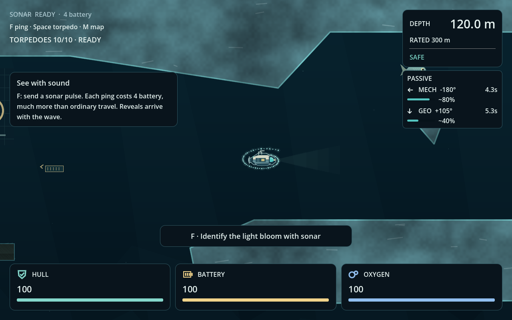
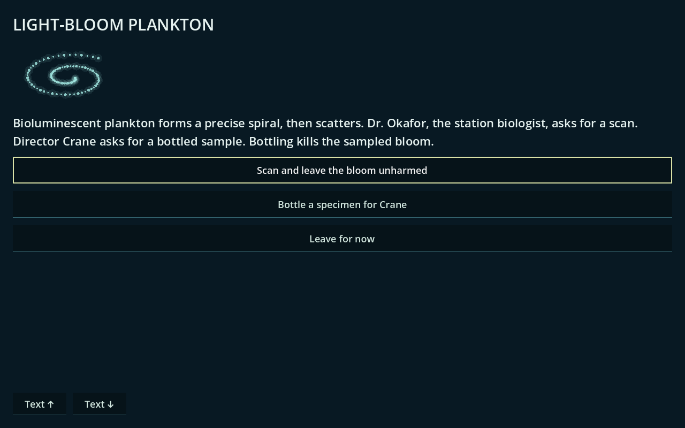
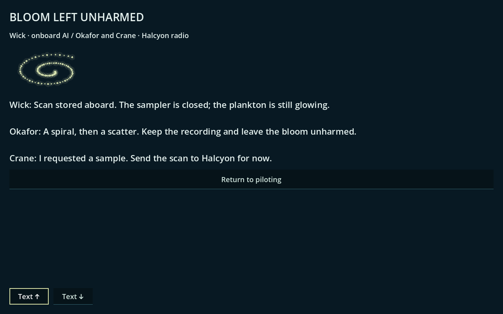
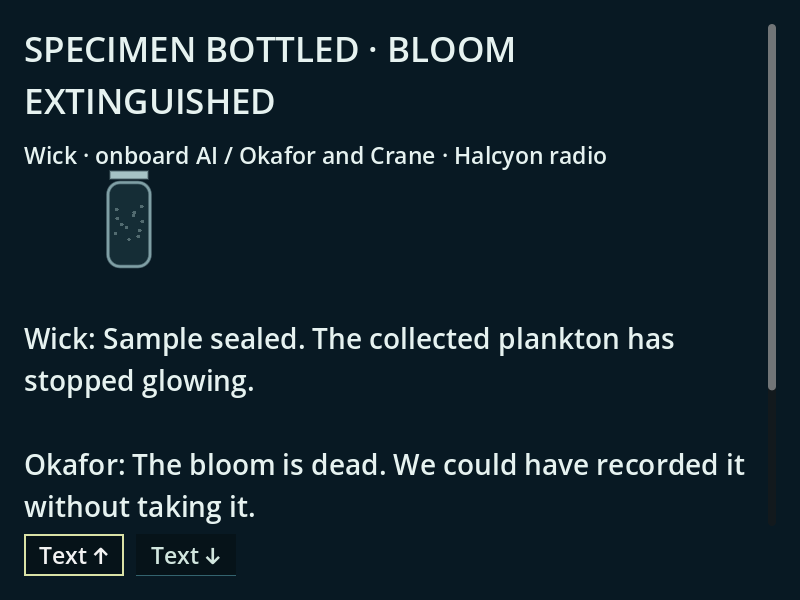

# Story Bible and prototype alignment

[Below the Abyss: Story Bible](Below_the_Abyss_Story_Bible.pdf), Nicholas Zorn,
27 October 2026. User-supplied authoring reference; **contains full campaign spoilers**.
This PDF is kept under docs and excluded from the playable export.

The Bible supplies narrative canon. Its implementation suggestions and descriptions
of future systems do not expand the currently authorized work. In particular this
alignment adds no autoload, dialogue dependency, later zones, endings, economic
rewards, small-action scoring or glyph HUD. Those require separately scoped work.

## Bloom alignment after PR #28

- Pages 2 and 6: the light bloom is bioluminescent plankton forming geometric
  patterns. It is not a rooted plant. The nearby encounter now briefly forms a
  spiral around the vessel and scatters toward a stationary patch in the water.
  The view shows a static spiral with reduced motion/flashing. It never reveals
  the anomaly's underlying explanation, reserved for later narrative content.
- Pages 4–6: Wick is the onboard AI; Dr. Elias Okafor is the station's biologist;
  Director Helen Crane requests the bottled specimen. The small encounter panel
  identifies their roles and carries authored, unvoiced responses. Crane remains
  interested in a physical sample, without revealing later motivations.
- Page 6: scanning leaves the bloom alive; bottling kills the sampled bloom.
  Collection shows a sealed, unlit vial in the dialogue illustration and extinguishes
  the waterborne patch. There is no stump, inventory item system or station reward.
- Page 9 confirms the foundation's zero initial value, [-100,100] bounds, ordinary
  ±15 choice, exceptional ±25 authoring and ±40 thresholds. These remain provisional
  tuning, exactly as the Bible says. No state/save migration is needed for this
  presentation alignment: schema 5, decision/flag/research IDs and score deltas stay
  identical. Existing completed choices acquire the corrected presentation on load
  without replaying effects. New choices elsewhere can later change direction;
  an irreversible record of this encounter does not lock a permanent moral path.
- Page 12 suggests an autoload and flag dictionary as implementation examples. The
  current scene-owned StoryState/validated flag APIs and integrated checkpoint meet
  the foundation's authorized architecture. Ownership can be revisited when scenes
  span multiple canonical zones. The document also leaves glyph introduction timing
  open; this update does not decide it.

## Canonical names and the shelf wreck

The existing expanded shelf expedition is a gameplay prototype, not a literal
implementation of the eight-zone plot. NERIS / Shelf Base and the grounded shelf
expedition vessel retain their display names and stable save IDs. **That shallow
wreck is a separate prototype expedition vessel, not Lantern-1 or Mara's fate.**
Do not relabel it Lantern-1. The Bible places Lantern-1 intact on the Hollow Plain
in Zone 5 (4,000–6,000 m), with an open hatch and a later revelation about its pilot
(pp. 3, 7–8). Bringing that story forward into the shallow wreck would spoil and
contradict the intended investigation. No old wreck mission, log, route or reward is
rewritten here. Halcyon is named in the isolated new radio responses. A campaign-wide display-name
transition to Halcyon / Lantern-2 remains separate work and
must preserve old save IDs.

Zone 1's emergency buoy, its first-dive mission framing, the other seven zones,
small ±1–3 actions, wildlife reactions, path-specific tools, glyph puzzles and
endings remain outside this presentation alignment. Their presence in the source
PDF does not imply they are playable. The optional bloom scan center is at 147.5 m,
within the Bible's Sunlit Shallows band (0–200 m), despite the prototype region's
existing continental-shelf name.

## Verification and review

[All alignment changed files](alignment-changed-files.txt). Local Godot 4.6.3:
full GUT **541/541**, **26,162 assertions**, no failures/errors/skips, **395.619 s**;
focused story suite **35/35**, **297 assertions**; import, **227** parser checks and
startup passed; Python **6/6**; actual-input fresh/Continue **8/8**. Both outcomes
also loaded from the actual pre-alignment PR #28 fixture profiles with zero replay
signals, retaining their existing values and flags. Four native graphical runs
passed: both outcomes at 1280×800 and 800×600/Large/reduced effects, using keyboard
and controller. These are automated events, not a claim of physical-device or human
playtesting. The virtual X11/Mesa display has a known unsupported-VSync warning.


The follow-up PR links the final hosted CI jobs and Linux export/smoke artifacts. Reproduce using the existing commands:

```sh
python3 tools/validate_godot.py
python3 tools/run_tests.py
python3 tools/verify_story_choice.py
python3 tools/verify_expanded_expedition.py
python3 tools/verify_revision_two.py
python3 -m unittest discover -s tests/python -v
python3 tools/build_playtest.py
```

Pinned Godot 4.6.3 / GUT 9.6.1, cache setup, standalone smoke, actual-input fixtures
and manual replay/Continue instructions are in [BTA-046 verification](../testing/bta-046/README.md).
Observe the arrival before pinging; pause while it forms and check it stops. With
reduced effects enabled, check that the static pattern and dialogue convey the
same information. Choose either outcome on separate fixture profiles; quit/Continue
must retain the decision and corrected visual. Read all three voices at 800×600
using pinned text-scroll controls, keyboard or controller. Existing saves require
no reset and must not grant Resonance again.

Actual Godot evidence (updated after the alignment):





