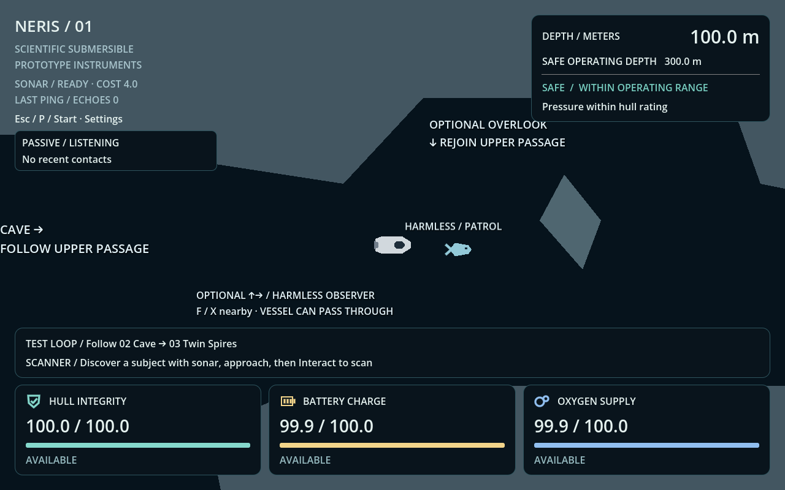
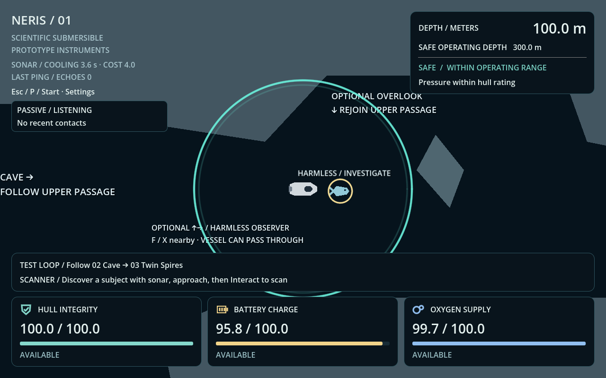
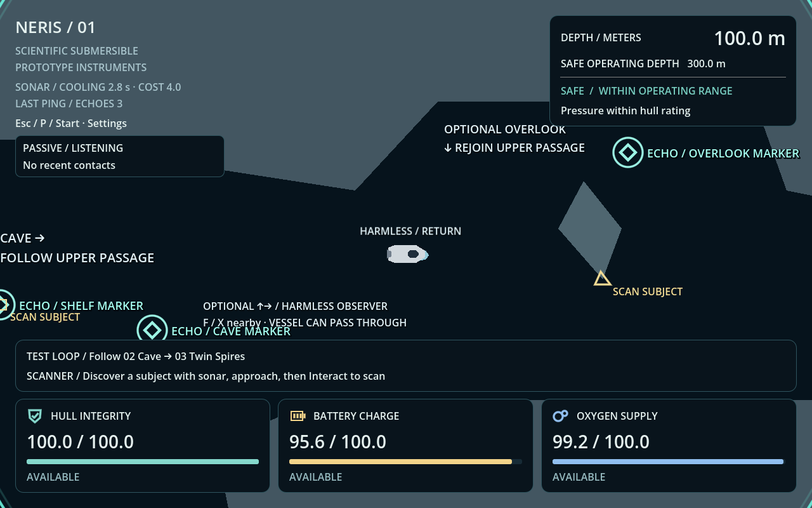
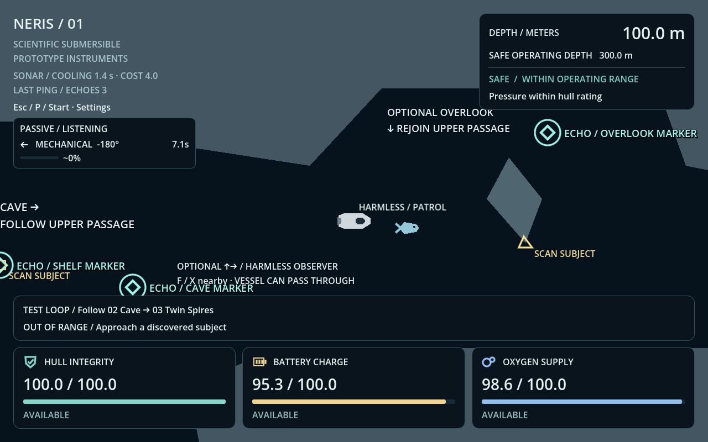
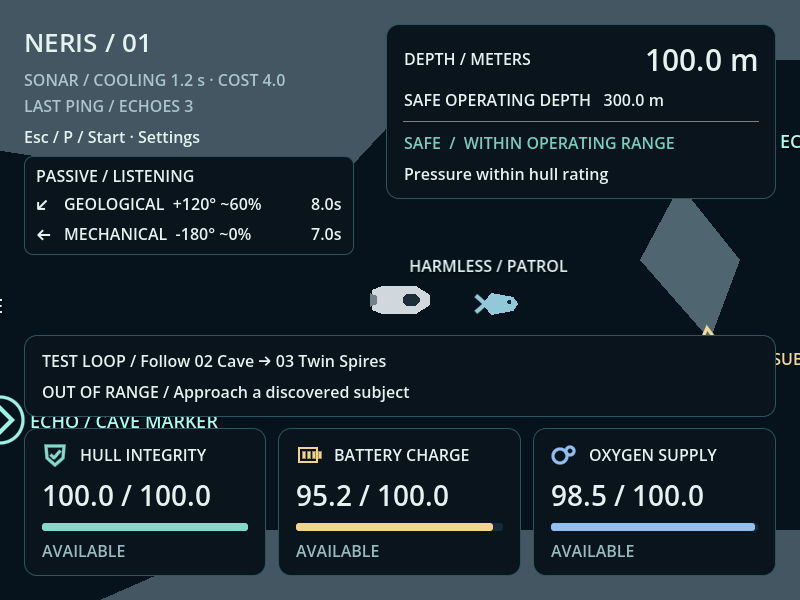

# BTA-030 verification and manual playtest

Use Godot **4.6.3.stable.official.7d41c59c4**, GDScript edition, from the root:

```sh
python3 tools/install_gut.py
python3 tools/validate_godot.py
python3 tools/run_tests.py
godot --path .
```

Focused tests after import:

```sh
godot --headless --path . --script res://addons/gut/gut_cmdln.gd \
  -gexit -gdisable_colors -gconfig= \
  -gtest=res://tests/unit/test_creature_state.gd,res://tests/integration/test_acoustic_creature.gd
```

The existing PR/main GitHub Actions workflow is unchanged: pinned/checksummed Godot
4.6.3 and GUT 9.6.1, import, all authored-script parser checks, startup smoke, complete
GUT suite and always-retained logs/JUnit for 14 days. Local logs are in build/ci-logs;
the PR records the actual corresponding Actions result.

Coverage includes PATROL/INVESTIGATE/RETURN transitions, deterministic event
priorities/ties, strength/range/type/bounds filtering, duplicates, stale/future
samples, non-extending retarget deadlines, arrival/timeout/blocked recovery,
patrol cycling, actual player ping/ambient receipt, passive isolation, all existing
pauses, restart/bounded-history retention, receiver cleanup, static-pillar routing,
actual motion/no jumps, a new two-unit obstacle, vessel pass-through, and identical
controller position/state at 30/60/120 steps. Prior tests remain, with only the two
exact main-scene receiver-count assertions updated for the added endpoint (6 total,
2 after removing all active reveal targets); no history or identity assertion removed.

## Recorded local results

- Godot 4.6.3.stable.official.7d41c59c4: import, **106 authored-script parser checks**, startup smoke passed.
- Complete GUT suite: **264/264 tests**, **16768 assertions**, zero failures/errors/skips and no leak errors; 147.517 seconds locally.
- 24 new unit/integration tests; all previous 240 tests retained, with only the two receiver-count expectations adjusted for composition.
- Pinned GUT installation/checksum, unchanged workflow actionlint and git diff checks passed.
- Actual graphical fixture exited 0 with BTA030_GRAPHICAL_PATROL_PING_INVESTIGATE_RETURN_RECOVERY_OK.
- The PR records the actual GitHub Actions run/result and retained artifact.

## Manual acceptance

1. Begin/Resume the shelf. Follow the upper passage east to about X=1400, then
   ascend from the required-route Y=480 toward Y=400, into the signed **optional
   harmless observer** area. The original mandatory route remains unchanged.
2. Watch the placeholder patrol around the overlook: its text says HARMLESS / PATROL.
   It stays in Rect2(1380,210,620,250), above the main route. The pillar is solid;
   navigation must go around it. No attacks, resource drain or damage occur.
3. Remain inside the area near (1400,400) and press **F / controller X**, or your
   saved sonar_ping binding. The existing 4-battery ping/cooldown/wave still works.
   The creature changes to INVESTIGATE and approaches the sampled ping origin.
   Move away: it does not pursue the vessel. Text and an outline show the reaction
   without relying on color alone. Hearing is dispatcher-timed, while POI reveal
   still waits for the visual wavefront as before.
4. On arrival (or after the configured 6-second investigation deadline), it enters
   RETURN and moves back to its nearest patrol point, then resumes PATROL. It
   never teleports to finish a route. Repeated/new pings may retarget investigation
   but cannot extend that episode's deadline; RETURN ignores further sounds.
5. Listen passively without pinging: passive contacts alone cause no reaction.
   The authored ambience originates outside the habitat. The integration fixture's
   controlled in-area ambient emitter proves actual ambient events can qualify;
   no passive-listening action emits a lure.
6. Ping from outside the habitat: even a heard sound cannot draw it outside its
   permitted center bounds. Swim through the creature to confirm it cannot block
   the vessel or cause contact damage. Complete the existing POI/base route with
   keyboard or controller, scan a specimen, inspect map/research and reload saves.
7. During investigation, open route pause, settings, map, research or developer
   controls. Wait, then resume: creature position/state time freeze and new sound
   receipts are disabled during pause. Restart restores its spawn/PATROL state,
   clears pending sounds and keeps bus history plus discoveries/research intact.
8. In an isolated scene/fixture, put an obstacle between the creature and its
   destination, including a thin wall added after navigation was built. It must
   stop safely and return/try another patrol point after its stuck interval. If
   every route is blocked, it may wait/retry; it must not cross walls, warp, or
   push/trap the vessel. Unit/integration tests automate both obstacle cases.
9. Resize to 1280×800 and 800×600. State text and the existing HUD must remain
   readable. World signs may leave the viewport naturally; HUD controls remain
   usable with keyboard/controller and current remapped input settings.

## Actual Godot capture evidence

These are real Godot/X11/Mesa software renders, not mockups. The fixture relocates
the vessel into the optional area, uses actual F input and checks investigation,
return, patrol recovery and unchanged hull. It clears only its isolated capture
research/discovery files; it never touches default player saves.







Reproduce with an available X11 display:

```sh
godot --path . --display-driver x11 --rendering-method gl_compatibility \
  --audio-driver Dummy --script res://tests/fixtures/capture_creature_fsm.gd
```

Expected exit 0 and BTA030_GRAPHICAL_PATROL_PING_INVESTIGATE_RETURN_RECOVERY_OK.
Dummy X11's known inability to change VSync mode is the only graphical warning.
[API/design limitations](../decisions/bta-030-acoustic-creature.md) describe the
bounded static graph, ignored outside-habitat sounds, hearing timing and pending
native-platform/physical-controller/hardware verification. No BTA-031 threat is
implemented or implied by this harmless foundation.
