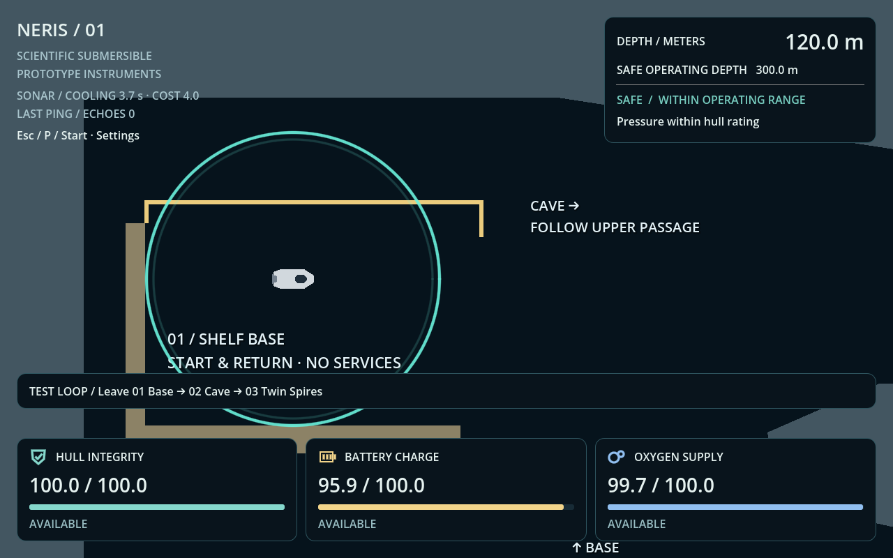
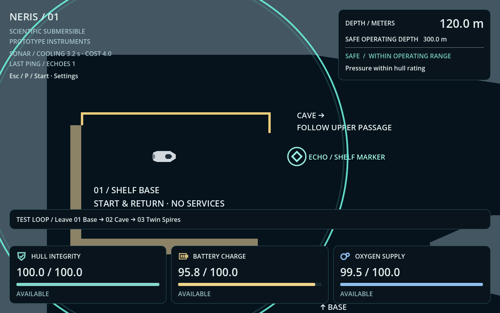
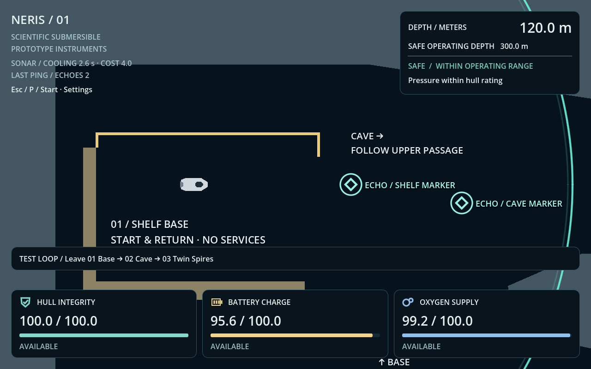
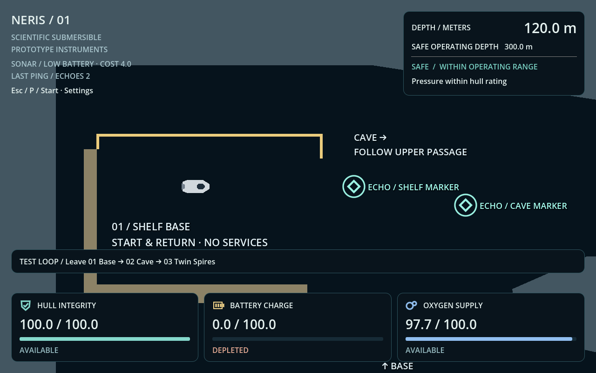
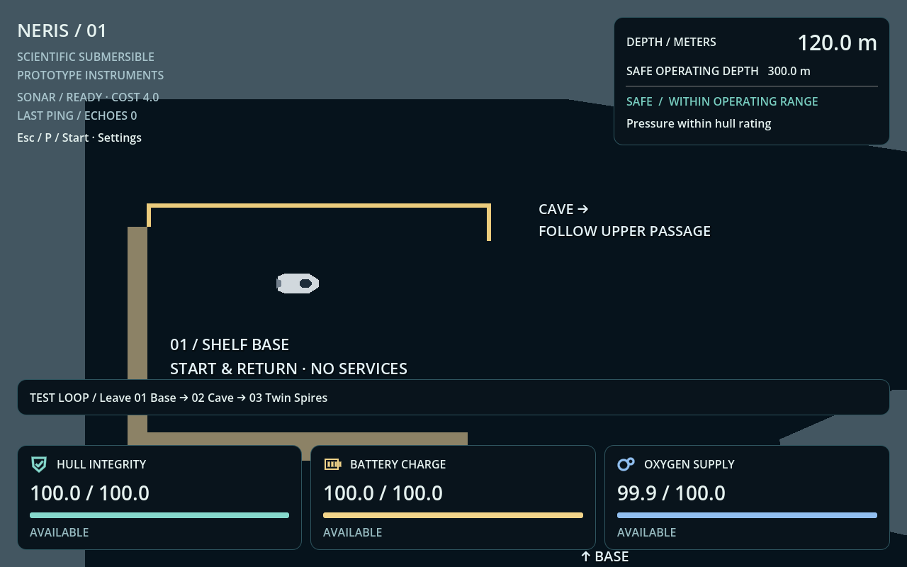
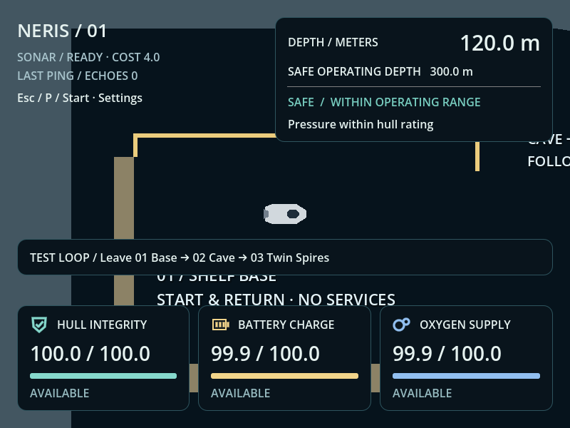

# BTA-021 active sonar verification

Use **Godot 4.6.3.stable.official.7d41c59c4**, standard edition. This milestone
implements active pings and temporary placeholder echoes, not passive sonar,
creature responses, scientific scanning or persistent discoveries.

## Launch and controls

```sh
godot --path .
# Optional existing resource-test controls:
godot --path . -- --debug-controls
```

Begin/Resume the shelf briefing. Press **F** or controller **X** (the existing
sonar_ping action) to ping. Rebinding that action through Input settings changes
the input; saved mappings survive route restart. The briefing documents defaults.
The HUD reports readiness, cost, cooldown and LAST PING / ECHOES without adding a
button, taking focus or obstructing the vessel. Explicit words/numbers accompany
the visible wave/echo marker; information is not audio- or color-only.

Default configuration: `resources/balance/prototype_sonar.tres`.

| Setting | Value |
| --- | --- |
| Battery cost | 4 units per accepted ping |
| Cooldown | 4 simulation seconds |
| Travel speed | 600 world units/second |
| Maximum radius | 900 world units |
| Temporary reveal | 6 seconds from each target's arrival |
| Fade at full radius | 0.2 seconds |
| Maximum simultaneous pulses | 8 |

The ring reaches maximum radius in 1.5 seconds. It uses authored native vector
arcs and no shaders/assets, screen flash, camera shake or audio. Its origin stays
at emission while the submarine/camera moves. Rocks remain visible; the sonar
reveals only separate, nonsolid placeholder targets.

From the (420,480) station spawn:

| Target | Position | Distance / expected arrival |
| --- | --- | --- |
| Shelf marker | (760,480) | 340 units / 0.5667 s |
| Cave marker | (1000,520) | about 581.38 units / 0.9690 s |
| Overlook marker | (1750,240) | beyond 900; remains hidden from this ping |
| Spire marker | (3560,650) | beyond 900; remains hidden from this ping |

Travel closer and issue another accepted ping to reveal the farther markers.
The existing route remains fully navigable without sonar; all original route
landmarks, safe paths, optional hazards and reset behavior remain available.
Pinging adds its explicit cost to unchanged idle/thrust battery drains.

## APIs and ownership

- `SonarEmitter.configure(ActiveSonarProfile) -> Error`: validate/copy tuning;
  preserve current valid rules on failure. Existing pulses keep their snapshot.
- `setup(AcousticBus, SubmarineResourceSystem, WorldEffects: Node2D) -> Error`:
  inject live dependencies and bind the existing AcousticEmitter child. The
  effects parent should remain stationary in the same world coordinate frame.
- `request_ping(event_id = &"") -> Error`: use a generated stable ID or an
  explicitly supplied one. Ordinary failures do not charge or start cooldown.
  The generated namespace is session/source/epoch/sequence, never an instance ID.
- `advance(delta) -> Error`: owner-driven simulation step. Reject negative or
  nonfinite time; no independent wall clock, Timer, tween or process animation.
- `listen_to(SonarRevealTarget) -> Error`: observe that target's existing acoustic
  receiver receipts. No eligibility query or range scan is duplicated.
- `reset_session() -> Error`: cancel pulses, clear temporary target state/counts,
  reset cooldown/time and increment producer epoch. **Does not clear bus history.**
- Read-only `availability`, `status_text`, `cooldown_remaining`, `battery_cost`,
  `echo_count`, `active_pulse_count`; `pulse_emitted`, `echo_revealed` and
  `state_changed` signals for presentation/consumers.

`scenes/props/sonar_reveal_target.tscn` is a reusable target with a stable authored
target_id, caption, AcousticReceiver and per-instance reception profile. Set its
position/ID before adding it; bind it to the bus and have the sonar listen to it.
It starts hidden, forwards eligible receipts, and exposes
`reveal_for_ping(id,duration,arrival_time)`, `is_revealed`, `reset_reveal` and
`revealed_for_ping` / `reveal_state_changed` signals. Duplicate IDs are rejected.
The owner supplies its simulation clock; this prototype has one sonar owner per
target. There is no save data, discovery registry or scanning implementation.

## Publication, cost and history guarantees

Active sonar does not bypass BTA-020. The component creates a validated
AcousticEvent of type `active_sonar`, classification `scientific`, and publishes
through its existing AcousticEmitter. AcousticBus alone validates source ownership,
deduplicates IDs and computes/filter-snapshots eligible receiver distance/strength.
Its received signal schedules a pending echo; it cannot reveal immediately.

The bus gains `check_dispatch(emitter,event)` and an optional atomic boolean
acceptance Callable on `dispatch`; AcousticEmitter gains `publish(event,gate)`.
The gate runs under the reentrancy lock only after validation, source ownership,
deduplication and capacity checks, before history insertion or delivery. Sonar
passes the existing `try_consume_battery(cost)`. False returns ERR_UNAVAILABLE
without event/history/cooldown/visual side effects. Invalid/conflicting/duplicate
emissions, missing setup, busy dispatch and full ledger never invoke the cost.
Exact available battery is accepted, zero cost is allowed, and insufficient
battery is never partially consumed. Battery signal reentrancy cannot double-ping.

The gate must be a synchronous atomic boolean operation. It is not a general
rollback mechanism for arbitrary callbacks that mutate state and then fail.
Successful acceptance commits the event: later consumer removal can cancel its
receipt, not refund energy. Queue deletion instead of freeing an executing bus.
The accepted payload is frozen before the gate, so callbacks cannot change it.

All original ledger rules remain: accepted IDs stay consumed for bus lifetime;
same ID/payload returns ERR_ALREADY_EXISTS; conflicting payload returns
ERR_INVALID_DATA; capacity fails with ERR_OUT_OF_MEMORY; no eviction, TTL, replay
or ledger reset. False-gate IDs stay free. Existing non-sonar producers and the
BTA-020 headless example retain their default behavior.

Route restart clears only sonar session state, not the ledger. Epoch IDs change
so immediate fresh pings are valid while old IDs remain rejected. Reconstructing
a producer against a surviving bus requires a new session namespace. Ledger
capacity is configurable, default 4096 accepted events; restarting the test route
does not silently bypass it. At capacity the HUD says BLOCKED and costs nothing.

## Wavefront and lifetime semantics

Arrival time is event timestamp + sampled distance/travel speed, with inclusive
range boundaries. Target eligibility/positions are sampled at emission, matching
the existing acoustic contract. Out-of-range/filtered/late receivers never schedule
an echo. Prototype targets are static; there is no moving-target interception,
occlusion, reflectivity, environmental modifier, or map/terrain reveal.

Pending echoes use weak target handles and identity/registration generations.
Removed/free/queued/unbound/rebound targets are skipped, and bus teardown cancels
remaining arrivals. Removing the sonar owner also clears its temporary visuals
and reveals. Duplicate receipt or repeated reveal calls cannot notify a
target twice per ping. Equal arrivals use stable target-ID ordering.

Reveals expire at arrival+duration. Large deltas do not extend visibility by an
extra frame or beyond the mathematical expiry; even an arrival and expiry crossed
in one step produce one notification with the final target hidden. Overlapping
pings extend the target's expiry to the latest arrival. Comparisons allow only
1e-9 seconds of floating-point accumulation tolerance.

Route menu, input settings and focused debug controls stop the existing motor,
which also stops sonar input and every sonar clock. Resume continues the same
wave/cooldown/reveal lifetime. Restart cancels pending arrivals, removes visuals,
hides echoes, restores vessel resources through the existing test-reset path,
and clears sonar HUD state. Entering the station itself still never refills.
The preserved movement fixture has no bus/targets injected and displays OFFLINE;
its original movement/resource/depth/settings tests remain meaningful.

## Automated verification

```sh
python3 tools/install_gut.py
python3 tools/validate_godot.py
python3 tools/run_tests.py
# Original acoustic-contract demo must remain operational:
godot --headless --path . res://scenes/main/acoustic_contract_example.tscn
git diff --check
```

Managed cloud setup, when needed:

```sh
export XDG_CACHE_HOME=/workspace/.cache
export XDG_DATA_HOME=/workspace/.local/share
export XDG_CONFIG_HOME=/workspace/.config
```

Focused tests after import:

```sh
godot --headless --path . --script res://addons/gut/gut_cmdln.gd \
  -gexit -gdisable_colors -gconfig= \
  -gtest=res://tests/unit/test_active_sonar.gd,res://tests/unit/test_acoustic_acceptance.gd,res://tests/integration/test_active_sonar_prototype.gd
```

Unit tests cover exact/insufficient/finally-rejected/zero costs, atomic gate timing,
invalid/duplicate/conflicting/full-ledger emissions, battery-signal reentrancy,
cooldown boundaries, sampled travel/edge/outside behavior, duplicate receipts,
missing/free/unbound/rebound/late targets, bus teardown, bounded radius/pulse
limits, copied/invalid configuration, large deltas, overlapping pings, expiry and
30/60/120-step consistency. Integration tests use keyboard F and controller X,
saved sonar remapping, real physics wave origins, all pause surfaces, real route
restart/history retention, removed targets, HUD states/bounds at 800×600 and
actual 30/60/120 render caps with fixed 60-Hz simulation.

All 143 previous tests stay enabled, including BTA-020 and the 42-second shelf
flight. The existing workflow remains unchanged: checksum-pinned Godot/GUT,
import, authored-script parser inventory, startup smoke, full GUT and retained
JUnit/log artifacts. Final counts and actual hosted CI evidence are recorded in
the pull request. Local results: **171/171 tests pass, 4,258 assertions, zero
failures/errors/skips**, all **66 parser checks**, import/startup smoke, actionlint
and whitespace pass. The 143 previous tests remain plus 28 sonar/acceptance tests.
No check is relaxed or replaced by screenshots.

## Manual playtest

1. Launch at 1280×800. Read the sonar controls in the paused briefing, then Begin.
   Expect READY, cost 4, zero last-ping echoes and hidden placeholder targets.
2. Press F. Expect one expanding cyan ring fixed at the emission location,
   approximately four extra battery units consumed and COOLING with a four-second
   countdown. Initially both nearby echoes must remain hidden. The shelf marker
   appears after ~0.57 s; the cave marker after ~0.97 s. The distant overlook/
   spire markers must stay hidden from this ping. Echo labels/diamonds identify
   revealed targets without audio or reliance on color alone.
3. Move while the ring expands. Its center must stay where the ping occurred.
   Press/hold/repeat F during cooldown: no extra cost, event or ring. At four
   seconds, a new press is accepted. Observe target expiry six seconds after
   arrival; LAST PING / ECHOES remains a historical count until the next ping.
4. Repeat using controller X, including stick/D-pad piloting. Rebind sonar_ping
   using Input settings, Save and Return. Verify the new key/button activates it
   and the old binding does not; restart must preserve the saved mapping.
5. Pause mid-wave with Escape/P/Start, wait, Resume. Radius, target expiry and
   cooldown must resume from the paused state. Repeat with input settings and
   optional developer resource controls. Pinging while menus own input must do
   nothing. No sonar button should take focus from movement/navigation.
6. Restart through the route menu during a wave and after echoes appear. Expect
   no old rings/echoes, READY, reset last-ping count and restored test resources.
   Immediately ping again; it must work with a new ID while history is retained.
7. In developer mode (`--debug-controls`), use existing test buttons to lower
   battery below four, then return to piloting. Expect LOW BATTERY and no ping,
   cost or cooldown on an attempted activation. Refill using the test controls
   or restart the test route, then verify readiness returns. These are development
   requests, not new station repair/refill gameplay.
8. Fly the original shelf loop, optionally ping near the overlook/spires to reveal
   those markers. The route must remain completable without any ping; no new
   reveal gate, collision, mission, scan, creature or permanent discovery appears.
   Verify pressure/collision/resource HUD and station return remain intact.
9. Resize to 800×600, 1280×800, 1920×1080 and a tall window. Check READY, COOLING,
   LOW BATTERY and last-ping text remain legible and the navigation center clear.
   Inspect the wave/markers on native hardware and a physical controller.

## Screenshots

Actual Godot 1280×800 and 800×600 renders. The fixture uses the real keyboard
sonar_ping input and asserts delayed reveals, range, pause and restart. Only the
low-battery setup injects resource depletion via its existing API. No generated
or third-party images/assets are used.

```sh
godot --path . --script res://tests/fixtures/capture_active_sonar.gd
```

The cloud graphical check uses Xorg dummy output, X11 GL compatibility, Mesa
llvmpipe and Dummy audio. Only the software display's unsupported VSync warning
is expected; headless validation must be clean. Physical controller, native GPU,
Windows/macOS/Steam Deck and target-hardware performance remain manual checks.








