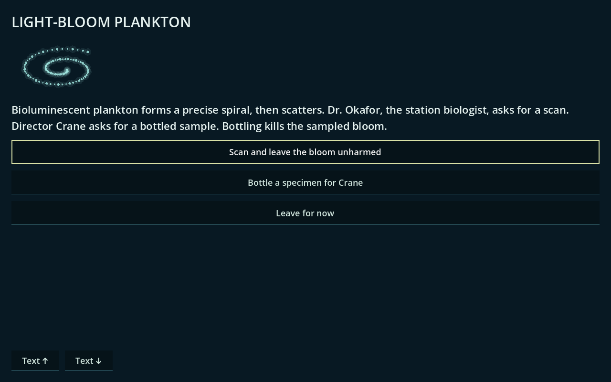
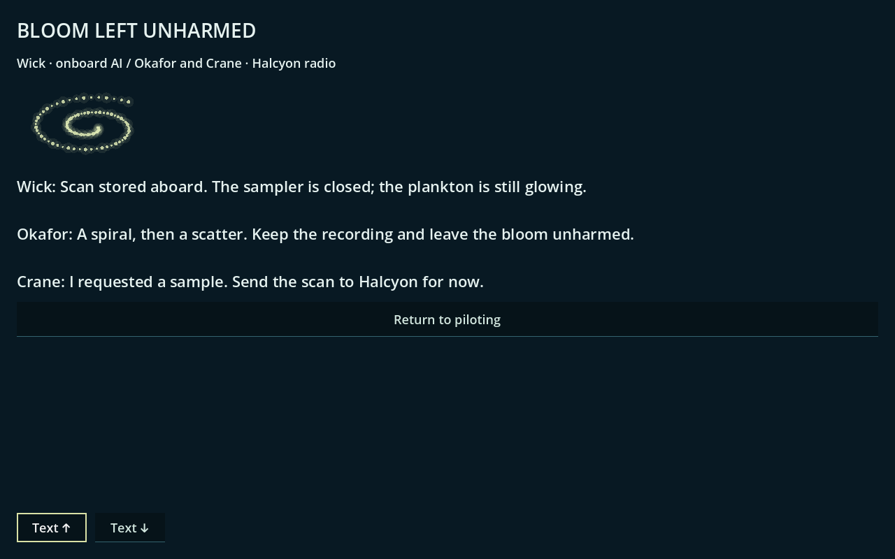
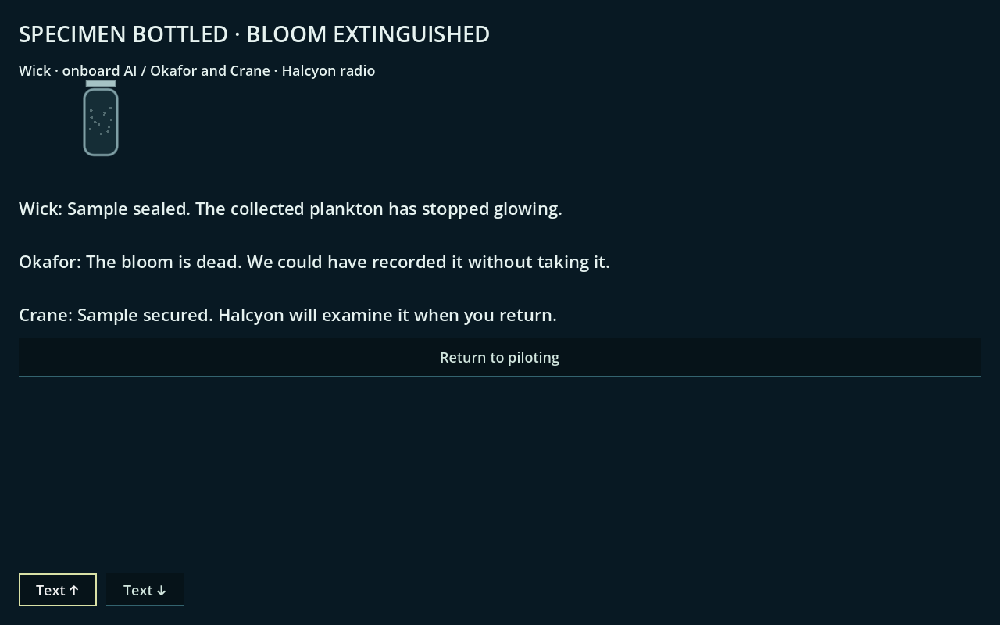
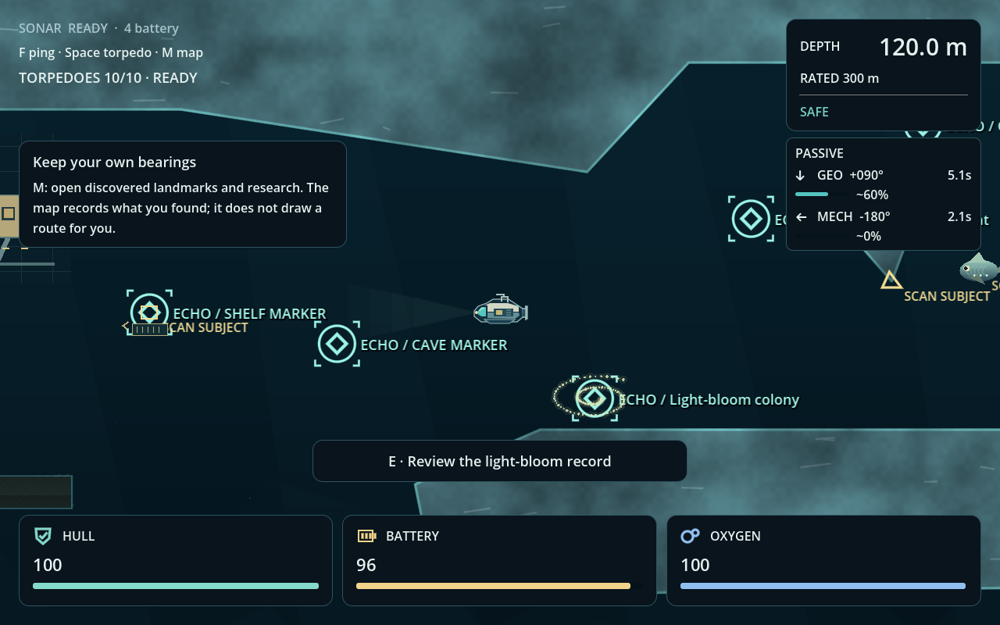
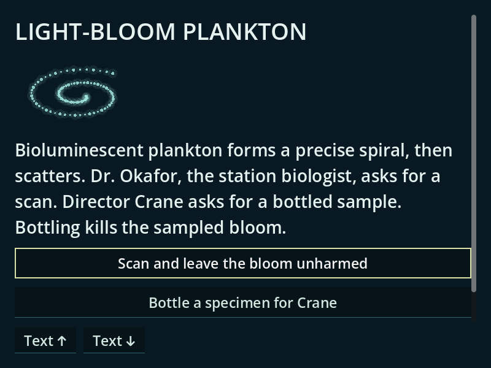
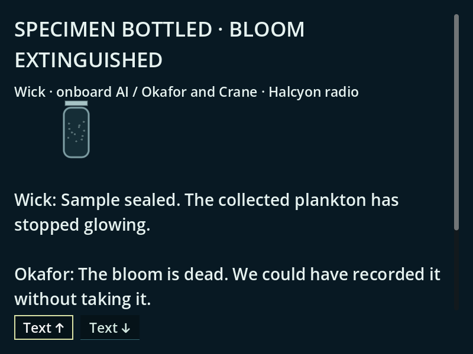

# BTA-046: Resonance foundation and first story choice

Base: main at `8887506a3555dbd2410e3f2f73ca8db1a2b87f55`, the merge of PR #27.
BTA-045 is already reserved for the slice release candidate in CODEX_PLAN. The
GitHub tracker had no non-PR issues or milestones when checked for this work.

README, GDD, TDD, CODEX_PLAN and AGENTS were reviewed along with PR #27, its
narrative/research services and save schema. The Story Bible was absent when PR #28
was implemented; the user subsequently supplied the 27 October 2026 PDF. The
[Story Bible and alignment decisions](../../story/README.md) now anchor the plankton
visual and the isolated Wick/Okafor/Crane dialogue. Original prototype names,
mission IDs and campaign records remain unchanged; the shallow wreck is a separate
prototype vessel, not Lantern-1.

## Playing the encounter

1. Launch `godot --path .`; choose Begin or Continue. Pilot east from Shelf Base
   through the upper shelf passage. The optional plankton patch floats above the shelf
   just east of the first upper gate: visual and scan center `(1330,590)`.
   A clear approach is `(1280,480)`. No combat, excavation, upgrade or
   mission prerequisite is required.
2. Use F / controller X for sonar. Normal wavefront discovery identifies the plankton;
   sonar identification alone has no story effect. Within 180 world units the pilot
   context offers E / controller A to study it (current remapped bindings also work).
3. The explicit choice pauses the simulation. Read that bottling kills the sampled
   bloom. Use arrows/D-pad/stick or Tab and Enter/A to choose:
   - **Scan and leave the bloom unharmed:** resumes piloting and runs the existing
     three-second scanner. Stay in range; E/A cancels, leaving range interrupts,
     and normal pause freezes scan time. Completion records the biological research
     entry and the positive choice together. The intact bloom subtly warms.
   - **Bottle a specimen for Crane:** intentionally commits the destructive choice,
     extinguishes the plankton patch, and cannot subsequently be scanned. There is no
     inventory, currency, research-point grant or new collection system.
   - **Leave for now:** closes without making a decision.
4. Wick, Okafor and Crane respond in text. Read the explicit intact/extinguished
   heading; no sound or color interpretation is required. Return to piloting with
   Enter/A, or Esc/B. These dialogues require no audio and add no voice assets.
5. Quit and relaunch. Continue retains the outcome and research record. Visiting
   again shows a read-only response, with neither choice offered. Restart Test Route
   and New Expedition retain this permanent history, just like other permanent
   progress. Test both branches with **separate isolated profiles**, never by deleting
   a real player's save. For isolated runs use the fixture commands below.
6. Check Pause → Audio mute, reduced motion/flashing, high contrast and Large text.
   Resize to 800×600. Text reflows in a scroll area; pinned Text ↑/↓ controls, Tab/
   controller focus traversal and PageUp/PageDown allow reading without a mouse.
   Pausing/docking/map recovery and the original full expedition remain operational.

Choices immediately update permanent checkpoint progress; like existing remote
research commits they retain the last saved vessel/route pose, rather than creating
an unsafe in-flight pose checkpoint. Manual Save still follows the existing safe
pause rule. No implicit quit autosave was added.

## Changed files

[Original PR #28 file inventory](changed-files.txt); the follow-up PR records the
additional Story Bible alignment files. The changes add scene-owned story
Resources/state, the isolated encounter/panel/visual, and focused tests/input driver.
Existing scanner/research completion gain a narrow optional gate; scene/catalogs
attach the optional encounter. Persistence extends the canonical schema/store/
coordinator. Report allowlists accept the new scientific IDs without logging story
state. Existing version assertions migrate to schema 5; README/GDD/TDD/plan and the
workflow document and validate the addition. No external dependencies were added.

## Contracts and save migration

- `StoryState` is one scene-owned Node; fixtures can configure an in-memory instance.
  Production requires SaveCoordinator's durable writer. It exposes `resonance()`,
  `tier()`, `snapshot()`, `has_flag()`, `has_decision()`, `resolved()`, `apply_choice()`,
  `set_flag()` and silent `restore()`. Returned definitions/snapshots are copies.
- `resonance_changed(previous,current)`, `tier_changed(previous,current)`,
  `flag_changed(flag_id)` and `choice_applied(choice_id,encounter_id)` fire only after
  a successful commit. Reentrant commits are rejected. Restore emits none of these,
  and never replays dialogue, research completion, visual reaction or rewards.
- Fresh state is zero, empty decisions and flags. Values clamp to [-100,100].
  Provisional tiers: Listener >=40; Neutral -39..39; Hostile <=-40. Neither number
  nor tier is exposed in the HUD, choice text, map, research log or playtest telemetry.
- ChoiceData has stable choice/encounter IDs, bounded integer delta, owned flags,
  optional companion research ID and authored presentation. Ordinary magnitude is
  at most 15; an explicit exceptional-weight definition supports at most 25 for
  future authoring. **No Zone 4 choice or lore is implemented.**
- The canonical catalog contains exactly `zone1-light-bloom-observe` (+15) and
  `zone1-light-bloom-collect` (-15), in encounter `zone1-light-bloom`. One decision
  per encounter, ever; duplicates/opposite outcomes fail without writes/signals.
  Flags are `zone1-light-bloom-unharmed` / `zone1-light-bloom-collected`.
  Extra flags must be explicitly whitelisted; callers cannot forge choice-owned flags.
  Released choice IDs/deltas/owned flags are immutable contract data: future balance
  edits require an explicit schema migration, not silently recalculating old scores.
- **Expedition schema 5**, same `user://saves/expedition.json` and existing `.bak`,
  adds `story: {resonance, flags, decisions}`. No independent story save or mission
  ledger. Versions 1/2/3/4 migrate through existing adapters, then receive zero and
  empty story; old actions are never retrospectively scored. Existing progress,
  resources, ordnance, research talents, terrain, mission claims and IDs remain.
- Strict validation rejects unknown/duplicate IDs, invalid types, fractional or
  out-of-bound values, mutually exclusive decisions, missing/foreign flags and a
  score inconsistent with the ordered clamped decision history. The bloom research
  record must exist **if and only if** its observation decision does.
- The scanner's optional completion gate commits both story and companion research
  in one atomic checkpoint write **before** either domain completion signal. A failed
  write commits neither runtime result. Collection uses that same writer. This
  closes the quit/crash window between research completion and story reward.
- Existing temp/flush/close/rename and latest-good backup behavior is preserved.
  Live/candidate histories may merge only when one ordered decision history extends
  the other. Recovery merges compatible permanent records without signal replay.
  Opposite histories fail before renaming the primary; rejected/corrupt/incompatible
  files are retained and the existing explicit recovery UI remains authoritative.
  A live restore or stale writer cannot roll back decisions to farm another outcome.
  Files are local validated data, **not cryptographically protected against manual
  editing**. Losing both copies loses unavailable progress; no cloud save is claimed.

## Reproducible validation

Use the pinned standard Godot `4.6.3.stable.official.7d41c59c4` (not .NET), Python 3
and the existing pinned GUT 9.6.1. From the repository root:

```sh
python3 tools/install_gut.py
python3 tools/validate_godot.py
python3 tools/run_tests.py
python3 tools/verify_expanded_expedition.py
python3 tools/verify_revision_two.py
python3 tools/verify_story_choice.py
python3 -m unittest discover -s tests/python -v
python3 tools/install_export_templates.py
python3 tools/build_playtest.py
python3 tools/smoke_playtest.py build/below-the-abyss-playtest-linux-<build-id>.zip --log build/playtest/standalone-smoke.log
```

Commit first for the normal release package; `--allow-dirty` explicitly labels a
local development export. In this cloud environment set writable XDG_CACHE_HOME,
XDG_DATA_HOME and XDG_CONFIG_HOME as described in the root README. Logs live in
`build/ci-logs/` and `build/playtest/`, with JUnit XML for GUT. Workflow artifacts
retain logs and Linux package/manifest for 14 days. Existing import/parser/startup,
full GUT, both expedition walkthroughs, Python and Linux export/smoke jobs remain;
the story walkthrough is an additional required validation step.

Focused tests:

```sh
godot --headless --path . --script res://addons/gut/gut_cmdln.gd -gexit -gdisable_colors -gconfig= -gtest=res://tests/unit/test_story_state.gd,res://tests/integration/test_light_bloom.gd
```

`verify_story_choice.py` makes eight actual-input launches: each outcome with
keyboard and controller, then separate-process Continue for each profile. It pilots
from base, identifies with sonar, navigates the actual choice panel, finishes or
collects, quits, reloads and verifies read-only replay/no extra completion event.
No vessel teleport or programmatic button press is used in this walkthrough. Unit/
integration fixtures separately exercise boundaries, failed writes and corruption.

For a visible input-driven Godot walkthrough (uses its own isolated local profile):

```sh
godot --path . --script res://tests/fixtures/drive_story_choice.gd --quit-after 12000 -- --outcome=observe --input=keyboard --profile=bta046-manual-observe
godot --path . --script res://tests/fixtures/drive_story_choice.gd --quit-after 12000 -- --outcome=observe --input=keyboard --profile=bta046-manual-observe --resume
godot --path . --script res://tests/fixtures/drive_story_choice.gd --quit-after 12000 -- --outcome=collect --input=controller --profile=bta046-manual-collect
```

Fresh mode clears **only its named fixture profile**, never the normal expedition.
Use `--small --comfort` for 800×600/Large/reduced effects. All driver runs mute audio.
Set `BTA_EVIDENCE_DIR` to an existing absolute directory to save native choice,
response and world-view PNGs; captures require a graphical display (no `--headless`).
The cloud uses `DISPLAY=:99 LIBGL_ALWAYS_SOFTWARE=1` and
`--audio-driver Dummy --rendering-method gl_compatibility`. The virtual display
reports a known unsupported VSync warning; no Godot script/parse errors are accepted.

## Evidence and acceptance

Local verification on 2026-10-27: full GUT **541/541**, **26,162 assertions**,
zero failures/errors/skips, 395.619 seconds. Godot import, **227** standalone script
checks and startup passed. Python tooling: **6/6**. The focused story suite has
35 passing tests (14 unit, 21 integration). Native screenshots are rendered by
Godot, not mockups or generated assets. Hosted run evidence is added in the PR.

| Requirement | Verification |
| --- | --- |
| Fresh zero; clamp/tier thresholds; authored validation | `test_story_state.gd` |
| Exclusive outcomes; no replay rewards; silent restore | Both new GUT scripts; eight-launch walkthrough |
| Old saves preserve progress; corruption/recovery/conflicts | `test_light_bloom.gd`; existing checkpoint suite |
| Existing scanner, interruption, failed durable write | `test_light_bloom.gd` |
| Keyboard/controller, mute, comfort, small-window reading | Input driver; small-window GUT; native PNGs |
| No regression in torpedoes/talents/sonar/services/full route | Entire prior suite and both prior input expedition drivers |
| Import/parser/startup and standalone export | Existing validation and Linux workflow jobs |








## Scope and limitations

Only this authored choice changes Resonance. Torpedoes, incidental damage, unrelated
scans, pings, proximity and existing dialogue do not receive automatic morality
hooks. Collection is an explicit specimen outcome, not a new harvesting/inventory
system. No rewards, economy, wildlife behavior changes, Vael trust, endings, later
zone, new playable region or campaign rewrite. Tiers are domain interfaces only;
one ±15 encounter alone cannot reach either ±40 tier. Ordinary/exceptional balancing
is provisional as specified by the Story Bible, pending human playtesting. Text is English
and unvoiced; normal accessibility font/contrast/focus policy applies. The short
modal pauses the existing simulation; it does not add a dialogue framework or new
input action. Older numbered milestone scenes remain regression fixtures without
this optional production encounter. Automated input does not replace human device,
comfort or pacing evaluation, and no five-player study is claimed.
