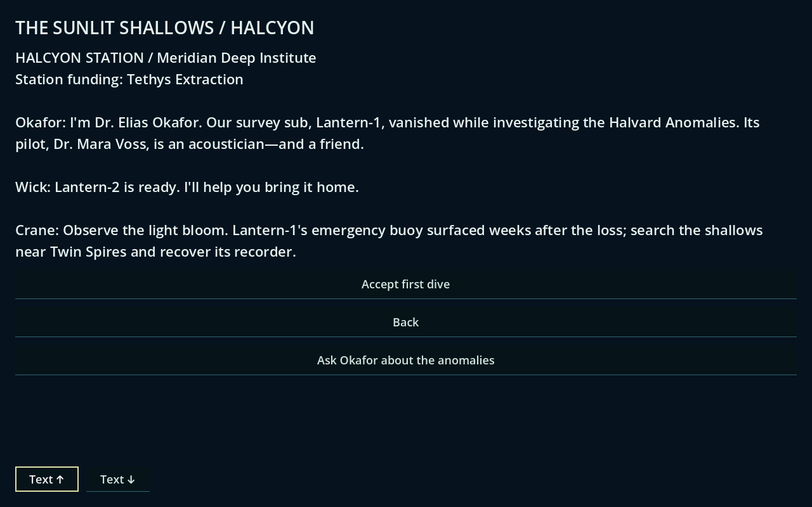
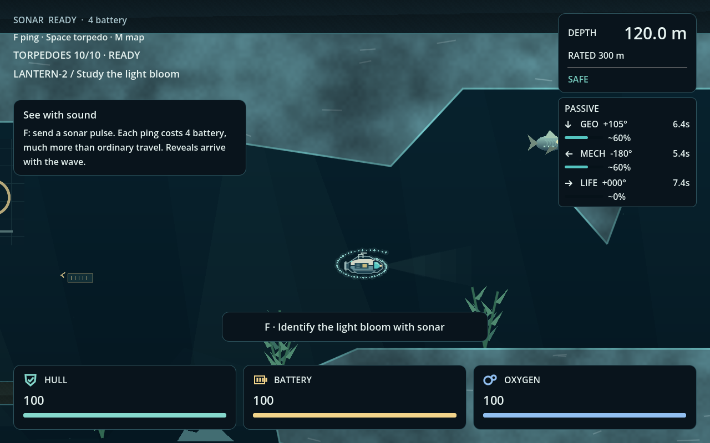
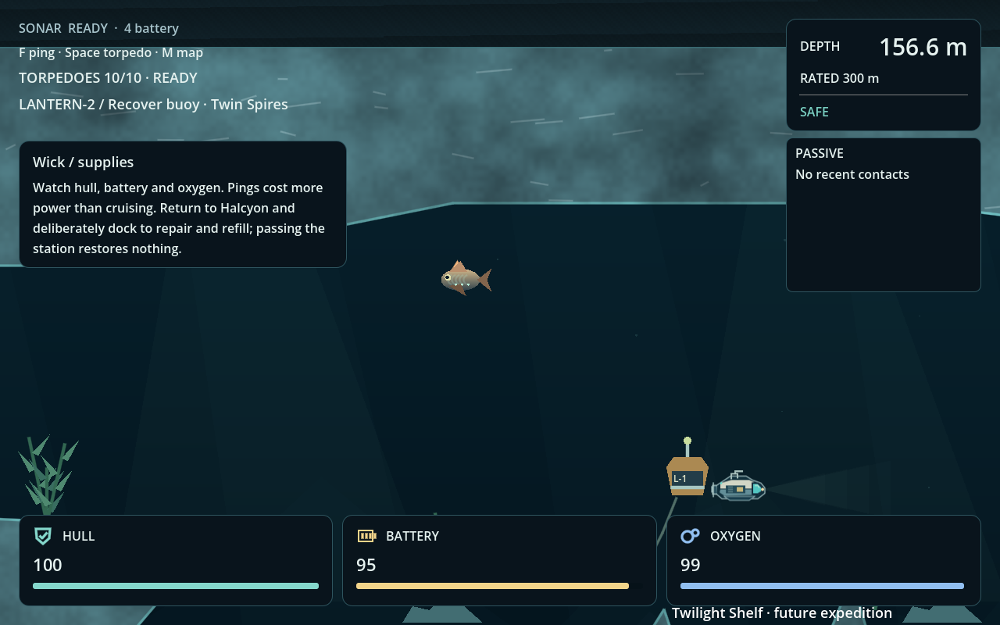
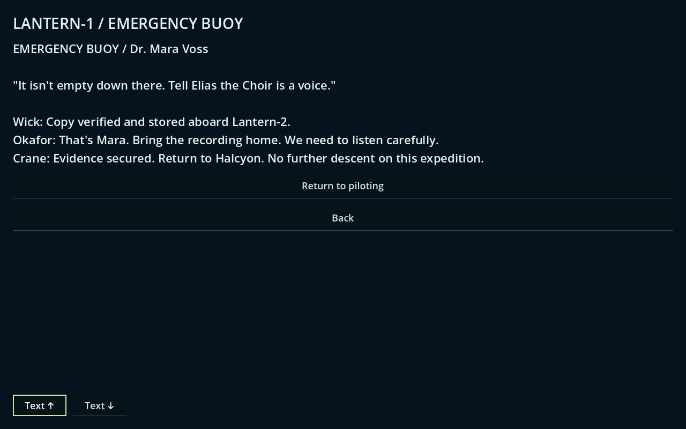
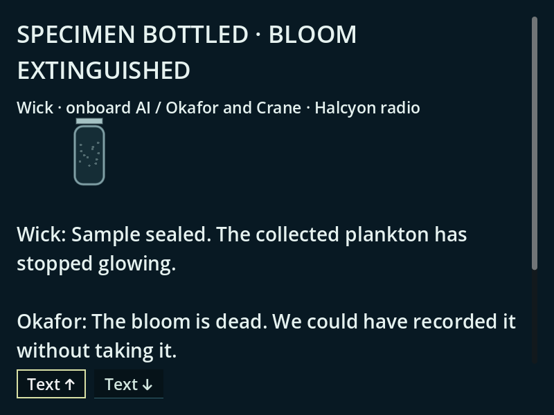
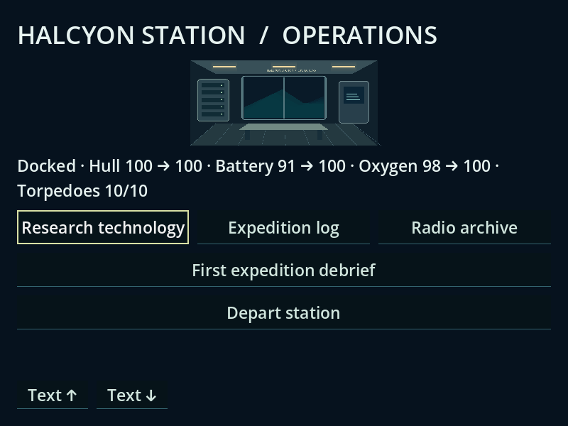
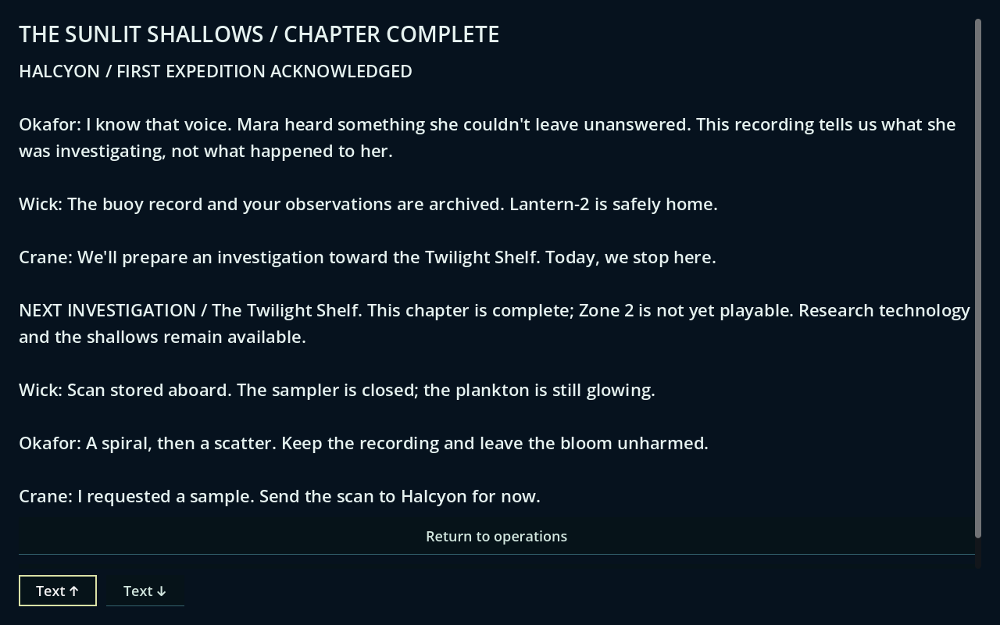

# BTA-047 — The Sunlit Shallows

Canonical Zone 1, based on the [Story Bible](../../story/README.md), especially
pages 1, 4–6 and 9. Starts from main after merged PR #29
(`523d5639ab7a009411e441d2c17ca306e6a5af63`). BTA-045 remains the reserved release
candidate and BTA-046 the Resonance foundation; the tracker had no additional
reserved issue/milestone when this work began.

## Playable chapter

The normal title now offers **Begin The Sunlit Shallows**. A short interactive
Halcyon briefing introduces Meridian Deep Institute, public Tethys funding,
Okafor, Crane, Wick, Lantern-2, missing acoustician Mara Voss and the Halvard
Anomalies. Asking Okafor about the anomalies is optional; accepting the dive is
intentional. There are no timed dialogue selections or mandatory cutscenes.

Follow Halcyon's pylons east through kelp and reefs. The geometric plankton
arrival and exclusive scan/bottle decision remain the BTA-046 encounter. Either
choice advances the expedition. Sonar identifies Lantern-1's emergency buoy near
Twin Spires; a deliberate four-second scan recovers Mara's exact recording:

> It isn't empty down there. Tell Elias the Choir is a voice.

The written Wick/Okafor/Crane responses work with sound muted. Return west through
the upper passage, slow down, deliberately dock, and submit **First expedition
debrief**. The chapter ends with a Twilight Shelf investigation hook. Zone 2 is
not playable. Chapter acknowledgement is non-economic: no new research-point award,
extra upgrade, combat requirement or reward for harming wildlife.

One compact objective line changes with progress. Full instructions and recovered
entries stay in the existing expedition log (pause menu, or station **Expedition
log**). The map shows an approximate buoy search area and discovered landmarks,
without a chain of route arrows. Undiscovered records do not expose Mara's message.
At the recovered buoy, Interact can replay its archived message without rescanning.

## Manual route / acceptance

Use a fresh application profile or copy your existing saves aside before testing;
do not delete a real player's files. Keep separate profiles for the two choices.

1. Launch `godot --path .`. Use arrows/Tab/Enter or D-pad/shoulder/A to select Begin.
   Read the briefing; optionally ask Okafor, go back, and accept the first dive.
2. Fly with WASD/arrows or left stick. Pause/help lists current remapped bindings;
   optional Wick cards can be disabled. Initially dock with E/A, open Research
   technology and assign/reassign existing points if desired. Depart.
3. Follow station pylons east at roughly 120 m. Near the light bloom, watch the
   spiral/scatter before pinging with F/X. Approach, E/A, then choose either the
   non-destructive scan or Crane's bottled sample. Remain in range for the scan.
   Read the outcome: intact light versus an extinguished sample, plus distinct
   responses. No numeric Resonance or morality tier appears.
4. Continue east through the **upper** cave passage to Twin Spires. The buoy is
   near world `(3500,620)` (155 m); approach from `(3050,480)`. Sonar reveals it
   at the wavefront, not at emission. Approach within 180 units and E/A to recover.
   Stay in range for four seconds; moving away interrupts, E/A cancels.
5. Read Mara's message. Quit **on this screen**, relaunch and Continue. The buoy
   record, decision, actual safe vessel checkpoint and log must remain. No choice,
   scan-completion or acknowledgement is emitted again on restore. E/A at the
   buoy reopens the recording; M/Back and pause → Expedition log retain evidence.
6. Return west through `(3050,480)`, `(2350,480)`, `(1200,480)` to Halcyon near
   `(420,480)`. Release thrust and brake to docking speed, then E/A to dock.
   Passing through the ring alone does not refill anything. Deliberate docking
   restores supplies/rearms through the existing station APIs.
7. Select **First expedition debrief**, then submit. Read all voices and the
   Twilight Shelf hook. Return to operations; technology and logs remain available.
   Reopening, Continue, route restart and replaying the buoy must not grant more
   Resonance, claims or research points. Both bloom paths can complete this route.
8. Repeat with the other input device and bloom branch. Repeat at **800×600**, Large
   text, reduced motion/flashing and muted audio. Use the pinned **Text ↑/↓**
   controls to read overflow; all actions remain in the focus cycle. Check that
   movement, sonar, scanning, resources and map remain usable.
9. Check an existing version-1–5 profile. Old discoveries/research/choices/talents,
   torpedoes, excavations and mission claims remain. Selecting the new chapter
   explains that an intentional launch replaces the departure vessel checkpoint,
   keeping permanent records. The **Prototype expedition / legacy checkpoint**
   title option resumes old gameplay without accepting/replacing it. Confirm that
   the shallow wreck remains a separate prototype vessel, never Lantern-1.
10. At the marked 200 m survey limit and eastern boundary, verify that collision
    prevents reaching the old deep/outer course even with hull talents or torpedoes.
    The legacy prototype remains available explicitly as described below.

This is an acceptance script for a human reviewer. Automated results below are
separate; they do **not** demonstrate unfamiliar-player comprehension, a physical
controller trial, measured human pacing or a completed external study.

## Architecture and stable identifiers

`SunlitShallows` is a scene-owned presentation/interaction adapter, not a second
mission ledger or campaign service. `SunlitShallowsData` plus three authored
Resources define this chapter. Existing domain systems remain authoritative:

| Evidence/state | Existing authority / new authored ID |
| --- | --- |
| Accepted/completed/acknowledged chapter | MissionService, `sunlit-shallows-expedition` |
| Bloom outcome | StoryState, original `zone1-light-bloom` choices/flags, unchanged ±15 |
| Buoy discovery | DiscoveryRegistry, `sunlit-lantern1-buoy` |
| Active-sonar target | SonarRevealTarget, `sunlit-lantern1-buoy-echo` |
| Permanent recording | ResearchRegistry, `sunlit-lantern1-buoy-record` |
| Real return after recording | Existing `GrayboxRouteCheck.base_returned` signal |
| Acknowledgement | `sunlit-first-expedition-acknowledged`, existing mission claim |
| Log/dialogue | Existing NarrativeService + ExpeditionLog, authored entries projected from evidence |

MissionObjective gains reusable **STORY_CHOICE** and **RETURN_AFTER_SCAN** kinds.
Previously recorded bloom outcomes and scans count on acceptance. A historical
COMPLETE route cannot satisfy the new return objective: a real base-entry signal
must follow recovered evidence while the mission is accepted. A bounded witnessed
return survives same-process write retries; persisted objective records survive
Continue. Canonical travel updates only the canonical mission; it does not retcon
old prototype mission progress. Explicit prototype mode restores the old filter.

The buoy uses the existing scanner eligibility/range/pause/timing logic, sonar
wavefront discovery and research completion gate. Its safe checkpoint is written
before research emits completion or the message opens. Denied/unsafe writes leave
no recording, completion, message or reward; retry after resolving the save issue.
A pressure-danger/active-predator pose cannot become a recovery checkpoint.

NarrativeService has optional presentation callbacks; its original fixture behavior
remains the default. The chapter log derives from permanent evidence, so it needs
no duplicated delivery flags or another file. Restoring projection is silent; opening
an archive is intentional. Bloom feedback and saved Resonance are unchanged.

The water palette and original static kelp/reef silhouettes establish shallower
water without collision changes. A protected floor at y=800 and eastern wall at
x=3900 limit the canonical route; all traversable canonical depths are at most
200 m using existing y=0 / 0.25 m-per-unit conversion. Camera/map presentation bounds
stay within this course. Switching to the legacy prototype disables these limits.

## Canon transition and save compatibility

- **Presentation mapping:** Halcyon / Lantern-2 on the new title, instruments,
  interaction prompts, station art and chapter entries. Existing `continental_shelf`,
  `neris-01/sonar`, mission IDs, telemetry version and prototype records remain
  stable. No global search-and-replace or invented retroactive Lantern-1 wreck.
- **Prototype retained:** old five-mission outer-shelf/wreck expedition is explicitly
  separate. Its vessel, grounding, logs, research-point awards and legacy conclusion
  stay unchanged. Native old-input fixtures disable the canonical adapter to test
  exactly that path. Run `godot --path . -- --prototype-expedition` to access it.
- **Schema 6:** same eleven top-level fields and one existing atomic expedition
  checkpoint/backup. No independent story/log file or new top-level state. Readers
  accept versions 1–6. Old two/five-mission catalogues are validated before adding
  one **available**, unaccepted canonical mission; old records are copied verbatim.
  Old files are not overwritten merely by loading. Version-1–4 Resonance migration
  still starts zero/empty; version-5 bloom decisions remain unchanged.
- The coordinator projects known mission records into each scene while retaining
  the full validated checkpoint for future merges. Monotonic progress recovery
  accepts two/five/six-record catalogues, preserving old acknowledgements and the
  new recording/choice. Forged canonical completion without supporting recording
  or bloom evidence is rejected. Existing corruption/future-version write blocks,
  atomic replacement, backups and explicit recovery remain in force.
- New-chapter acceptance requires an intentional launch from Halcyon if the save
  belongs to the prototype or lies outside chapter bounds. The briefing discloses
  the departure checkpoint replacement; permanent progress remains intact. Cancel
  or choose Prototype to leave that checkpoint alone.
- Restart Test Route resets temporary vessel/route/sonar state, not permanent bloom,
  research or mission records. It cannot replay their rewards. Recovered buoy
  entries remain visible independently of temporary sonar echo visibility.

## Reproducible checks

Godot **4.6.3.stable.official.7d41c59c4**, checksum-pinned GUT **9.6.1**. Start from
repository root. In the managed environment set the writable XDG paths documented
in the root README first. No new dependency is introduced.

```sh
python3 tools/install_gut.py
python3 tools/validate_godot.py
python3 tools/run_tests.py
python3 tools/verify_expanded_expedition.py
python3 tools/verify_revision_two.py
python3 tools/verify_story_choice.py
python3 tools/verify_sunlit_shallows.py
python3 -m unittest discover -s tests/python -v
python3 tools/install_export_templates.py
python3 tools/build_playtest.py
python3 tools/smoke_playtest.py build/below-the-abyss-playtest-linux-<commit>.zip \
  --log build/playtest/standalone-smoke.log
```

The package filename contains the short commit; use the actual emitted ZIP path.
Build from a clean checkout. CI keeps all previous checks and adds the canonical
chapter driver before Linux export; any logged engine error or missing PASS token
fails validation. Logs/JUnit/standalone package remain CI artifacts for 14 days.

To run a single native route and capture the actual Godot viewport:

```sh
mkdir -p /tmp/sunlit-captures
BTA_EVIDENCE_DIR=/tmp/sunlit-captures godot --path . --audio-driver Dummy \
  --rendering-method gl_compatibility --fixed-fps 60 \
  --script res://tests/fixtures/drive_sunlit_shallows.gd --quit-after 24000 -- \
  --outcome=observe --input=keyboard --profile=sunlit-native-observe
# Other branch/device; append --small --comfort for 800×600/Large/reduced effects:
# --outcome=collect --input=controller --profile=sunlit-native-collect
# Continue the SAME profile with --resume (omit BTA_EVIDENCE_DIR to avoid overwrite).
# Mid-expedition test: first --stop-at-buoy, then --resume --checkpoint=buoy.
```

The driver sends physical-key / joypad events through normal input handling and
follows focus bindings. It does not teleport the vessel, press Button signals,
complete scans directly or inject mission rewards. It steers an upper-passage
out-and-back route, visits technology, checks zero torpedo shots/excavations and
unchanged commission-only awards. Every driver run mutes audio; comfort runs use
reduced effects. These are **automated input-driven playthroughs**, not human trials.

## Results and native evidence

Local verification used pinned Godot 4.6.3 / GUT 9.6.1:

| Check | Actual result |
| --- | --- |
| Full GUT suite | **559/559**, **26,347 assertions**, 471.634 s; zero failures/errors/skips |
| Final focused canonical integration | **16/16**, 176 assertions, including legacy import/recovery and small UI |
| Python analysis tooling | **7/7**, including canonical telemetry allowlist/privacy validation |
| Expanded legacy flight | PASS, 320.717 simulation seconds; hull 100, battery 73.662, oxygen 90.262; no excavation |
| Revised legacy flight | PASS, 462.883 simulation seconds; returned hull 100 / battery 72.625; dock battery 100, four points, ten torpedoes |
| Legacy bloom input/Continue | **8/8** separate launches, both branches × both input devices; restore emits zero choice events |
| Canonical chapter input/Continue | **12/12** launches: four full, four completed Continue, two quit-on-buoy, two Continue-from-buoy |
| Native graphical chapters | **2/2** full actual-input routes; keyboard/observe at 1280×800, controller/collect at 800×600/Large/reduced effects; both muted |
| Human / physical-device study | **Not performed**; no claim of unfamiliar-player comprehension or pacing |

Fresh automated chapter routes took 54.4–74.533 simulation seconds. Completed
Continue replays emitted zero choices/claims; mid-buoy Continue emitted zero choices
and exactly one first debrief claim. Both full routes finished without firing or
excavating, at full hull integrity and with only the existing commissioning award.
Native routes reported 57.417 / 71.550 simulation seconds. This shortest-path
automation is not a human completion-time measurement.

The initial full regression run exposed the intended title-label change and an
incorrect legacy-fixture expectation in the new test. Those expectations were
corrected without weakening gameplay assertions. [Changed-file inventory](changed-files.txt).
Engine import/parser/startup and standalone export results are added to the
verification record after completion. Hosted CI remains separately identified;
local runs are not presented as GitHub Actions results.

All images below are **actual Godot X11/Mesa viewport captures** from the complete
input-driven runs, not mockups or generated artwork. The [screenshots directory](screenshots/)
also contains the choice, response, briefing and debrief at both tested sizes.









## Remaining limitations

- This is a complete short **first chapter**, not the complete campaign. No Zone 2,
  glyph/Vael reveal, later Lantern-1 wreck, new economy or ending is implemented.
- Written dialogue uses the existing reading panels; no new voice recordings or
  external narrative dependency. Mute cannot remove critical story information.
- Only the authored bloom choice affects Resonance. Existing optional torpedo use
  and other ambient behavior are not newly scored. Either choice permits debrief.
- Existing talents remain accessible with already earned points; the canonical
  acknowledgement grants no extra points. Full-campaign progression is undecided.
- The survey boundary is a clearly marked prototype limit, not a playable route
  into the Twilight Shelf. Reef dressing is decorative; hard wall silhouettes are
  collision geometry. No new biome production pipeline.
- The native Mesa/X11 display reports unsupported VSync. Screenshots show the real
  Godot renderer; performance on target GPUs and physical controller hardware needs
  human validation. No human/external study was conducted in this implementation.
- New-player clarity, subjective polish and desired expedition duration still need
  actual human testing. The automated route deliberately takes the shortest safe
  path and cannot establish the 20–40 minute unfamiliar-player target.
