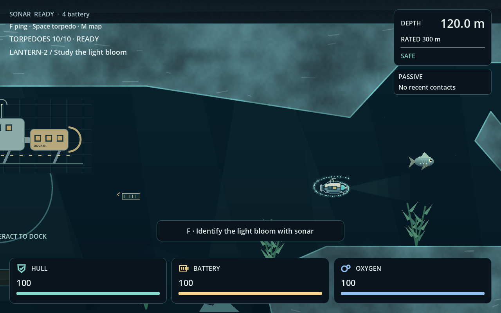
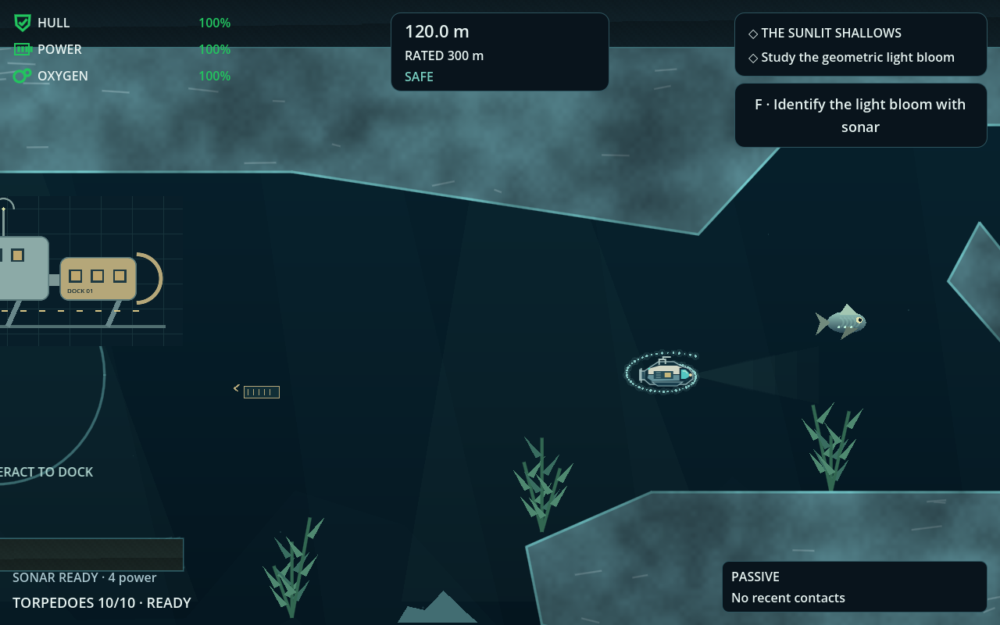
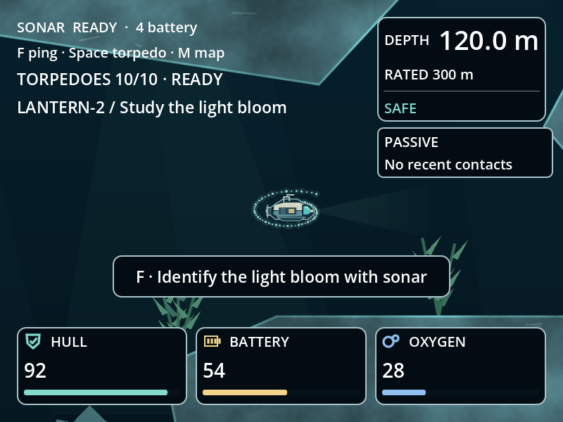
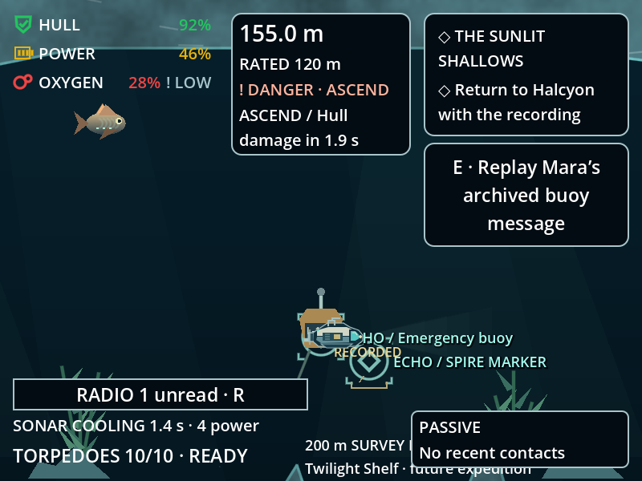
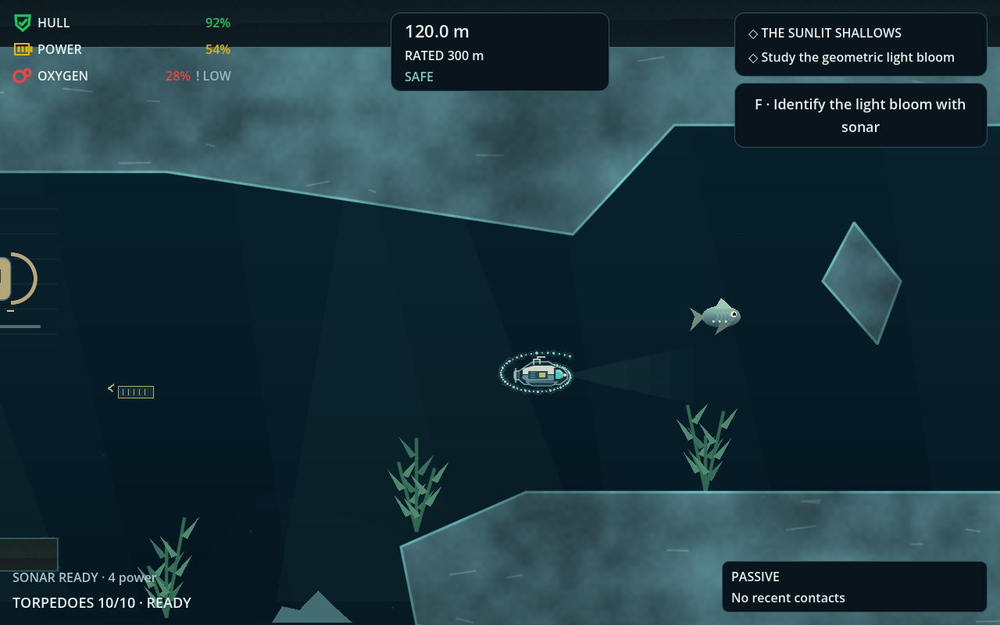
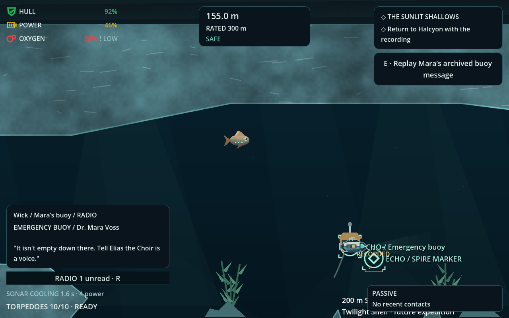
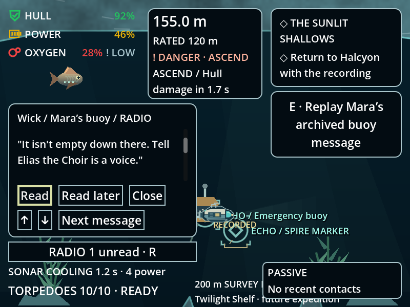
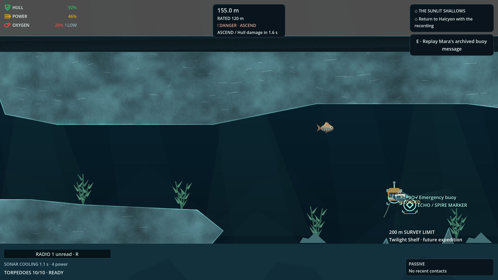

# BTA-048 — Compact HUD, radio and objectives

Based on main after merged PR #30 (`16e8e48`), this changes the production interface
without changing movement, resource rules, story content, mission rewards or the
expedition schema. [Complete changed-file inventory](changed-files.txt).

## Layout and controls

The main game and expanded legacy expedition use the compact layout. Historical
movement/short-course development fixtures retain their original instrument layout
and APIs for regression testing; the production HUD has no visible resource bars.

| Area | Contents |
| --- | --- |
| Upper left | Existing vector glyphs, HULL / POWER / OXYGEN and integer percentages |
| Upper center | Current depth, rated depth and textual SAFE / CAUTION / DANGER, including pressure grace/damage instructions |
| Upper right | Accepted mission title/current objectives, with contextual interaction/scan prompt beneath |
| Lower left | Compact sonar cost/readiness and torpedo count/readiness; radio badge and temporary notification above |
| Lower right | Passive bearings/classification/strength/expiry and predator warning above contacts |
| Below resource readings | Temporary, independent impact and pressure damage notices |

There is no permanent panel across the bottom center. At 800×600 the three columns
remain separated, secondary text wraps, and full radio text scrolls inside a bounded
reader. Standard uses at least 16 px text; Large follows the existing 1.25 scale.
High Contrast keeps readable panel/focus borders; warning words and symbols remain
independent of color. No new flashing, shake, animated transitions or audio-only cue.

**Radio:** R / controller left shoulder is the new remappable `open_radio` action.
The badge shows the actual binding for the active device. Click it, or press the
action, to engage the reader intentionally. Tab/Shift+Tab or right shoulder cycles
its controls; Enter/Space/A activates; Escape/B or the radio action collapses.
Text ↑/↓ scrolls, and **Next message** visits queued messages without acknowledging
them. Left stick / WASD continue piloting; arrow/D-pad focus neighbors stay on the
selected button so navigation cannot change the selection while steering.

Only explicit radio engagement takes button focus. Routine arrival does not pause,
zero velocity, disable the submarine or take focus. Opening a transcript also
leaves physics, sonar, resources, scanning and creature simulation running. If a
menu-accept key is also a non-movement command (notably Space for torpedoes), radio
activation consumes that command press to prevent firing while confirming a button.
For sonar, whose input is polled, a one-step guard also handles Godot’s latched
`just_pressed` state after release. Legitimate quick taps still ping normally.
Movement bindings are never released. While engaged, A confirms radio actions;
close the reader to use A for docking/scanning. Pause/Start still deliberately pauses.

An ordinary preview lasts 12 seconds of active simulation, then collapses. The
unread badge remains. Dispatch offers expose **Accept** and **Read later**; merely
seeing or opening one does not activate a mission. Deferral keeps the message unread
rather than forcing a fullscreen repeat. Simultaneous messages queue in deterministic
eligibility order, without replacing an open transcript. A failed checkpoint write
keeps the message/action pending and displays NOT SAVED. Acknowledged legacy radio
text remains in the station archive. Mara's recording remains in the permanent
research/expedition log and can also be replayed with Interact at the recovered buoy.

Briefing questions, the exclusive bloom choice, station operations, deliberate maps/
logs and the final debrief retain their existing explicit interaction/pause behavior.
The automatic buoy response is now a notification, not a mandatory stopping screen.

## Resource calculation

Readings subscribe to the existing hull/resource signals and take initial snapshots.
`fraction = clamp(current / maximum, 0, 1)` is evaluated only for finite readings
and a finite positive maximum. Invalid data displays **0% / ! INVALID**, in red;
negative readings clamp to zero, over-capacity readings clamp to 100%. No domain
values are rounded, changed or written by the HUD.

- Green `#22C55E`: normalized fraction **>= 2/3**.
- Yellow `#EAB308`: **> 1/3 and < 2/3**.
- Red `#EF4444`: **<= 1/3**, including empty/invalid readings.

Whole percentages are rounded only after this classification. Thus 67/66/34/33
percent produce the requested bands. Exact thirds are deliberately tested: 2/3 is
green and 1/3 is red. Fractional readings can round across an integer label boundary;
color never derives from that rounded string. LOW, EMPTY and INVALID are explicit
text/symbol cues. Existing depletion and refill APIs remain authoritative.

## State ownership and compatibility

`MissionTracker` only projects MissionService, SunlitShallows and narrative facts.
It adds no completion flags, rewards or independent ledger. Sunlit objectives are:
study either bloom outcome → recover the sonar-identified buoy → return with the
recording → dock/submit debrief → completed, with the next region explicitly not
playable. Restoration refreshes from the same authoritative state without replay.
Legacy tracking prioritizes incomplete, accepted main objectives, then optional
studies, ahead of completed records awaiting debrief. At most two mission summaries
and three lines per label are shown; all underlying optional records remain intact.
Available/unaccepted missions and undiscovered late-game targets are not displayed.

`RadioNotifications` holds a bounded, session-only queue of the five existing
transmission IDs and the existing `sunlit-buoy-recovered` narrative ID. It cannot
create missions or research. `ExpeditionRevision` still validates acceptance,
executes the original mission activation, commits the original campaign messages,
updates the map report and uses the same checkpoint ports. Repeated deliveries,
acknowledgements, Continue and rewards remain idempotent. The old single active-ID
field is not used as a second progress store.

**Expedition schema remains 6; no save fields/files or persistent IDs change.**
Mara's completed research record still commits with the safe vessel pose before
notification. Continue does not replay its scan/choice/claim events. Legacy unread
eligibility reconstructs from the existing acknowledgement ledger; preview timers,
reading offsets and queue order are temporary, not additional saved progress.
Previously recovered buoy text is available through the existing logs after Continue,
even when its original transient popup is gone.

Settings schema remains 1. Valid older binding sets missing `open_radio` (and, for
older profiles, `fire_torpedo`) gain unused keyboard/controller descriptors. Existing
bindings are copied verbatim; occupied R/left-shoulder bindings are preserved and
radio chooses a free alternative. Invalid configurations still fail validation
rather than overwrite saved controls. Input settings list/remap the new action via
the existing architecture; fixed menu recovery bindings remain available.

The HUD owns compact reflow. `identity_container()` supplies the relocated secondary
instruments; `%InstrumentDeck` retains a valid unique name with compact children.
Accessibility, dynamic ammunition, tutorial placement, objective placement and pilot
context dependencies are updated together. There are no dangling primary paths to
the old `Top/Identity` / `Bottom/InstrumentDeck` layout. The original paths remain
valid only in their deliberately retained development layout.

## Acceptance coverage

| Requirement | Evidence |
| --- | --- |
| Percentages, exact thirds, invalid maximums, damage/services/upgrades/reload | `test_compact_interface.gd` resource cases use the authoritative APIs, including a 250-unit battery |
| Arrival/reader retain motion and focus; explicit acceptance, deferral, archive and dedup | Radio regression cases plus normal-input revised-expedition driver |
| Both bloom paths, buoy, return, debrief and checkpoint projection | Tracker tests and the complete 12-launch Sunlit Shallows driver |
| Legacy/optional missions preserved; no duplicate claims | Legacy projection cases, unchanged mission tests and revised-expedition route |
| Keyboard/controller/mouse, remapping, readable warnings and non-overlap | Radio input/click tests and six size/text combinations with three contacts, predator and damage notices |
| Native appearance and muted/reduced-effects gameplay | Ten before/after captures and a separate graphical controller chapter run |

## Native comparisons

All PNGs are actual Godot Compatibility/X11/Mesa viewport captures, not mockups.
The capture fixture stages matching poses/readings on main and the implementation;
it is explicitly **not** the flight test. The separate actual-input drivers fly
without teleports, invoke normal scan/dock controls and follow real menu focus.

| Resource cluster bounding footprint | Before | After | Reduction |
| --- | --- | --- | --- |
| 1280×800 Standard | 1232×117 = **14.08%** | 280×94 = **2.57%** | **81.74%** of the resource footprint; 11.51% of the viewport |
| 800×600 Large / High Contrast | 752×111 = **17.39%** | 248×100 = **5.17%** | **70.29%** of the resource footprint; 12.22% of the viewport |

These are measured bounding rectangles, not a claim that every pixel inside a
panel was opaque or that total interface coverage fell by the same percentage.
Depth, passive/threat status and objectives are included in the screenshots; the
measurement isolates the replaced resource deck.

| Main after PR #30 | Compact interface |
| --- | --- |
|  |  |
|  |  |






The warning capture deliberately sets a 120 m rating through the existing depth API;
production ratings and talents are unchanged. Resource colors are staged through
actual consumption/damage APIs, not edited into an image. No environmental art changes.

## Exact verification commands

Godot **4.6.3.stable.official.7d41c59c4**, checksum-pinned GUT **9.6.1**. Set the writable
XDG paths from the root README in the managed workspace, then run:

```sh
python3 tools/install_gut.py
python3 tools/validate_godot.py
python3 tools/run_tests.py
python3 tools/verify_expanded_expedition.py
python3 tools/verify_revision_two.py
python3 tools/verify_story_choice.py
python3 tools/verify_sunlit_shallows.py
python3 -m unittest discover -s tests/python -v
python3 tools/install_export_templates.py
# Clean committed checkout:
python3 tools/build_playtest.py
python3 tools/smoke_playtest.py build/below-the-abyss-playtest-linux-<build-id>.zip \
  --log build/playtest/standalone-smoke.log
```

Existing GitHub Actions runs these validators and input-driven routes, including
all new GUT cases. No existing checks or failure conditions are disabled. Parser
validation includes the new scripts; the workflow retains logs/JUnit and Linux
package evidence for 14 days when an actual PR triggers hosted CI.

Native capture on a graphical desktop:

```sh
mkdir -p /tmp/bta048-shots
BTA_EVIDENCE_DIR=/tmp/bta048-shots godot --path . --audio-driver Dummy \
  --rendering-method gl_compatibility --fixed-fps 60 \
  --script res://tests/fixtures/capture_compact_interface.gd
# Real controller chapter, without staging or teleporting:
godot --path . --audio-driver Dummy --rendering-method gl_compatibility \
  --fixed-fps 60 --script res://tests/fixtures/drive_sunlit_shallows.gd \
  --quit-after 24000 -- --outcome=collect --input=controller \
  --profile=bta048-manual-driver --small --comfort
```

For baseline images, extract main `16e8e48` with `git archive` into a temporary folder,
copy the capture fixture into its `tests/fixtures/`, import it, and run the same
capture command with that folder's `--path`. No worktree, dependency or application
code change is needed. This session used the existing dummy Xorg driver at DISPLAY
`:98`, software Mesa, and `LP_NUM_THREADS=2`. The expected unsupported-VSync warning
is retained in logs; rendering succeeded without engine errors.

## Manual playtest

1. Begin The Sunlit Shallows. Confirm upper-left glyph/percentage readings, centered
   depth/rating, upper-right accepted objective, and an open bottom center. Remap
   radio in Options if desired, save, reload and verify the badge uses that binding.
2. Pilot to the bloom. Observe and scan on one profile; collect on another. The
   tracker must advance identically to buoy recovery while branch responses differ.
3. Recover the buoy normally. Keep moving as the popup arrives: thrust, coasting,
   camera, resources and sonar remain active. Arrival must not move focus. Read
   its short preview, let it collapse, then open the unread badge with R/LB.
4. Keep using left stick/WASD with the transcript open. Tab/RB to Text ↓ and read
   Mara's message. Use Next message when several arrive. Close with R/LB/B/Escape.
   Reading/preview alone must not accept a mission or grant a reward. Pause/Start
   remains an explicit way to stop simulation if desired.
5. Save, quit and Continue. The permanent recording and bloom outcome remain; the
   tracker restores from mission/domain state, without repeated choices or rewards.
   Mara's complete text remains in pause → Expedition log and station logs. Replay
   it by interacting near the recovered buoy; it must not restart a scan.
6. Return west, slow down and deliberately dock. Readings become 100% through actual
   service signals. The tracker requests debrief, then shows completed/not-yet-playable
   after submission. Technology, free reassignment, logs and services still work.
7. In `godot --path . -- --prototype-expedition`, depart until the dispatch popup.
   Ignore/defer it while moving: mission stays available. Open and Accept deliberately;
   the map/mission activates and the archive retains it. Complete the existing plate,
   hydrophone, chimney and wreck route, decode at base, and confirm the original four
   research points, no duplicate awards and ten torpedoes after docking.
8. Repeat at 800×600, 1280×800 and 1920×1080 with Standard/Large, High Contrast,
   muted audio and reduced effects. Verify full readable danger/depletion/impact
   warnings, three passive contacts and a predator warning. Critical warnings must
   stay visible while a radio reader is open; long text uses scroll controls.

## Results and limitations

Local validation passed: **574/574 GUT tests** (64 scripts; zero failures, errors or
skips), **15/15 focused interface tests**, import, **237 parser checks**, startup,
all 12 canonical chapter launches, legacy revised/expanded routes, all eight bloom
choice launches and seven Python tooling tests. The clean release export/smoke
passed; [verification.txt](verification.txt) records the clean commit, binary hash
and exact commands/results. The review branch is published, but PR creation returned
GitHub API `Forbidden`; hosted CI has not run. The existing workflow is unchanged.
[Create the PR](https://github.com/zornscience/below-the-abyss/compare/main...bta-048-compact-interface?expand=1).

Automated routes and graphical captures are **not human usability studies or physical-device
trials**. Human comfort, subjective readability and target-GPU performance still
need review. Small-window radio reading intentionally requires scrolling; steering
continues, so use the existing explicit Pause when needed. Collapsed/unread preview
state is temporary; permanent transcripts/progress use the existing stores.
