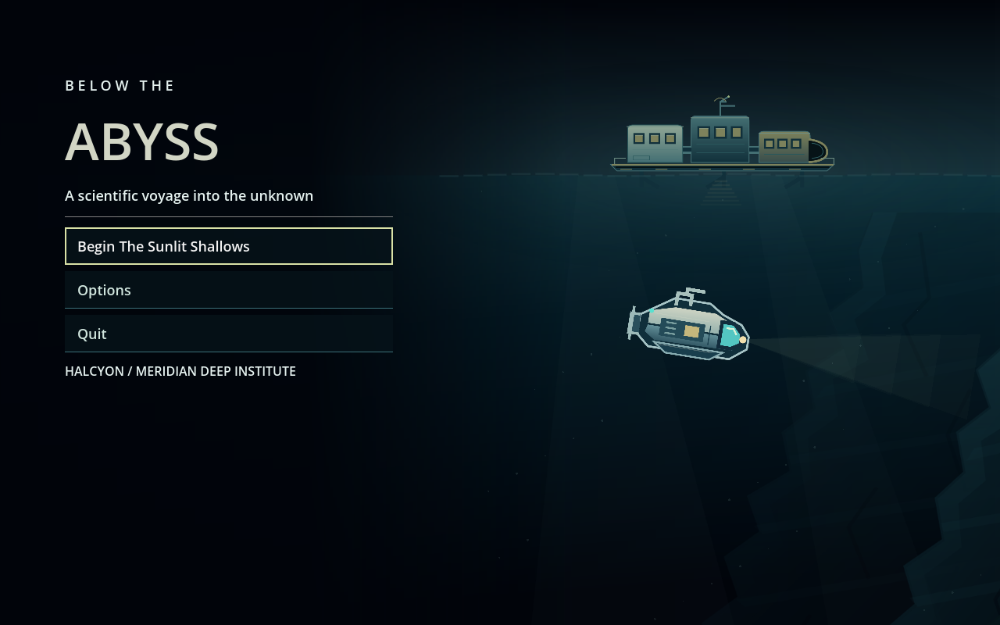
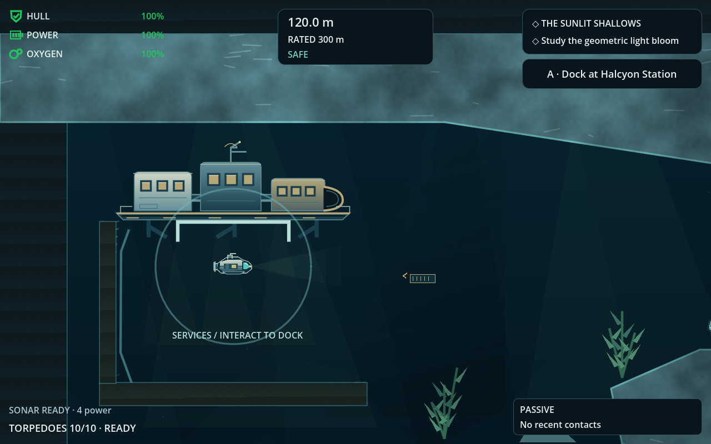
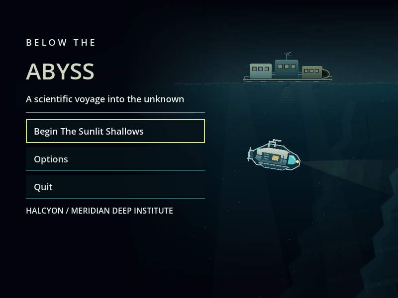
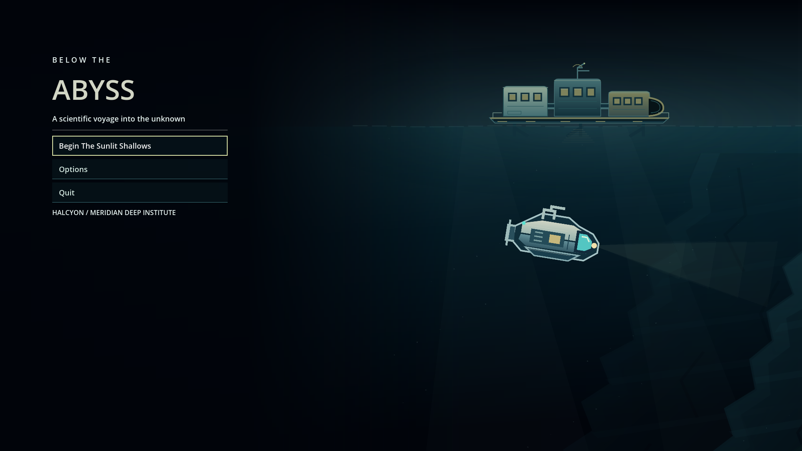
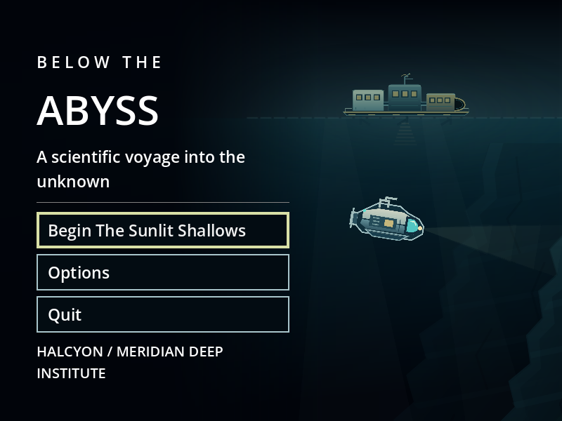
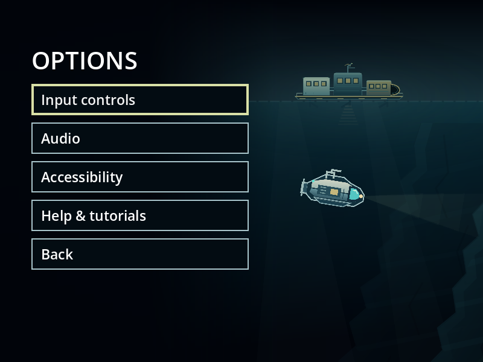
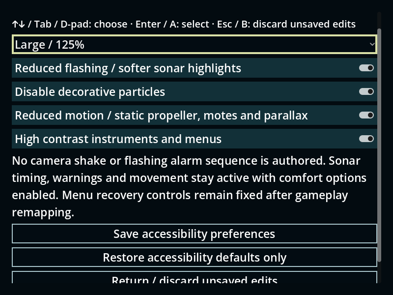
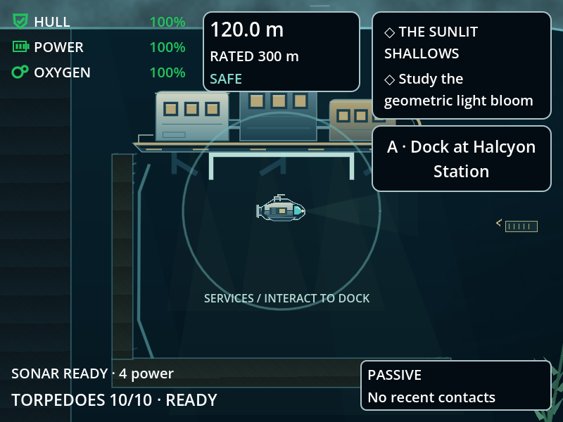

# BTA-049 — The Halcyon Descent

Based on main `13e814a` after merged PR #31. This is a focused illustrated title,
shared artwork and immediate Halcyon departure study. It adds no region, narrative
fact, objective, gameplay rule or save field. [Changed files](changed-files.txt)
and [exact verification results](verification.txt).

## Composition and shared identity

A distant three-module scientific installation sits at a dark sea surface. Restrained
brass windows, a small survey mast and trussed deck establish Halcyon. Lantern-2
descends into cool negative space with its illustrated searchlight; three basalt
planes recede through atmospheric values. There are no alien silhouettes, secret
landmarks or later-zone discoveries. This is a cinematic composition, not a literal
map/camera view or a new playable surface area.

The playable submarine and title use **the same Texture2D master**. The old cutaway
portrait is removed from the production title, rather than advertising a differently
shaped vessel. Mast, blunt bow, offset dome, ventral keel, porcelain shell and steel
underside remain recognizable at both scales. The 640×384 SVG retains an 80×48
viewBox: the playable sprite scales by 0.125, preserving its authored footprint.
Its stable `NerisIllustration` node name and all physics/camera children remain intact.
The legacy SVG/portrait remain available to historical fixtures; no save ID is renamed.

Halcyon's connected habitat/lab/dock modules share the same SVG in the title and at
the existing canonical departure position. Local cables, platform paint, faint light
wedges and low-contrast distant relief complete the demonstration. The old decorative
station cutaway is hidden only during the canonical chapter; legacy presentation
remains available. Terrain polygons, collision layers, spawn, service radius, camera,
nav bounds and gameplay targets are unchanged. Background relief is nonsolid and
low contrast; existing solid terrain rims remain authoritative.

## Menu and accessibility contracts

Begin/Continue, Options, Quit, conditional prototype access and blocked-save recovery
retain their original callbacks and guards. The actual Godot Controls sit in a dark
left column, with focus-following scrolling when optional/recovery content is tall.
The original focus ring and fixed keyboard/controller recovery bindings remain.
Returning from Accessibility also retains focus on the visible title rather than
refocusing the hidden pause menu. Navigation activates immediately; there is no
input lock, delayed callback or
mandatory entrance animation. Warm hover/selection treatments stay restrained.

- Mouse: click the ordinary buttons. Decorative art uses `MOUSE_FILTER_IGNORE`
  and `FOCUS_NONE` and cannot intercept clicks.
- Keyboard: arrows / Tab / Shift+Tab to navigate, Enter/Space to activate, Escape
  to return from Options. Existing remapping and recovery bindings remain available.
- Controller: D-pad or fixed focus-next/right shoulder to navigate, A to activate,
  B to return. Options still opens Input, Audio, Accessibility and Help panels.
- Large Text scales existing labels/buttons. At 800×600 long labels wrap; tall
  recovery/prototype combinations scroll to the focused action rather than clip it.
- High Contrast keeps white text, opaque button grounds and the existing four-pixel
  focus outline. Selection is never communicated by color alone.
- Reduced Motion uses a static authored composition and stops the title clock.
  Reduced Particles removes all 42 title motes. The existing softer-effects flag
  (`reduced_flashing`) fixes illumination intensity. These map to existing settings;
  no new options or saved preferences are introduced.
- Muting audio leaves all menu, briefing and gameplay information available.

`HalcyonDescent` has no reference to a vessel, physics system, random stream or save
service. Its local phase changes only drawing offsets/light intensity, with at most
30 redraws/second. Slow ocean lines, particle drift and four-pixel background parallax
never move the actual submarine or camera. Hidden titles stop processing. While the
opaque title is visible, the covered `WorldRoot` is render-hidden to avoid unnecessary
world rendering; its previous visibility is restored when the title closes. This
changes neither simulation enablement nor checkpoint state. Station/briefing/radio/HUD
behavior remains owned by the existing services, including all BTA-048 nonblocking
notifications and objective tracking.

## Original assets and reusable workflow

| Source | Reuse and scale |
| --- | --- |
| `assets/art/identity/lantern_2.svg` | Shared title/playable master, 640×384 texture / 80×48 local silhouette |
| `assets/art/identity/halcyon_modules.svg` | Surface composition and existing dock hardware, 960×360 |
| `assets/art/identity/shelf_cliff.svg` | Low-contrast decorative relief planes, 640×960; never collision data |
| `assets/art/identity/descent_water.svg` | Palette gradient, negative-space veil and faint shafts, 1920×1080 |
| `scripts/visuals/halcyon_descent.gd` | Bounded cosmetic clock/motes/parallax, responsive composition |
| `scripts/visuals/halcyon_departure.gd` | Local dock dressing, static and collision-free |

All sources are original Codex-assisted repository-authored SVG/drawing code; the
vessel explicitly derives from this repository's original NERIS study. No image
model, downloaded image, external font, texture library, new dependency or 3D render
was used. [Provenance](../../../assets/art-provenance.csv) records each source and
derivation. **Project licensing remains pending**; this PR does not grant a new
license or claim third-party rights. The existing Godot font/runtime notices remain.

Proposed workflow for later *authorized* regions:

1. Start from the semantic palette and value hierarchy in [art direction](../../art_direction.md).
   Author a silhouette sheet and reserve dark interface space before adding detail.
2. Retain editable SVG viewBoxes, explicit hardware anchors and world-unit footprints.
   Use a single imported master for repeated hardware rather than separate promotional
   art. Keep vector features legible at gameplay scale; author larger source dimensions
   for title use without changing local-world bounds.
3. Compose distant, middle and close decorative planes with small value steps. Bake
   simple gradients into imported SVGs; cache static draws and bound moving details.
   Do not derive collisions or discovery geometry from background art.
4. Keep animation on a scene-owned cosmetic clock. Budget redraw rate/mote count and
   provide static alternatives using existing comfort preferences. Avoid screen-read
   postprocessing, realtime shadows and large stacks of translucent effects.
5. Add provenance/source/authoring-assistance/license status before importing an asset.
   External sources require explicit permission and license review; do not infer rights.
6. Capture native title/gameplay comparisons at all three window sizes, Large Text,
   High Contrast and static comfort settings. Recheck focus, contrast, wall readability,
   hardware scale, actual frame intervals and release packaging before acceptance.

No future-region artwork or production pipeline replacement is implemented here.

## Native Godot evidence

All images are actual Compatibility/X11/Mesa viewport captures, without post-editing
or conceptual compositing. The fixture navigates Options/Accessibility and Begin/
briefing through keyboard/controller events. Preferences and window sizes are staged
for comparison; gameplay remains at the normal departure spawn. This capture is
separate from the complete normal-input chapter walkthroughs.

| Title composition | Same vessel and station in gameplay |
| --- | --- |
|  |  |








## Reproducible verification

Godot `4.6.3.stable.official.7d41c59c4`, GUT 9.6.1 and existing checksum-pinned templates.
From the repository root, set writable XDG paths as documented in the root README:

```sh
python3 tools/validate_godot.py
python3 tools/run_tests.py
python3 tools/verify_sunlit_shallows.py
python3 tools/verify_revision_two.py
python3 tools/verify_expanded_expedition.py
python3 tools/verify_story_choice.py
python3 -m unittest discover -s tests/python -v
# Targeted title coverage:
godot --headless --path . --script res://addons/gut/gut_cmdln.gd \
  -gexit -gdisable_colors -gconfig= \
  -gtest=res://tests/integration/test_cinematic_title.gd
# Separate-process Quit: no --quit-after, so only the actual button exits.
godot --headless --path . --script res://tests/fixtures/capture_halcyon_descent.gd \
  -- --quit-test
# Clean committed source:
python3 tools/install_export_templates.py
python3 tools/build_playtest.py
python3 tools/smoke_playtest.py build/below-the-abyss-playtest-linux-<build-id>.zip \
  --log build/playtest/standalone-smoke.log
```

On a graphical desktop (omit `--fixed-fps` for observed render intervals):

```sh
mkdir -p /tmp/bta049-shots
BTA_EVIDENCE_DIR=/tmp/bta049-shots godot --path . --audio-driver Dummy \
  --rendering-method gl_compatibility \
  --script res://tests/fixtures/capture_halcyon_descent.gd
```

This workspace uses DISPLAY `:98`, `LIBGL_ALWAYS_SOFTWARE=1`, `LP_NUM_THREADS=2`
and the already available dummy Xorg driver. No desktop dependency was installed.
The software driver's unsupported-VSync warning is expected and recorded.

| Acceptance | Evidence |
| --- | --- |
| Same world identity, preserved collision/camera footprint | Shared-resource/footprint GUT case; title/departure native pair; all existing movement/region tests |
| Presentation cannot mutate progress, vessel pose or velocity | Title animation isolation test, hidden/static clock tests, existing save/physics suite |
| Begin/Continue/Options/Quit/prototype/recovery | Real keyboard/controller/mouse tests, six size/text combinations, separate-process Quit, existing checkpoint and full chapter recovery routes |
| PR #31 interface preserved | Existing compact HUD/radio/objective tests and complete canonical/legacy routes |
| Comfort/mute/contrast and minimum resolution | Static preference tests, focus/font/bounds assertions and native 800×600 screenshots |
| Export/runtime | Existing pinned validation, full GUT, Linux release and extracted standalone smoke |

## Performance observations

One native X11 / Compatibility / Mesa llvmpipe run used two software-rendering threads,
with no other Godot test process running. Each sample follows 30 warm-up frames and
records 150 process-frame wall intervals, excluding screenshot readback. No fixed FPS
was supplied. These are whole-application observations, including existing HUD and
gameplay overhead, not GPU timings or certified hardware performance.

| View | Size | Median ms | p95 ms | Draw calls sampled | Texture MiB |
| --- | --- | --- | --- | --- | --- |
| title-standard | 800×600 | 19.41 | 30.14 | 86 | 24.13 |
| title-standard | 1280×800 | 52.64 | 94.17 | 86 | 28.28 |
| title-standard | 1920×1080 | 60.60 | 98.51 | 86 | 36.29 |
| title-static-comfort | 800×600 | 25.08 | 51.61 | 44 | 25.26 |
| departure-gameplay | 1280×800 | 59.65 | 83.46 | 576 | 32.08 |

The cloud software-rendered run does **not** maintain 60 FPS at the larger windows.
Desktop-GPU and target-device profiling remain necessary. Static-mode frame intervals
also show host variability; the table is not a controlled claim about relative speed.
Texture memory is the whole renderer monitor, including the existing game and render
targets. Four new SVG sources total only 7,181 bytes; their uncompressed imported image
pixels total approximately 12.5 MiB before any renderer overhead.

The initial profile exposed covered world rendering behind the title. The implementation
now hides that covered world only while the title is visible, restoring prior visibility
on exit. The final title sampled 86 draw calls, or 44 without its 42 motes; hidden
titles stop processing, static geometry is cached, and moving draws are capped at 30 Hz.
No screen-read shader, 3D pass, shadow texture or realtime light allocation is added.
[Raw native log](native-runtime.txt) retains the driver warning and measurements.

## Manual review route

1. Launch `godot --path .` with a fresh isolated profile. Inspect the distant station,
   warm windows, Lantern-2 light, layered cliffs and quiet left column. Let it idle:
   motion must remain slow, with no flashing or changes to gameplay state.
2. Navigate every title action with mouse, keyboard and controller. Open each Options
   page and return. Confirm focus is visible, immediate and retained after settings.
3. Repeat 800×600, 1280×800 and 1920×1080, Standard/Large, High Contrast, muted audio,
   Reduced Motion/particles/softer effects. Tall optional/recovery menus must scroll
   the focused action into view. Static comfort must stop drift, waves and parallax.
4. Begin, optionally ask Okafor a question, and launch through the existing briefing.
   Compare the same dome/mast/keel and Halcyon modules in gameplay. Check the local
   dock, then leave east: traversal, camera and terrain must behave as before.
5. Complete either bloom choice, recover the buoy while radio remains nonblocking,
   return/dock/debrief, quit and Continue. Verify no repeated choices/claims and intact
   research/talents/resources. The existing legacy prototype remains selectable.
6. With a disposable corrupted profile, confirm Begin is disabled and recovery stays
   reachable without replacing files silently. Use the existing recovery procedure.
7. Quit through the actual menu button; relaunch and verify settings/checkpoints.

Automated input is **not a human usability or physical-controller trial**. Human
comfort/readability, desktop-GPU performance, Windows/macOS and Steam Deck still
require native review. No 60 FPS certification or new platform support is claimed.
