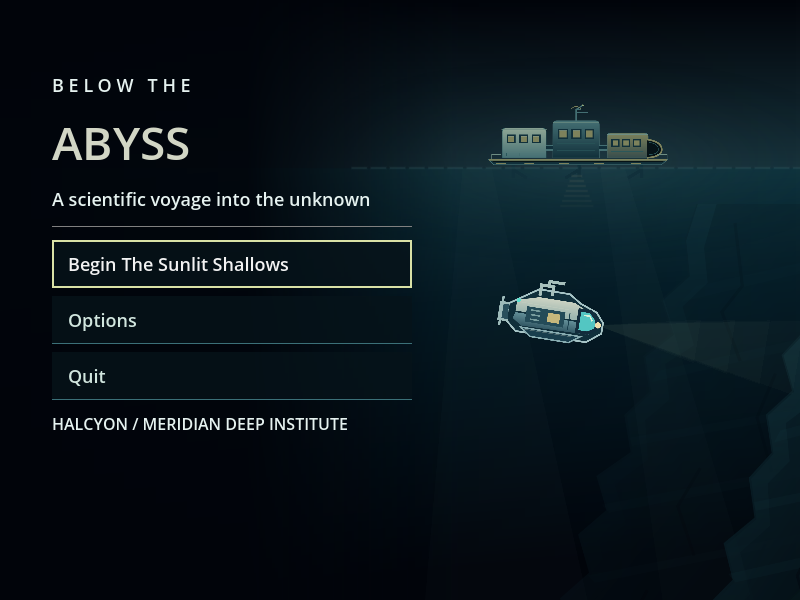
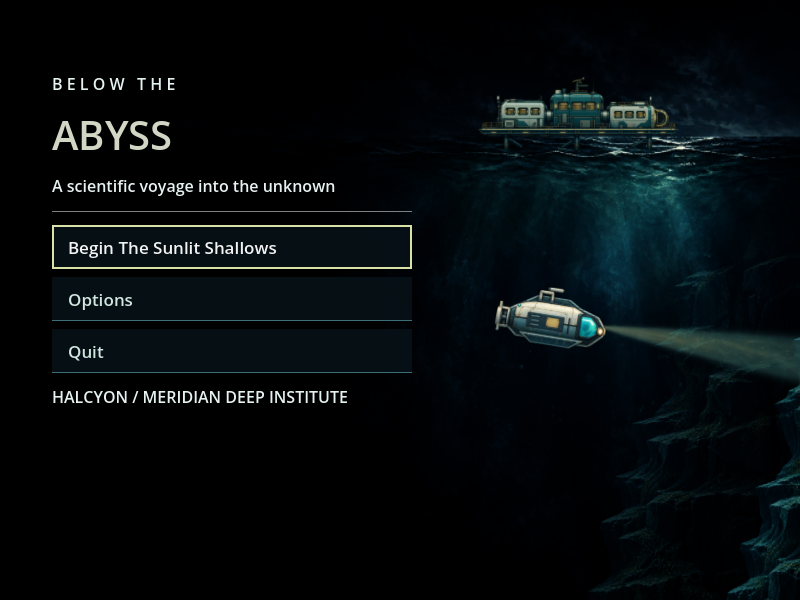
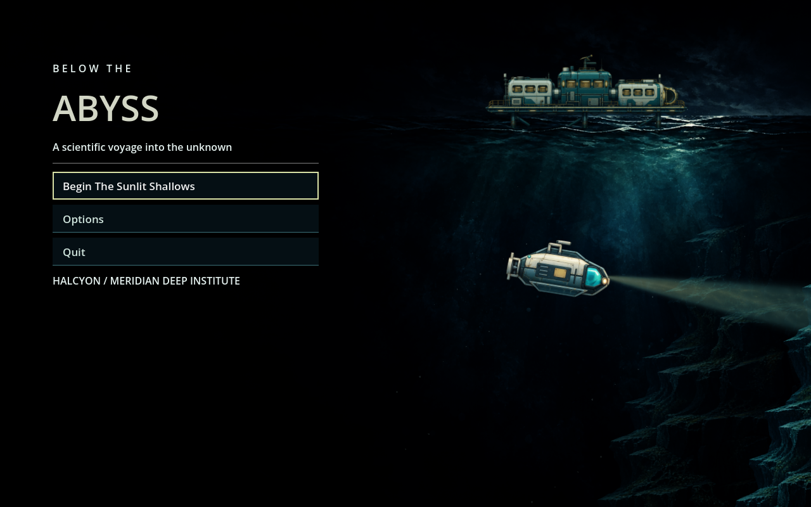
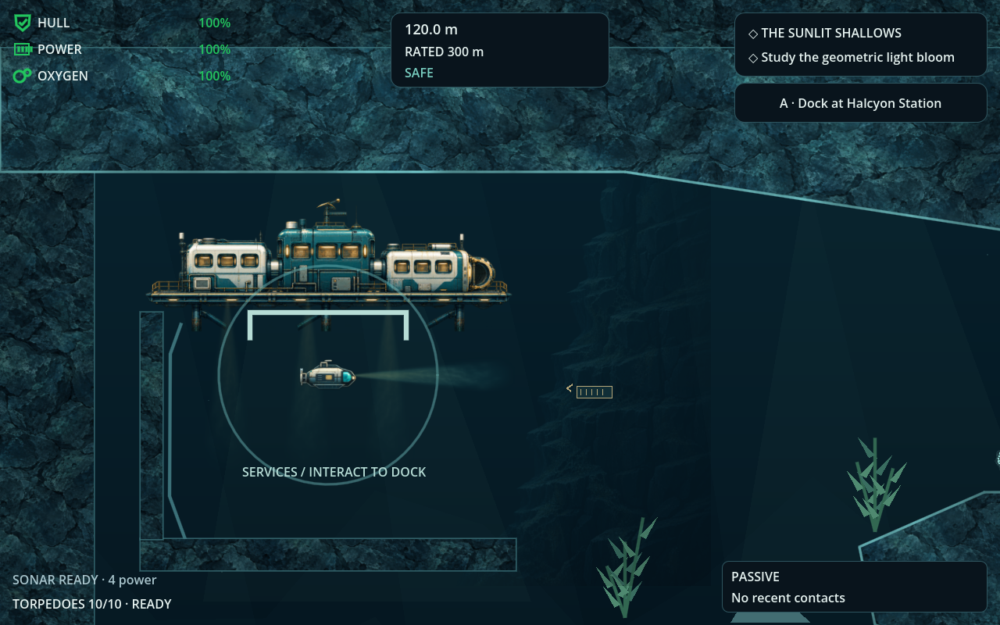

# BTA-049 requested revision — typography, dialogs and illustrated assets

This revises the existing `bta-049-halcyon-descent` branch from `02837fb`.
**PR #32 was already merged externally as `8c1980e` before this request.** Follow-up
commits cannot change a merged PR's review diff. No replacement PR or merge is created.
The implementation and review material remain on the requested branch.

## What changed

`UiTypography` replaces scattered hard-coded sizes and the old cached-font scaling.
Every production interface uses semantic roles, including title/options, opening and
narrative dialogs, bloom choices, docking, research/talents, mission/expedition logs,
radio, settings/accessibility, help/tutorials, save confirmations and debrief. Scene
metadata declares exceptional roles; ordinary prose/buttons default to 16 px. World
labels and custom-drawn map/talent labels use the same policy rather than large
independent defaults. No font or runtime dependency was added.

| Role | Compact | Standard | Large |
| --- | ---: | ---: | ---: |
| Body / dialog button / HUD / mission | 14 | 16 | 20 |
| Main menu button | 15 | 17 | 21 |
| Section heading / depth measurement | 16 | 18 | 23 |
| Dialog heading | 18 | 20 | 25 |
| Secondary label | 14 | 14 | 18 |

Compact is 90% with a 14 px floor; Standard is 100%; **Large remains 125%**.
Reapplying preferences always starts from semantic metrics, never from an already
scaled override. The title wordmark is 40/56/64 px at 800/1280/1920 before scaling.
Popups inherit their associated control's size. Wrapped horizontal actions reserve
actual text widths, preventing single-character vertical button strips.

`UiDialogLayout` bounds narrative/bloom, docking, log, research, settings, help and
pause presentation. Dialogs are centered with at least 24 px side and 32 px vertical
clearance; typical narrative maximum is 760×480, bloom 760×500, docking 960×580.
Existing content scrolls within those bounds. Persistent Text ↑/↓ actions and
focus-follow keep long prose and offscreen buttons reachable with a controller;
Page Up/Down remains available where previously supported. The surrounding world
stays visible through a dimmed backdrop. All existing close/back, focus, controller
recovery, save-recovery and simulation/pause ownership remain in their services.

The geometric title masters are replaced by **six asset-driven illustrated PNGs**:
weathered porcelain/steel Lantern-2; recessed habitat/lab/dock Halcyon modules;
stratified cliffs; ocean/atmosphere/reflections; basalt surface; transparent textured
searchlight. These were generated with OpenAI `image_gen`, **not painted by a human**.
They retain the repository's silhouettes and palette and add material texture,
weathering and varied lighting. Title, native gameplay and station presentation share
the same vessel/station/optics resources. The vessel remains 80×48 world units with
its original 64×32 collision capsule. Mipmaps support severe gameplay minification.
Basalt paint is clipped to the existing exact rock silhouettes, including excavated
pieces; collision rims, carving, camera and navigation remain unchanged.

Ocean movement samples only the water texture with a very small displacement near
its painted horizon. It uses the bounded cosmetic clock, no screen texture or engine
TIME. Motion/effects settings freeze it. The lamp uses the shared painted asset,
replacing polygon wedges. Existing bounded motes/parallax remain cosmetic. No new
region, mechanic, story, dependency, save field or stable-ID migration.

## Actual native before-and-after evidence

Before: isolated original `02837fb` source, same staged capture fixture. After: revised
source, actual Godot 4.6.3 X11 Compatibility renderer. PNGs are viewport readbacks,
not image-model mockups, composites or resized screenshots. The wrapper verifies
each PNG's exact dimensions and rejects Godot errors, missing shots and exit leaks.

| Original title | Revised title |
| --- | --- |
|  |  |

| Interface | Before 800×600 | After 800×600 | Before 1280×800 | After 1280×800 |
| --- | --- | --- | --- | --- |
| Title | [Native PNG](before/800-standard-title.png) | [Native PNG](after/800-standard-title.png) | [Native PNG](before/1280-standard-title.png) | [Native PNG](after/1280-standard-title.png) |
| Opening briefing | [Native PNG](before/800-standard-briefing.png) | [Native PNG](after/800-standard-briefing.png) | [Native PNG](before/1280-standard-briefing.png) | [Native PNG](after/1280-standard-briefing.png) |
| Story choice | [Native PNG](before/800-standard-choice.png) | [Native PNG](after/800-standard-choice.png) | [Native PNG](before/1280-standard-choice.png) | [Native PNG](after/1280-standard-choice.png) |
| Station | [Native PNG](before/800-standard-station.png) | [Native PNG](after/800-standard-station.png) | [Native PNG](before/1280-standard-station.png) | [Native PNG](after/1280-standard-station.png) |
| Research log | [Native PNG](before/800-standard-research.png) | [Native PNG](after/800-standard-research.png) | [Native PNG](before/1280-standard-research.png) | [Native PNG](after/1280-standard-research.png) |
| Research technology | [Native PNG](before/800-standard-technology.png) | [Native PNG](after/800-standard-technology.png) | [Native PNG](before/1280-standard-technology.png) | [Native PNG](after/1280-standard-technology.png) |
| Radio transcript | [Native PNG](before/800-standard-radio.png) | [Native PNG](after/800-standard-radio.png) | [Native PNG](before/1280-standard-radio.png) | [Native PNG](after/1280-standard-radio.png) |
| Expedition log | [Native PNG](before/800-standard-expedition-log.png) | [Native PNG](after/800-standard-expedition-log.png) | [Native PNG](before/1280-standard-expedition-log.png) | [Native PNG](after/1280-standard-expedition-log.png) |
| Debrief | [Native PNG](before/800-standard-debrief.png) | [Native PNG](after/800-standard-debrief.png) | [Native PNG](before/1280-standard-debrief.png) | [Native PNG](after/1280-standard-debrief.png) |
| Accessibility | [Native PNG](before/800-standard-settings.png) | [Native PNG](after/800-standard-settings.png) | [Native PNG](before/1280-standard-settings.png) | [Native PNG](after/1280-standard-settings.png) |
| Help/tutorials | [Native PNG](before/800-standard-help.png) | [Native PNG](after/800-standard-help.png) | [Native PNG](before/1280-standard-help.png) | [Native PNG](after/1280-standard-help.png) |

The after matrix additionally includes all eleven pages at [1920×1080](after/1920-standard-title.png)
and [800×600 Large Text + High Contrast](after/800-large-title.png). For each filename
above, change the prefix to `1920-standard-` or `800-large-` to inspect the matching
page. [Native capture log](after/native-runtime.txt) and [font/dimension/focus inventory](after/native-metrics.json).
Settings that make tall content scroll are intentional: the panel and controls remain
bounded rather than shrinking Large Text. Focus can scroll an earlier heading out
of view; Text ↑/↓ or normal focus navigation recovers it.

The fixture deliberately stages chapter positions and API outcomes to capture the
same screens. **It is not a flown route or a human playtest.** Separate existing
normal-input routes verify physics, choices, progression, checkpoint recovery and
keyboard/controller completion. Graphical inspection is distinct from those tests;
a green test suite does not establish professional art approval or human readability.

## Asset workflow and provenance

[Asset manifest](../../../../assets/art/painted/provenance.json) records exact source
filenames, dimensions, SHA256 and generation provenance. Original generation outputs
are retained unchanged in the workspace; committed PNGs are byte-for-byte copies.
[Project provenance ledger](../../../../assets/art-provenance.csv) includes the new
assets. Licensing remains pending with the project. No exclusive rights, artist
attribution or third-party license is invented. Existing SVG masters remain historical
silhouette references. There is no image-model service call at runtime.

Reusable workflow for future authorized regions:

1. Approve the silhouette/palette/value brief and actual world-unit footprint. Reserve
   calm UI space and distinguish solid collision contours from decorative relief.
2. Produce separate illustrated hardware, environment, water and transparent optics
   assets, with no embedded UI text or late-story content. Keep sources/provenance.
3. Import losslessly with mipmaps, share each master across title and gameplay and
   fit the existing footprint; never derive new collision shapes from painted pixels.
4. Clip rock materials to authored geometry and keep navigation rims readable. Use
   texture-local effects and scene-owned cosmetic clocks; provide static alternatives.
5. Review native minimum/reference/large-resolution captures, actual focus/scroll
   behavior, comfort/contrast settings, performance and standalone packaging.

For final human art production, commission editable layered source files rather
than pretending generated PNGs are those sources: Lantern-2 material/lighting masks
and clean native-scale detail; Halcyon module/deck/light layers; a genuinely seamless
basalt material with edge variants; separated water/reflection/shaft layers; and a
retouched transparent beam mask. Deliver 2×/4× raster masters, a 1× readability sheet,
alpha/mipmap guidance and explicit licensing. No such commission is claimed complete.

## Reproducible commands

Use Godot `4.6.3.stable.official.7d41c59c4`, GUT 9.6.1 and the pinned export templates.
Set writable XDG paths as in the root README. From repository root:

```sh
python3 tools/validate_godot.py
python3 tools/run_tests.py
python3 tools/verify_sunlit_shallows.py
python3 tools/verify_revision_two.py
python3 tools/verify_expanded_expedition.py
python3 tools/verify_story_choice.py
python3 -m unittest discover -s tests/python -v
# Native UI matrix; requires a graphical display, not --headless:
python3 tools/capture_interface_review.py --output docs/testing/bta-049/revision/after
# Native shared-art/menu evidence and frame observations (no --fixed-fps):
BTA_EVIDENCE_DIR=docs/testing/bta-049/revision/shared godot --path . \
  --audio-driver Dummy --rendering-method gl_compatibility \
  --script res://tests/fixtures/capture_halcyon_descent.gd
# Separate-process actual Quit, without a forced quit timer:
godot --headless --path . --script res://tests/fixtures/capture_halcyon_descent.gd \
  -- --quit-test
# Clean committed source:
python3 tools/build_playtest.py
python3 tools/smoke_playtest.py build/below-the-abyss-playtest-linux-<build-id>.zip \
  --log build/playtest/standalone-smoke.log
```

Cloud graphical commands use `DISPLAY=:98 LIBGL_ALWAYS_SOFTWARE=1 LP_NUM_THREADS=2`.
The software driver's unsupported VSync warning is recorded. Baseline reproduction:
archive `02837fb`'s `project.godot`, `assets`, `resources`, `scripts`, and `scenes` into
an isolated directory; copy only the current capture fixture under `tests/fixtures`;
import that project; run the wrapper with `--project <directory> --baseline` and a
separate output directory. Never overwrite current sources to capture a baseline.

## Manual visual and input review

1. Start a disposable profile; inspect the title at 800×600, 1280×800 and 1920×1080.
   Compare station modules, bow/dome/mast and basalt material with departure gameplay.
   Let the title idle, then use Reduced Motion/effects/particles; no flashing or
   gameplay/save changes may occur.
2. With keyboard, controller and mouse, open every Options page and return. Check
   Compact → Standard → Large are distinct; Large must remain enlarged after repeated
   toggles. Enable High Contrast, mute audio, and verify text/focus remain sufficient.
3. Begin the chapter. Read/scroll the opening briefing, optionally ask Okafor a
   question, and focus/activate launch. The panel must fit, with no horizontal scroll
   or clipped buttons. The world remains visible; piloting stays paused.
4. Reach the bloom with sonar. Inspect both choice labels and response text using
   separate fresh profiles. Use controller Text ↑/↓ and keyboard navigation. Neither
   outcome nor rewards may replay after Continue.
5. Recover the buoy. Expand the radio transcript; scroll/read/close without stopping
   piloting or firing sonar by accident. Inspect map/research and expedition records.
6. Return and dock. Check service results, station buttons, research/talent ranks,
   refund/reassign, archive/log and debrief. Focus every lower action to confirm it
   scrolls into the bounded panel. Depart, save/quit/Continue and inspect legacy
   checkpoint/recovery controls with disposable profiles.
7. Repeat long pages at 800×600 Large/High Contrast. Check wrapping, margins, selected
   state, text-scroll actions and cancel/recovery paths rather than only the first
   visible screen. Keep the existing pause/nonblocking-radio distinction.

## Validation and limits

Exact completed results, commands and release identity are recorded in
[verification.txt](verification.txt). [Changed files](changed-files.txt).
Native shared-world comparison and performance observations are recorded alongside
the final verification evidence. No human participant, physical-controller session,
Windows/macOS/Steam Deck trial, desktop-GPU benchmark or reviewer visual acceptance
is claimed. The generated art is materially richer, but professional aesthetic
approval and final human source-asset work remain external review tasks.

No runtime network calls or new dependencies. Save schema/IDs and gameplay mechanics
are unchanged. Local checks mirror the existing GitHub Actions commands. A push to
an already merged PR branch cannot trigger the workflow's open-PR/main filters;
new hosted CI results must not be inferred from local validation.

The rest of the game's fauna, buoy, wreck and distant regions retain their existing
visual studies. This revision is not a completed whole-game production-art replacement.
[Asset-level authoring notes and source-delivery requirements](../../../../assets/art/painted/README.md).


## Shared world and observed performance

| Title | Playable departure |
| --- | --- |
|  |  |

[Keyboard Options / Large and High Contrast](shared/options-800-accessible.png),
[controller-opened accessibility](shared/accessibility-800.png), and
[actual complete 800×600 Large Text route captures](routes/observe-chapter-complete-small.png)
are separate from the staged UI matrix. The route also retains its
[bloom feedback](routes/observe-bloom-outcome-small.png),
[radio message](routes/observe-maras-message-small.png) and
[Halcyon return](routes/observe-halcyon-return-small.png).

One final native X11/Compatibility/Mesa llvmpipe run, two software-rendering threads,
no competing Godot process, no fixed FPS: 30 warm-up frames then 150 process-frame
wall intervals per view. Screenshot readback is excluded. These are whole-application
observations, not GPU timing or certified target-device performance.

| View | Size | Median ms | p95 ms | Draw calls | Texture MiB |
| --- | --- | ---: | ---: | ---: | ---: |
| Title Standard | 800×600 | 34.04 | 67.18 | 82 | 49.40 |
| Title Standard | 1280×800 | 70.35 | 102.55 | 82 | 53.55 |
| Title Standard | 1920×1080 | 86.94 | 99.24 | 82 | 62.22 |
| Title static comfort | 800×600 | 25.25 | 35.84 | 40 | 51.19 |
| Playable departure | 1280×800 | 70.89 | 108.49 | 566 | 56.13 |

The richer raster artwork/mipmaps increase texture memory compared with the original
submission. This software-rendered VM does **not** achieve the 60 FPS target; the
larger title windows are slower than the historical SVG observations. Those separate
runs are not a controlled hardware comparison. Desktop-GPU profiling, atlas/overdraw
review and final art-source optimization remain necessary before performance approval.
Reduced Motion/effects/particles provide the existing static alternative, without
changing gameplay or save state. [Raw native observations](logs/shared-native-runtime.txt).


## Completed local verification

**587/587 GUT tests**, 26,744 assertions, 67 scripts, no failures/errors/skips;
import/startup and **246 parser checks**; all twelve canonical launches and legacy
expanded/revised/bloom routes; seven Python tests; actual-input Quit; the complete
native 800×600 Large Text chapter; 83 native evidence PNGs. Linux release from clean
implementation commit `e50dfd1df356695ad656accb74488c17c205df3c` and extracted standalone smoke
both pass. Follow-up commits only record evidence/documentation. [Exact commands,
release SHA256 and raw result links](verification.txt).

The complete suite passed in 464.798 seconds with no competing Godot process. A
previous contended rerun reached its existing 600-second bound; no timeout, workflow
check or test was disabled. Three historical font assertions now check the requested
semantic sizes instead of requiring the superseded oversized defaults. Six additional
unit/integration tests cover roles/scales, popup parity, wrapped action widths, bounded
long prose, actual controller scrolling, focus recovery, resize and cleanup.

[Prepared PR #32 update](pr32-update.md) includes screenshot links. GitHub API access
returns `Forbidden`; the update cannot be posted from this environment. The merged
PR's diff remains frozen independently of that API limitation. No new PR or merge.
