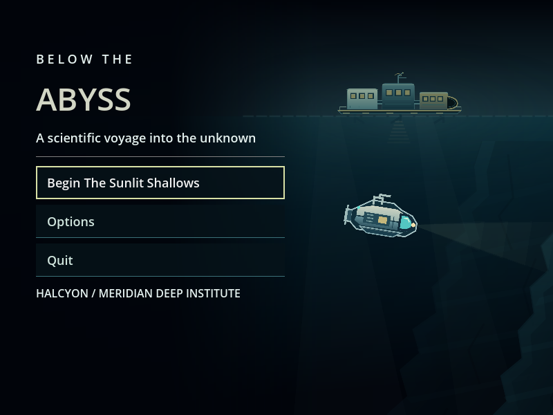
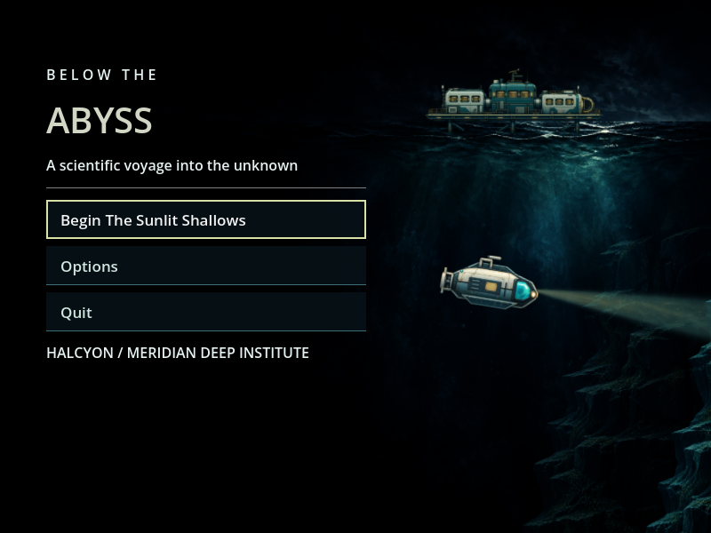

# Post-merge BTA-049 review revision

PR #32 was already merged as `8c1980e` before this revision request. These follow-up
changes are on the existing `bta-049-halcyon-descent` branch, not in its frozen merged
diff. No replacement PR or automatic merge was created.

- Central semantic typography across every production UI: Standard body/dialog
  buttons 16px, menu buttons 17px, headings 18–20px, HUD/mission 16px, secondary 14px.
  Compact remains distinct; Large remains 125%, without accumulated scaling.
- Centered, bounded, scrollable dialogs with visible underwater surroundings;
  preserved input/focus, pause, recovery, radio and accessibility behavior.
- Six detailed AI-generated illustrated assets shared between title and gameplay,
  with untouched PNG masters, hashes, provenance and licensing limits. No geometric
  substitute marketed as painted art; no claim of human artwork or final acceptance.
- All requested native before/after pages at 800×600 and 1280×800, with additional
  1920×1080 and 800×600 Large/High Contrast evidence. Separate normal-input chapter
  walkthrough, legacy routes, save/Continue coverage and Linux export verification.

[Current implementation, screenshots, manual review and limitations](https://github.com/zornscience/below-the-abyss/blob/bta-049-halcyon-descent/docs/testing/bta-049/revision/README.md)

| Before | After |
| --- | --- |
|  |  |

Completed locally: 587/587 GUT tests, 26,744 assertions, 246 parser checks,
import/startup, all canonical and legacy input routes, seven Python tests, native
menu/chapter captures, clean Linux export and extracted standalone smoke. Source
release: `e50dfd1df356695ad656accb74488c17c205df3c`. Exact commands and release
identity are linked from the revision record.
Local CI-equivalent verification is distinct from a hosted Actions result. The
existing workflow filters do not run for a push to an already merged PR branch.
Human art/usability approval, physical-controller and desktop-GPU review remain open.
