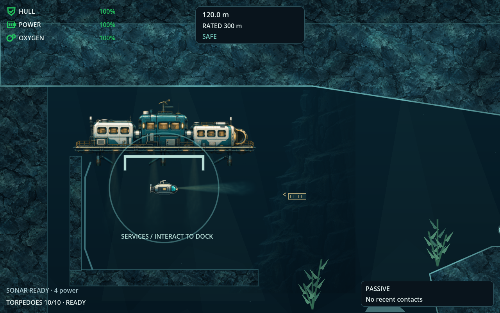
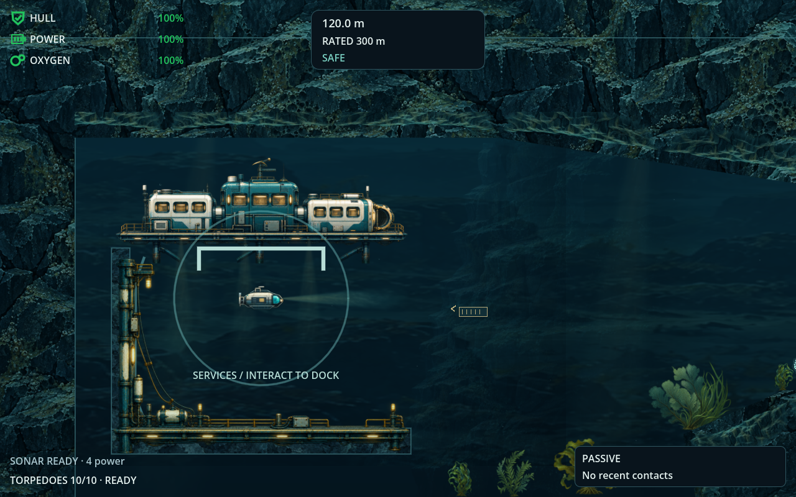

# BTA-050 — Sunlit Shallows environmental art

Based on main `8e13432`, merged PR #33. This is an art-only pass on the existing
canonical 0–200 m chapter. It adds no region, route, mission, discovery, choice,
resource rule or save field. [Changed files](changed-files.txt),
[exact verification](verification.txt), [asset inventory/provenance](../../../assets/art/sunlit/README.md).

## Implemented presentation

Seven detailed illustrated PNG masters replace the dominant geometric environmental
studies: four organic kelp variants, broad weathered basalt/mineral strata, a painted
ledge trim, distant shelf panorama, existing observer/predator fish presentation,
Halcyon service cradle and the existing emergency recording buoy. The original
Lantern-2, Halcyon module and searchlight masters remain unchanged and shared with
the title. The geometric plankton itself is unchanged, surrounded by an authored
kelp/mineral garden without exposing any further significance.

Two low-contrast parallax layers provide atmospheric depth behind the solid walls.
Painted material replaces the old canonical octave-noise rock pass. Ledge textures
are intersected with the actual current solid polygons; they cannot extend into
passages or leave painted rock over an excavated opening. Exact original outlines
remain angular where collision compatibility requires them. This is not a level
redesign or a claim that the graybox has new organic physics geometry.

Twenty-two plant placements use source-atlas anchors and varied silhouettes/heights.
They are nonsolid and do not create interactables. Support tests use existing polygon
data; unsupported plants disappear after excavation. Three dozen marine-snow/sediment
points and four small station bubbles use **two batched MultiMesh draws**, independent
of gameplay randomness. Subtle swaying/drift updates at most 15 times/second. Existing
comfort flags freeze motion/parallax, hide particles and remove supplementary shafts.
Baked illustrated lighting remains static. Cosmetic nodes opt out of physics
interpolation; player/camera interpolation is untouched.

Decorative polygon clipping is deferred until the canonical region is shown and
reused while its solid geometry is unchanged. Hidden title/prototype scenes do not
build these meshes. The bounded full-suite attempts exceeded the unchanged
600-second limit without an assertion failure; the first exposed this unnecessary
initialization work. The second still reached the time limit on this VM. A separate
complete direct-GUT run and its result are recorded in the verification report;
the final unchanged bounded CI command passed all 595 tests in 473.312 seconds.
Both failed attempts are retained alongside the successful run; the limit was not
raised. Hosted Actions status is reported separately from these local checks.

The existing scene-owned SunlitDressing owns the composition. Old procedural
atmosphere, long offscreen relief/garden command lists and their original materials
are restored for the legacy prototype. Canonical fish use a presentation-only flag;
movement, hearing, threat, collision, damage and scan behavior remain in their
existing components. The buoy still uses the same sonar/scanner/recording authority.

The default clear color now matches shallow water so large windows do not expose
a gray overscan band above the existing region; renderer/camera behavior is unchanged.

No new bodies, terrain shapes, navigation queries, camera rules, target locations,
input bindings, typography changes, acoustic emissions or persisted state. No
fullscreen postprocessing, screen reads, dynamic shadows, new renderer or dependency.

## Native before/after screenshots

These are actual Godot 4.6.3 Compatibility viewport readbacks, not generated concept
images or post-composited gameplay. Baseline is an isolated archive of merged main
`8e13432`; after uses this branch. Identical authored player coordinates, viewport
sizes and camera zoom are recorded in each capture manifest. The comparator requires
identical static-physics geometry SHA256 and allows only subpixel camera smoothing
variation (<0.5 px). Source camera and movement code are unchanged.

| Halcyon before | Halcyon after |
| --- | --- |
|  |  |

| View | Before 1280×800 | After 1280×800 | After reduced effects |
| --- | --- | --- | --- |
| Halcyon departure | [PNG](before/1280-normal-departure.png) | [PNG](after/1280-normal-departure.png) | [PNG](after/1280-reduced-departure.png) |
| Early exploration | [PNG](before/1280-normal-early-exploration.png) | [PNG](after/1280-normal-early-exploration.png) | [PNG](after/1280-reduced-early-exploration.png) |
| Kelp and seabed | [PNG](before/1280-normal-kelp-seabed.png) | [PNG](after/1280-normal-kelp-seabed.png) | [PNG](after/1280-reduced-kelp-seabed.png) |
| Geometric plankton | [PNG](before/1280-normal-plankton.png) | [PNG](after/1280-normal-plankton.png) | [PNG](after/1280-reduced-plankton.png) |
| Twin Spires | [PNG](before/1280-normal-twin-spires.png) | [PNG](after/1280-normal-twin-spires.png) | [PNG](after/1280-reduced-twin-spires.png) |
| Lantern-1 emergency buoy | [PNG](before/1280-normal-emergency-buoy.png) | [PNG](after/1280-normal-emergency-buoy.png) | [PNG](after/1280-reduced-emergency-buoy.png) |
| Return to Halcyon | [PNG](before/1280-normal-return-halcyon.png) | [PNG](after/1280-normal-return-halcyon.png) | [PNG](after/1280-reduced-return-halcyon.png) |

The same seven views also exist with `800-` and `1920-` prefixes under both
`before/` and `after/`, each in `normal` and `reduced` modes: **42 baseline + 42 after**
stills. Reduced mode combines existing Reduced Motion, Reduced Particles and softer
Effects flags; GUT checks their independent behavior too. Both modes mute audio and
retain all written gameplay information.

[Baseline still manifest](before/capture.json),
[after still manifest](after/capture.json),
[baseline raw profile](before/profile.json), [after raw profile](after/profile.json),
[baseline native log](before/native-runtime.txt), [after native log](after/native-runtime.txt).

The fixture stages positions and identification through existing APIs, resets
teleport interpolation and forces the existing camera to its authored pose, then
pauses simulation for each still. Zero-time depth updates keep depth labels current.
These images demonstrate composition, not a flown route, human comprehension or
pacing. The complete normal-input chapter is verified separately, with real physics,
resources, sonar/scanning, choice, return, station and debrief. No human participant
or physical gamepad session is fabricated. The thin environment-route fixture inherits
the unchanged chapter driver and forces native drawing only for evidence frames
(`--disable-render-loop`) on this software host. Input, simulation steps, UI and
assertions are unchanged. This sparse-rendered route is not a realtime performance
measurement; the independent live frame profiles use the normal render loop.

The completed native controller route records 76.13 simulation seconds, one choice,
one debrief claim, full hull, ten unused torpedoes and no excavations. Its ten
1280×800 screenshots: [title](route/observe-title.png),
[briefing](route/observe-briefing.png), [arrival](route/observe-arrival-observe.png),
[choice](route/observe-bloom-choice.png), [outcome](route/observe-bloom-outcome.png),
[buoy approach](route/observe-buoy-environment.png),
[Mara's recording](route/observe-maras-message.png),
[station return](route/observe-halcyon-return.png), [debrief](route/observe-debrief.png)
and [completion](route/observe-chapter-complete.png).
[Exact native command and runtime log](logs/native-chapter-route.txt).
The separate headless wrappers passed all 22 fresh/recovery launches across the
canonical and legacy routes. This is automated input evidence, not a human playtest.

## Performance method and costs

Actual MAIN is resumed for profiling, with no steering input and no fixed FPS.
Frame profiling and still captures are retained separately. The original profile
manifest camera-center field describes the pre-warm-up pose; it is not the final
comparison-still alignment. Fresh stills reset teleport interpolation explicitly.
Each of departure, plankton and Twin Spires is sampled at all three sizes in normal
and reduced mode: 20 warm-up process frames, then 60 frame-wall intervals. Median/p95
exclude screenshot readback. Draw calls, renderer objects, texture memory and
process/physics milliseconds are the final monitor snapshot, not GPU timestamps or
per-pass timings. The before/after runs use the same X11/Mesa llvmpipe software
renderer and two raster threads, with no competing Godot process.

Steady-state profile data predates the final hidden-mesh initialization deferral
and clear-color correction. Neither adds a steady-state draw or changes the sampled
visible composition. Final comparison stills include the clear-color correction.

The main identified rendering costs were the old per-fragment octave-noise geology,
150 individual motes and large cached procedural relief/garden command lists whose
bounds included offscreen regions. The new chapter uses one painted material sample,
two particle batches and cullable static illustration pieces. Raster masters/mipmaps
increase texture memory, and transparent background/trim/plant layers still incur
sampling and overdraw. Lower draw counts alone do not establish faster GPU frames.

Recorded comparisons are generated from the raw manifests in
[performance.md](performance.md). CPU, physics catch-up and shared-host variability
also affect these whole-application intervals. No per-shader GPU timing is available
from this driver. The modest-desktop-GPU **60 FPS target is not certified** by a
software-rendered cloud run; hardware profiling remains required. No resolution,
font, survival or physics setting is weakened to make an observation look faster.

## Automated results

- Complete GUT: **595/595**, 68 scripts, 27,027 assertions; final unchanged bounded
  runner passed in **473.312 seconds**. No skipped tests, failures or errors.
- Pinned engine/import, **250 parser checks**, startup smoke and **7/7 Python tests**.
- **22** headless input/recovery launches across canonical and legacy expeditions;
  one additional complete native controller route with ten screenshots.
- **84** staged comparison stills with exact geometry/pose/camera matches and
  **18** live frame/draw/memory comparisons. No human/target-GPU acceptance claim.
- Clean Linux release **e30cbf3aa862** exported and extracted standalone smoke
  passed; default telemetry remains off. Exact commands, checksum and initial
  timeout history: [verification record](verification.txt). Hosted Actions status remains unverified
  until a pull request can be submitted through the currently blocked GitHub API.

## Reproducible verification

Godot `4.6.3.stable.official.7d41c59c4`, GUT 9.6.1, Compatibility renderer and existing
checksum-pinned Linux templates. Set writable XDG paths as documented in the root
README. From repository root:

```sh
godot --path .
python3 tools/validate_godot.py
python3 tools/run_tests.py
python3 tools/verify_sunlit_shallows.py
python3 tools/verify_revision_two.py
python3 tools/verify_expanded_expedition.py
python3 tools/verify_story_choice.py
python3 -m unittest discover -s tests/python -v
# Native display required; run alone for frame observations:
python3 tools/capture_sunlit_environment.py --output docs/testing/bta-050/after \
  --baseline docs/testing/bta-050/before
# Quick visual preview (no performance samples):
python3 tools/capture_sunlit_environment.py --preview --output /tmp/bta050-preview
# Normal-input native complete route, source fixture uses fresh isolated profile:
mkdir -p /tmp/bta050-route
BTA_EVIDENCE_DIR=/tmp/bta050-route godot --path . --audio-driver Dummy \
  --rendering-method gl_compatibility --disable-render-loop --fixed-fps 60 \
  --script res://tests/fixtures/drive_sunlit_environment.gd --quit-after 24000 -- \
  --profile=bta050-review-route --outcome=observe --input=controller
# Clean committed source:
python3 tools/build_playtest.py
python3 tools/smoke_playtest.py build/below-the-abyss-playtest-linux-<build-id>.zip \
  --log build/playtest/standalone-smoke.log
```

The cloud display uses `DISPLAY=:98 LIBGL_ALWAYS_SOFTWARE=1 LP_NUM_THREADS=2` and
an existing dummy Xorg configuration; no desktop package was added. Its unsupported
VSync warning is retained. The capture runner rejects errors, missing shots, wrong
PNG sizes, physics-interpolation warnings, leaks and geometry/camera mismatches.
It uses a separate 900-second native profiling bound; existing CI test limits remain.

Baseline reproduction: archive `8e13432`'s `project.godot`, `assets`, `resources`,
`scripts`, `scenes` into an isolated directory; copy the capture fixture under
`tests/fixtures`, import that project and pass `--project <archive-directory>` to
the same wrapper. Never overwrite the current runtime to generate a baseline.

## Manual route and acceptance

1. Launch from a disposable profile, choose Begin, accept the existing briefing.
   At Halcyon compare module materials, deck/support, umbilicals, lamps and Lantern-2.
   UI typography, focus and controller recovery must match PR #33.
2. Depart east through the original clear passage. Inspect varied kelp holdfasts,
   lower-contrast distant shelves and foreground rock contours. Vegetation/fittings
   remain nonsolid; actual walls must remain visually distinguishable from haze.
3. Approach the plankton without firing weapons. Its original spiral/scatter,
   sonar identification and exclusive observe/collect interaction remain unchanged.
   Both choices retain existing nonnumeric feedback and allow completion.
4. Continue through the upper passage to Twin Spires and the emergency buoy. Verify
   the positions/range thresholds and real hull clearance are unchanged. Ping, approach
   and intentionally scan the buoy; the same Mara recording, log and return objective
   appear. Decorative minerals/plants add no new discovery or reward.
5. Return west, slow down and dock intentionally. Services, technology, research,
   map/logs and debrief retain their controls and effects. Save/quit/Continue and
   restart keep permanent discoveries, research, choices, talents and claims.
6. With a separate test profile, excavate an existing allowed shelf surface. Trim
   must follow the cut; unsupported plants vanish. No painted rock may mask the new
   passage, and protected geometry remains protected. No new weapon behavior.
7. Toggle each comfort option independently; combine them; test 800×600, 1280×800,
   1920×1080, Large Text, High Contrast and muted audio. Motion/parallax freeze,
   particles hide and extra shafts disappear as selected; gameplay never depends
   on these effects. Pause/resume must not move the player or advance survival.
8. Enter the legacy prototype intentionally. Its previous materials/scenery return,
   with all earlier data intact. Re-enter the canonical chapter and inspect the
   same authored art placements. No general save or campaign rewrite is involved.

## Known limits

This is a substantial illustrated pass for review, **not a claim of final human art
acceptance**. Generated PNGs do not provide editable human-painted source layers.
Atlas gutters/alpha edges, repetition and native-scale fauna need human review and
possible retouching; licensing is pending. Hard geometric silhouettes remain where
exact physics preservation requires them. Background depth/illumination is illustrative,
not dynamic occlusion, visibility gameplay or a light-toggle system.

Other regions/legacy outer-course art remain their prior studies. The Twilight Shelf,
new missions/choices/upgrades/mechanics and later lore are not implemented. Human
navigation/readability/comfort review, desktop-GPU performance and platform/device
trials remain external acceptance gates. Automated test results are reported separately.

## Acceptance evidence mapping

| Requirement | Evidence |
| --- | --- |
| Illustrated kelp, geology, station, fauna, bloom surroundings and buoy area | Seven asset masters/manifest; seven same-pose viewpoints across three window sizes |
| Exact solid geometry and unchanged camera/navigation | Matching baseline/after terrain hashes, player coordinates, camera centers and zoom; existing region/navigation tests |
| Decorative ownership and excavation correctness | New GUT checks for zero bodies/targets, trim containment/removal, lost plant support and state/velocity isolation |
| Comfort and pause behavior | Independent flag, paused clock, bounded batch and 30/60/120-step tests; normal/reduced native captures |
| Existing UI/story/resources/saves | Existing complete GUT and integration routes, separate-process Continue, normal-input chapter; no schema/domain changes |
| Version/renderer and packaging | Pinned import/parser/startup, native Compatibility captures and clean Linux export smoke |
| Measured costs and honest limits | 18 unfiltered frame/draw/memory comparisons and raw logs; no human/GPU acceptance claim |
