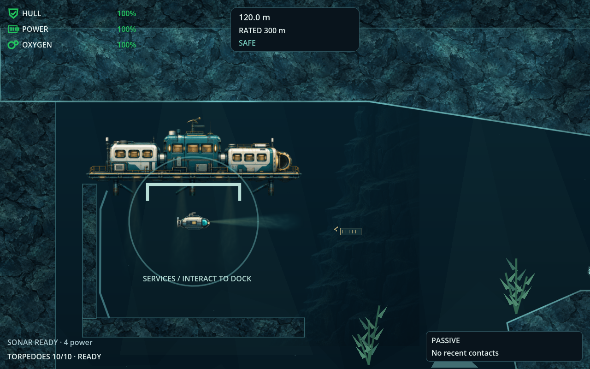
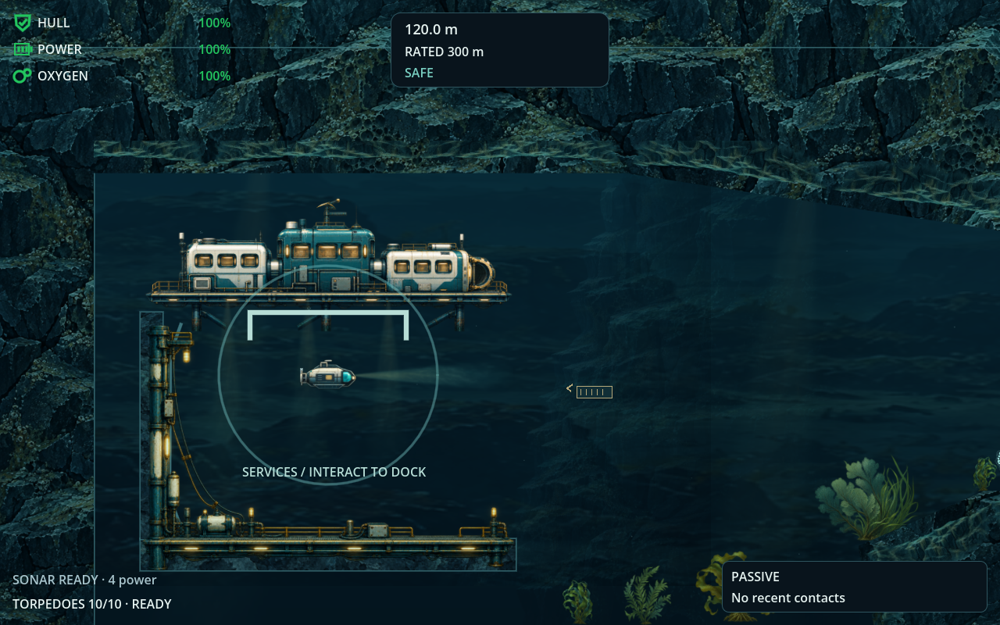
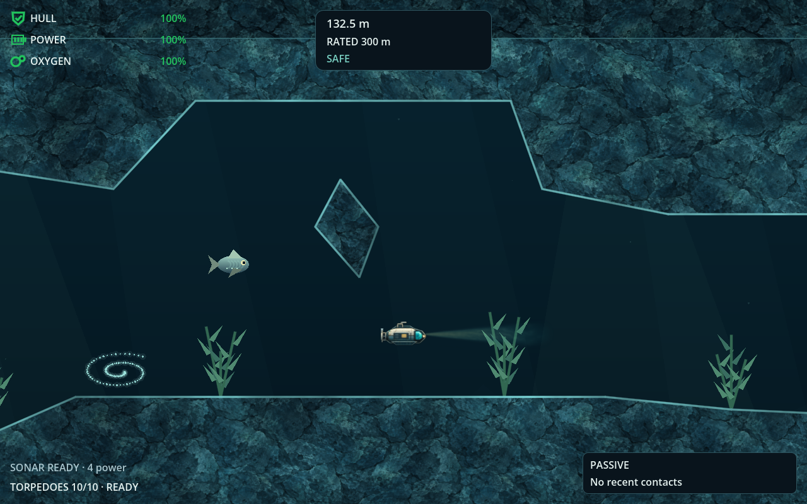
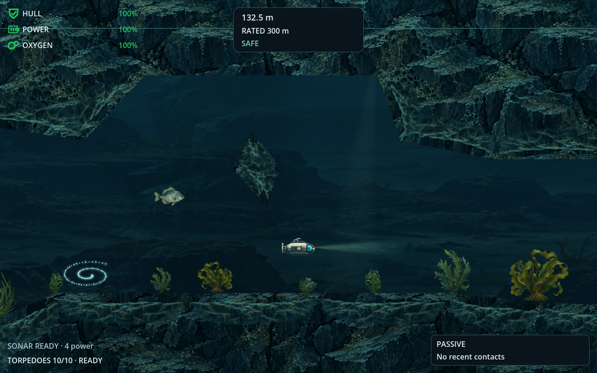
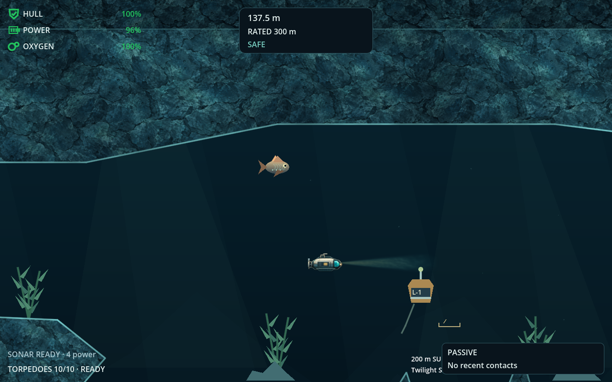
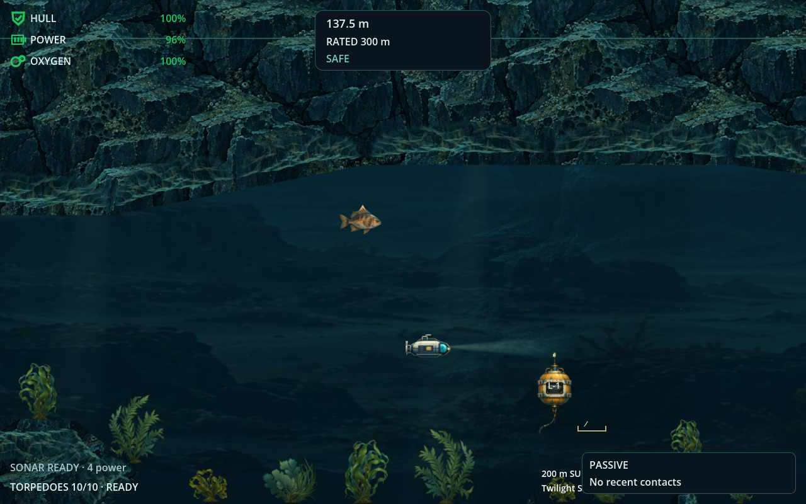

## Summary

The playable Sunlit Shallows still used geometric environmental studies after the title artwork pass. This focused art-only change adds seven original illustrated masters for kelp, basalt, ledges, distant shelf, existing fish, Halcyon support infrastructure and the emergency buoy. It shares the established Lantern-2/Halcyon palette and preserves the original solid geometry, camera, routes, target locations, controls, progression and save format.

- Scene-owned decorative composition, two subtle parallax layers, mipmapped material/ledge textures clipped inside actual rock, and two bounded particle batches.
- Existing excavation removes stale trim immediately and hides unsupported vegetation; title/prototype restores the previous materials and scenery. Hidden scenes defer expensive mesh construction.
- Existing Reduced Motion, Reduced Particles and softer Effects preferences remain independent. No new dependency, region, mission, choice, upgrade or mechanic.
- Artwork provenance, dimensions, source hashes, import settings, limitations and reuse workflow are recorded. These are AI-generated raster masters, not claimed human-painted source layers or newly licensed media.

## Evidence and verification

See [implementation, acceptance mapping and manual route](https://github.com/zornscience/below-the-abyss/blob/bta-050-sunlit-environment-art/docs/testing/bta-050/README.md), [exact commands/results](https://github.com/zornscience/below-the-abyss/blob/bta-050-sunlit-environment-art/docs/testing/bta-050/verification.txt), [changed files](https://github.com/zornscience/below-the-abyss/blob/bta-050-sunlit-environment-art/docs/testing/bta-050/changed-files.txt), [asset inventory](https://github.com/zornscience/below-the-abyss/blob/bta-050-sunlit-environment-art/assets/art/sunlit/README.md) and [all performance measurements](https://github.com/zornscience/below-the-abyss/blob/bta-050-sunlit-environment-art/docs/testing/bta-050/performance.md).

- Final unchanged bounded GUT command: **595/595**, 68 scripts, 27,027 assertions, **473.312 seconds** (600-second limit unchanged). Direct full run also passed 595/595 in 498.2 seconds. Two earlier timeouts are retained transparently.
- Exact Godot 4.6.3, import, **250 parser checks**, startup smoke and **7/7 Python tests**.
- **22 headless input/recovery launches**, both choices/devices and legacy routes; complete normal-effects native controller route, muted, no combat, ten screenshots.
- **84 native comparison stills** and **18 live before/after profiles**.
- Linux packaging/standalone evidence is linked in the verification record. Hosted Actions status is unverified until the API permits PR submission.

### Actual native comparison — 1280×800

| Main / before | Branch / after |
| --- | --- |
|  |  |
|  |  |
|  |  |

The report links all 84 actual Godot stills (seven identical viewpoints × three resolutions × two comfort modes × before/after) and separate real-input route evidence. Exact terrain fingerprints, player positions, camera centers and zoom match across comparison stills. Staged screenshots are explicitly distinguished from flown routes.

## Performance and remaining acceptance limits

This VM uses Mesa llvmpipe software rendering. Draw calls decreased, but measured frame times generally regressed and texture memory increased by about 52 MiB. All 18 unfiltered comparisons, including regressions, are retained. For example, 1280 normal departure changed from 179.49/320.97 ms median/p95, 566 draws and 54.09 MiB to 180.66/216.66 ms, 288 draws and 106.09 MiB. This is **not** a claim of 60 FPS on a modest desktop GPU; target-hardware profiling remains required.

Automated input, screenshot inspection and GUT coverage are not human playtest/art acceptance. Native-scale readability, material repetition/alpha edges, licensing and editable production source layers need human review. Exact pre-existing angular collision silhouettes remain; decoration does not invent passages. No save schema or migration changes.

## Manual playtest

Begin the existing canonical chapter; depart Halcyon east; inspect the original upper passages, kelp and basalt; observe or collect the light bloom without combat; continue to Twin Spires; ping, approach and scan the emergency buoy; return and intentionally dock/debrief. Repeat with keyboard/controller, muted audio, individual/combined comfort options and 800×600/1280×800/1920×1080. Check settings/menu focus and save/Continue. In a disposable profile, verify existing permitted excavation removes the painted trim. Enter prototype access and verify prior presentation returns. Full steps and acceptance map are in the report.

Please review; do not merge automatically.
