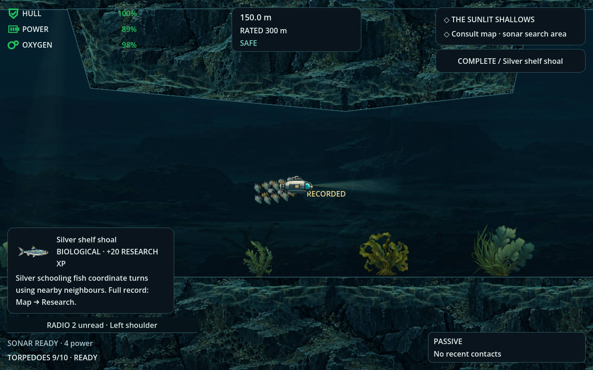
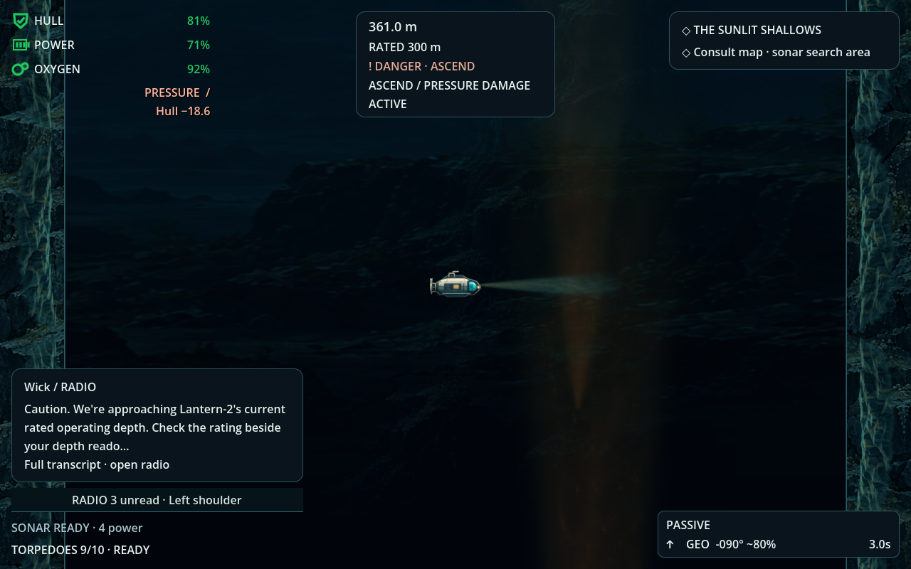

## Expanded first expedition

The canonical Sunlit Shallows now extends through a winding shallow survey course
with optional studies and a clearly warned hydrothermal shaft. Players consult an
approximate buoy report, clear a thick physical rockfall with three well-placed excavation torpedoes,
identify the hidden buoy only when an active-sonar wavefront reaches it, recover
Mara's unchanged recording and return to Halcyon. Both bloom choices work; no
wildlife combat or new chapter is required.

- Six batched illustrated schools (48 fish, three species records), eight new
  scientific studies and pictured, nonblocking scan notifications.
- Unique species/study records earn data-driven 20/30 XP; each 100 adds a research
  point, capped at two bonus points. Existing station assignment/refund/respec works.
- Schema 7 stores credited/imported IDs in the existing atomic expedition
  checkpoint. Versions 1–6 retain all progress/ranks/choices/cuts; historical records
  get no retroactive XP. Failed writes cannot grant a partial award. No extra save file.
- Original raster masters are unchanged. Hot scanner queries reuse immutable
  definitions; clipped rock meshes are cached and invalidated per changed surface;
  canonical decorations are lazy and wildlife is bounded/batched/viewport-aware.
- The legacy expedition remains playable with its original finite awards and
  unrelated wreck. Its distant markers stay out of the canonical map without
  deleting old discoveries. No Zone 2, new Resonance decision, mission or spoiler.

## Review material

[Implementation, full manual route, acceptance mapping and native gallery](https://github.com/zornscience/below-the-abyss/blob/bta-051-expanded-sunlit-shallows/docs/testing/bta-051/README.md)
· [Changed files](https://github.com/zornscience/below-the-abyss/blob/bta-051-expanded-sunlit-shallows/docs/testing/bta-051/changed-files.txt)
· [Save migration / APIs / decisions](https://github.com/zornscience/below-the-abyss/blob/bta-051-expanded-sunlit-shallows/docs/decisions/bta-051-expanded-shallows.md)
· [Measured performance / Fedora-NVIDIA reproduction](https://github.com/zornscience/below-the-abyss/blob/bta-051-expanded-sunlit-shallows/docs/testing/bta-051/performance.md)
· [Exact verification](https://github.com/zornscience/below-the-abyss/blob/bta-051-expanded-sunlit-shallows/docs/testing/bta-051/verification.txt)
· [Artwork inventory/provenance](https://github.com/zornscience/below-the-abyss/blob/bta-051-expanded-sunlit-shallows/assets/art/sunlit/README.md).

The gallery includes actual Godot 800×600, 1280×800 and 1920×1080 readbacks,
normal/reduced modes, plus 800×600 Large Text/High Contrast. Map, rockfall before/after,
vent margin/damage, fish/scan image, travelling sonar/first echo, XP assignment and
debrief are covered. Staged before/after presentation probes are explicitly separate
from complete input-driven routes. No generated concept image is labelled gameplay.

## Validation

- Pinned Godot 4.6.3: import, 267 authored script parser checks and startup pass;
  final changed scripts rechecked separately.
- Full GUT: **624/624**, **38,364 assertions**, **497.941 s**, no skips/errors.
  Final map/legacy/Large Text compatibility changes also pass 33 affected tests,
  with the last clamped-pan regression checked separately (1 test, 14 assertions).
- All 12 canonical keyboard/controller fresh/Continue/mid-buoy launches pass;
  both bloom outcomes remain exclusive and replay-safe. The extended observer
  route tests empty ammunition/rearm, insufficient energy/refill, all new studies,
  pressure/ascent, missed ping, recovery and return. Eight older bloom/Continue
  runs and both legacy expedition drivers pass. Python tooling tests: 7/7.
- Native complete observer route: 803.75 active vessel seconds / 288.927 wall seconds,
  260 XP, 11 valid launches including the ammunition test; no wildlife required.
  Final native 800×600 Large Text/High Contrast collect route: 608.05 active vessel
  seconds / 259.617 wall seconds, 240 XP, two bonus points and real station assignment.
- Clean-checkout Linux release export and extracted-package smoke **pass**, source
  `63bf6aacd842`, default telemetry OFF; raw logs and manifest are retained.
- Controlled scanner workload: **244.864 → 47.065 ms / 1000 calls (80.8% lower)**.
  **Whole-frame median regresses in 16/18 shared views on llvmpipe**, and texture
  allocation rises about **8.54 MiB**. Rendering improvement/60 FPS is not accepted;
  retain the full table and obtain target-hardware profiling. See verification.txt
  and the performance report. Hosted Actions status must be reviewed on this PR;
  local checks alone are not a claim of hosted CI success.

The first bounded GUT attempt hit 600 seconds and exposed obsolete map assertions;
a second run was stopped to correct the remaining old fixture. Those logs are
retained alongside the successful run. No test was removed/disabled. The expanded
suite now has a 900-second guard and the longer CI job a 40-minute budget.

## Manual review

Begin → open map/report → ping and study/collect bloom → face/fire at fractured
passage → scan shoal/terrace (optional arch, other species and vent) → search circle,
ping and wait for actual buoy echo → approach/scan → read Mara → return/dock/debrief
→ assign XP-earned talent points → quit/Continue. Repeat with the other choice.
At the vent, respect the actual fitted rating; ascent stops damage. With no ammo,
return west for intentional docking/rearm. Use Pause → Continue for the last safe
checkpoint on depletion; no new game-over architecture is introduced.

Human first-time **15–20 minute pacing**, comprehension, physical-gamepad usability,
art approval and modest-GPU **60 FPS** remain unverified acceptance targets.
Software llvmpipe samples do not certify target-hardware performance. The new fish
atlas is AI-generated, subject thumbnails are offline Godot renders, and project
licensing remains pending. The overview needs zoom/pan for local geography at small
resolutions. No automatic merge.

## PR #35 review revision

Additional loop/alcove, interlocking passages and collision-matched jagged basalt;
a three-shot rough cave-in; illustrated eel/turtle plus optional warned, escapable
hammerhead head ram; richer bounded underwater impact/bubble effects; radio arrival
sound and swimming bloom. New Game confirms, archives expedition plus legacy stores,
and starts fresh while preserving preferences. Schema 7 and permanent stable IDs
remain compatible, including an already-cleared pre-revision gate.

[Final review route, native gallery, commands, test results, asset provenance and
archive limitations](https://github.com/zornscience/below-the-abyss/blob/bta-051-expanded-sunlit-shallows/docs/testing/bta-051/revision/README.md).
No additional PR or automatic merge. Hosted CI status must be checked on GitHub;
local evidence is labeled separately.

Latest local acceptance: **641/641 GUT tests, 41,217 assertions, no skips/errors**;
engine pin/import/271 parsers/startup; 12 canonical fresh/Continue launches; legacy
expanded and revised routes; 8 bloom choice/Continue launches; 7 Python tests;
clean Linux release export and extracted standalone smoke. Both native complete
chapter routes pass (controller/observe/1280×800, keyboard/collect/800×600 Large Text,
High Contrast, comfort and mute), with 74 retained native walkthrough screenshots.
All three sizes/modes also pass the 66-view / 36-live-sample Compatibility probe.

The [revision gallery and performance report](https://github.com/zornscience/below-the-abyss/blob/bta-051-expanded-sunlit-shallows/docs/testing/bta-051/revision/README.md)
include new-game confirmation, three-shot excavation, rough passages, turtle/eel,
warning → head ram → safe retreat, buoy return and debrief. Human art/controller/
audio evaluation and target-GPU 60 FPS remain unverified. Campaign archiving has
reported-I/O rollback and preserves originals, but is not a multi-file power-loss
transaction and has no in-game archive-restore selector. No automatic merge.
