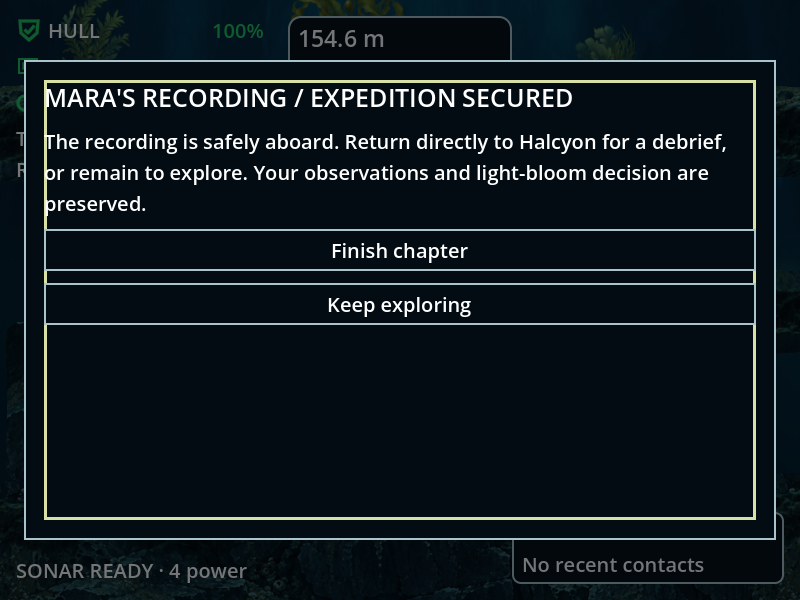
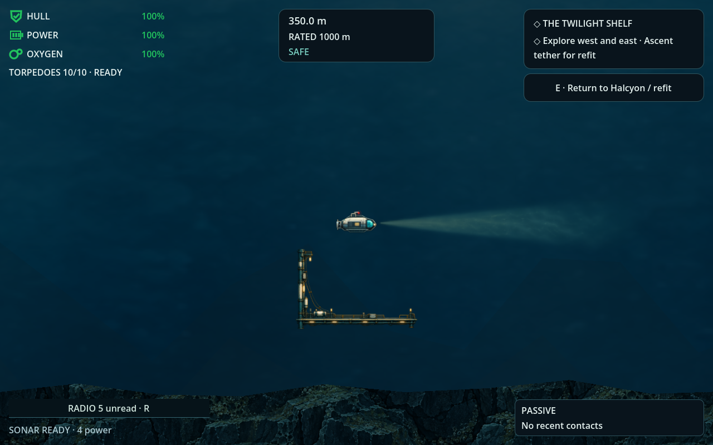

# BTA-053: Chapter handoff and deep Twilight Shelf foundation

Players can now finish the first expedition after securing Mara's buoy recording
and resolving the bloom, instead of swimming all the way home. Keep Exploring and
the original manual return/debrief remain. Finishing uses the existing mission
claim and atomic checkpoint, so neither route can repeat its acknowledgement.

This delivers **step 1** of the approved Twilight Shelf plan: an explicitly labelled
exploration preview, not the finished 30–45-minute second story chapter.

- Commission Lantern-2 fully supplied at **350 m**, without the surface or Halcyon
  exterior in view. An authored free **1,000 m pressure fit** retains paid hull
  margins without stacking or using research points.
- Explore interconnected west/east and lower loops in a collision-validated textured
  graybox. No kill, excavation or extra upgrade is required.
- Deliberately return through the central ascent tether, use existing station
  services/free research reassignment, then resume at the deep pocket. Merely passing
  the tether does nothing. Ordinary Continue retains actual depleted supplies/pose.
- Preserve mission/research/discovery/story IDs, finite research allocations,
  Resonance, torpedoes, acoustic history semantics and explicit prototype access.
- Cover transitions until the existing camera settles, and prevent a decorative
  rebuild coroutine from outliving its removed scene.

## Saves

Schema **9**, within the same expedition file. Versions **1–8** migrate to Sunlit /
uncommissioned state; old progress and files remain. Strictly validated phase and
monotonic commissioning use existing atomic writes/backup/recovery. Restore emits
no new choices/claims. Failed writes retain live resources/pose/progress. A recovered
deep checkpoint offers the correct Continue instead of a fresh shallow departure.
No new independent store, renamed stable ID, or fake Twilight mission ledger.

## Evidence and verification

- Complete GUT suite: **686/686**, **42,721 assertions**, 559.381 s.
- Existing canonical chapter matrix: **12/12 processes**, both outcomes/devices and
  completed/mid-expedition recovery; legacy routes/story-choice checks and **7/7**
  Python tests pass.
- Actual native keyboard/Observe and controller/Collect fresh + separate-process
  Continue/refit/resume routes pass, including **800×600 Large Text, High Contrast,
  reduced presentation and mute**. No shots required, no repeated choice/claim.
- Final import/parser/startup, four-process headless handoff and clean Linux export
  evidence is listed in the linked release report. Hosted Actions is reported
  separately; local results are not described as a hosted CI run.

[Commands, manual route, limits, acceptance mapping, screenshots and logs](https://github.com/zornscience/below-the-abyss/blob/bta-053-chapter-handoff/docs/testing/bta-053/README.md)
· [Release results](https://github.com/zornscience/below-the-abyss/blob/bta-053-chapter-handoff/docs/testing/bta-053/release-results.md)
· [Changed files](https://github.com/zornscience/below-the-abyss/blob/bta-053-chapter-handoff/docs/testing/bta-053/changed-files.txt)
· [Approved design / later delivery steps](https://github.com/zornscience/below-the-abyss/blob/bta-053-chapter-handoff/docs/design/twilight-shelf.md)

| Buoy choice, controller / 800×600 | Deep deployment, keyboard / 1280×800 |
| --- | --- |
|  |  |

Manual route: resolve either bloom choice → recover buoy → Interact → Keep exploring
→ Interact/expedition-log Finish chapter → debrief → Twilight exploration preview →
commission → explore left/right loops → save depleted supplies → quit/Continue →
central tether → Stay/Return to Halcyon → Research technology/refit → Resume.

## Scope and limitations

No new sentinel, wreck investigation, Mara field logs, glyph, story choices/rewards,
region artwork, economy, or full Chapter 2 narrative. This foundation must be reviewed
before those separate steps. The public deep map shows bounds/tether/player but no
fake discoveries. Original assets are reused with unchanged provenance.

Native captures use software-rendered Godot and simulated input through normal
handlers. They are not human playtests, physical-controller approval, GPU benchmarks,
or a claim of 30–45-minute pacing. Human navigation/comprehension and art review remain.

Review only. **Do not merge automatically.**
