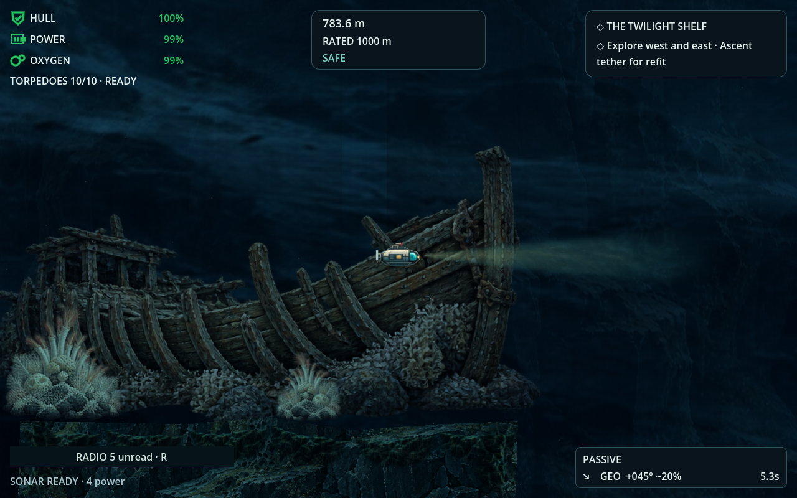
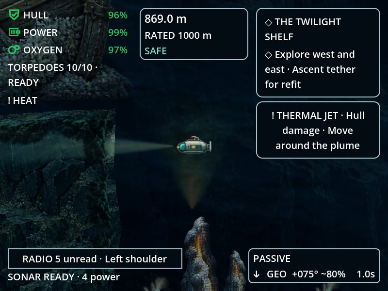

# BTA-054: Twilight Shelf details, wildlife and erupting vents

The deep exploration foundation now has a readable illustrated environment, natural
wildlife and an avoidable hull hazard beyond depth pressure. Players can explore
historic wreck scenery and mineral gardens, watch eel/squid/jelly NPCs investigate
eligible pings, and wait out or bypass erupting hydrothermal jets.

- Three original illustrated masters: horizon-free deep water, wreck/vent/garden
  atlas and animated fauna atlas. Shared basalt edge art follows the existing
  passage geometry. Prototype ridges stay hidden in both canonical regions and
  restore in explicit prototype mode.
- Two configurable thermal vents: 8 s quiet → **4 s warning** → **3 s eruption** →
  5 s cooling. Damage uses the existing hull API at **4 hull/s**, at most **12 per
  eruption**, only while exposed. Terrain blocks heat; a clear upper bypass remains.
- Existing collision-safe acoustic AI and dispatcher, deterministic time integration,
  passive geological ambience, pause/reset and mute/comfort behavior. No required
  combat; native routes fire zero torpedoes. Existing NPC blast damage still works.
- One contextual HUD warning and a compact heat-hit cue; no added world helper text.
  The 800×600 Large Text objective-panel reflow no longer blanks its labels.

## Compatibility and scope

Schema **9** remains unchanged. Hull damage uses the existing atomic checkpoint;
Continue preserves actual supplies/records, while temporary ecology restarts with
quiet arrival. Hot-jet saves are rejected. Historical poses inside a new chimney
use the existing safe-spawn fallback without healing or erasing progress.

This is environmental detail/wildlife/hazards, not the complete second-chapter
narrative. The whaler is background archaeology, **not Lantern-1**. No glyph, Mara
log, sentinel decision, reward, currency, new region or independent save store.

## Verification and review

- Full GUT suite: **705/705**, **42,960 assertions**, 545.394 s.
- Import, **295** parser checks and startup passed.
- New four-process headless hazard/Continue/refit matrix passed on both input devices.
- Final native keyboard/1280 and controller/800 Large Text/High Contrast/comfort
  walkthroughs passed, including safe bypass, actual heat damage, pause, sonar
  reaction, save/Continue and station refit. Both are muted and fire zero torpedoes.
- Existing expanded/revised expeditions, eight story-choice processes, four chapter
  handoff processes and the **12-process canonical Sunlit matrix** passed. The
  extended controller route retained its original 300-second budget (261.837 s).
- **7/7 Python tests**, clean Linux export and packaged standalone smoke passed.
  Exact source/hash, diagnostic timing notes and raw logs are in the release report.
- These are local results. Hosted GitHub Actions status and human review remain
  separate; no human playtest or physical-controller claim.

[Full evidence, tuning, acceptance and manual route](https://github.com/zornscience/below-the-abyss/blob/bta-054-twilight-environment/docs/testing/bta-054/README.md)
· [Changed files](https://github.com/zornscience/below-the-abyss/blob/bta-054-twilight-environment/docs/testing/bta-054/changed-files.txt)
· [Asset provenance/workflow](https://github.com/zornscience/below-the-abyss/blob/bta-054-twilight-environment/assets/art/twilight/README.md)

Manual route: finish buoy chapter → deploy at 350 m → west eel/wreck gallery →
west lower vent → observe warning from safe side → deliberately enter a jet →
pause/resume/escape → lower squid and active ping → east gully jelly → tether save
→ quit/Continue → Halcyon refit → resume. Repeat with mute and comfort settings.

No human playtest, physical gamepad approval, audible-mix approval or target-GPU
60 FPS claim. Screenshots are actual Godot Compatibility output on Mesa llvmpipe;
on-demand capture is not a real-time benchmark. Art quality remains a human review.
Generated masters and limitations are documented; no new licensing claim.

Review only; **do not merge automatically**.
