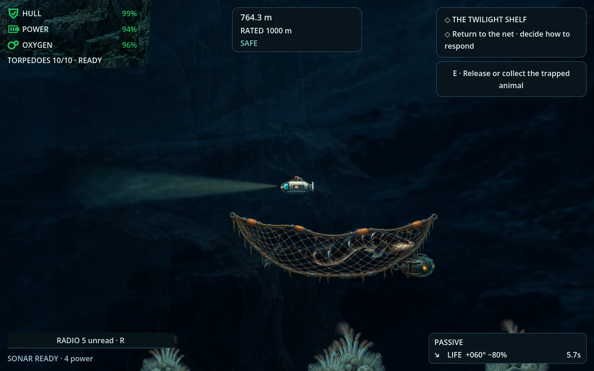
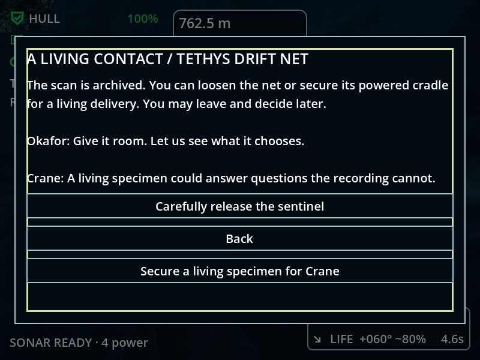

# BTA-055: Twilight Shelf expedition and narrative

The Twilight Shelf now connects the illustrated environment to a playable investigation:
follow severed cables, recover Mara's first field log, record the whaler's untranslated
marking and resolve a trapped luminous sentinel encounter. West-first and east-first
approaches work; two extra field loggers are optional. Return through the existing
ascent tether, refit and intentionally archive the Halcyon debrief.

**Base:** BTA-054 is now merged as PR #38 (main `55d1769`). Implementation began
on its source `838a862`; this PR contains only BTA-055 changes and targets main.
Do not merge automatically.

- Reuse scientific scanning, sonar wavefront discovery, temporary passive contacts,
  MissionService, StoryState, existing acoustic creature/navigation and shared UI.
- Release/capture take six simulation seconds, can be cancelled and pause correctly.
  Capture requires confirmation and living delivery. Killing the animal records a
  loss, never a live specimen, and leaves the main evidence route completable.
- Choice +/-15 hidden Resonance; future-guide/wary/loss flags, no numeric score.
- Atomic one-time 2-RP debrief; captured living delivery adds 1 RP and a unique
  additive +100 sonar range, preserving ping cost/cooldown and paid talents.
- Schema 10, same twelve fields/checkpoint file. Versions 1–9 and 2/5/6 mission
  catalogues preserve their records. No new save file/ledger/economy/dispatcher.
- Original illustrated sentinel and net masters with provenance, comfort-aware
  motion, quieter curved cable and existing compact responsive dialogs.
- Region-only resource budget supports a conservative 45-minute continuous-thrust
  model with ten pings and >25% battery/oxygen reserve; no refill on Continue.

[Implementation, exact commands and manual route](https://github.com/zornscience/below-the-abyss/blob/bta-055-twilight-expedition/docs/testing/bta-055/README.md)
· [BTA-055-only changed files](https://github.com/zornscience/below-the-abyss/blob/bta-055-twilight-expedition/docs/testing/bta-055/changed-files.txt)
· [Artwork provenance](https://github.com/zornscience/below-the-abyss/blob/bta-055-twilight-expedition/assets/art/twilight/sentinel-provenance.json)

Local verification passed: **727/727 GUT tests**, **43,271 assertions**, import,
**301 parser checks**, startup, all previous walkthroughs, the new four-process
headless chapter matrix, four native fresh/Continue processes, **7/7 Python tests**,
clean Linux export and packaged standalone smoke. Raw logs, save-compatibility notes,
exact commands and native gallery are in the linked report. Hosted CI and human
acceptance are reported separately.

**Pacing limit:** the 30–45-minute main expedition is a novice-human target. Final
experienced native routes took 252.5 seconds keyboard and 343.2 seconds controller,
without torpedoes. Those are not human playtests. Final measured values and native
captures are retained honestly; human comprehension, pacing and visual acceptance
remain open review gates. No artificial delays pad the route.

No Drowned Caves gameplay, glyph translation, Mara-fate/Choir/Crane-secret reveal,
ending, campaign-wide economic redesign or combat framework. The whaler is not
Lantern-1. New logs/dialogue are authored adaptations of the Bible, not quotations.
