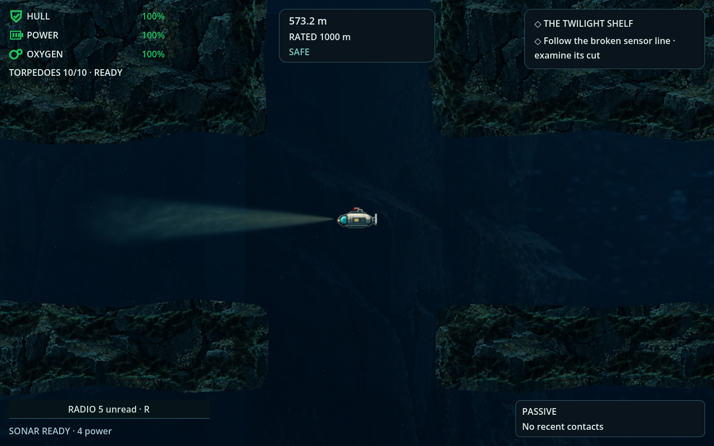
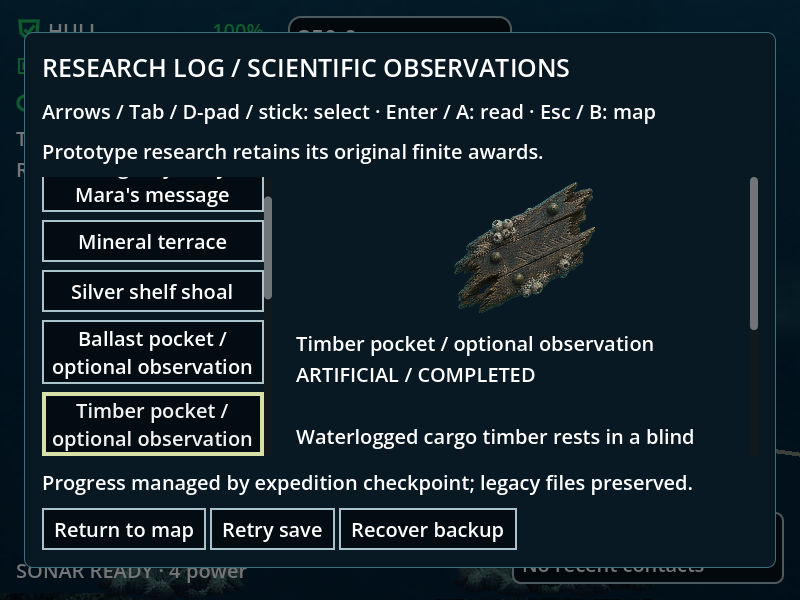

# BTA-056: Twilight Shelf Exploration and Pacing Polish

The Twilight expedition had two large outer loops but little reason to investigate
its central rock or compare minor evidence. This adds an interconnected inner
survey gallery with two reversible blind pockets, an intermediate cable anchor
and a cool-side thermal observation. All four records remain optional; required
scan anchors, both sentinel choices, rewards and the Halcyon return/debrief remain
unchanged. West-side guidance now acknowledges a west-first pilot.

An unobstructed approach queues one contextual hint about the actual trapped
animal; it creates no duplicate NPC, sound event, discovery or reward.
A new illustrated subject atlas replaces generic record plates and the provisional
scratch line. Completed research records show their matching image inside the
scrollable detail pane; hidden entries stay hidden. Existing typography/focus and
comfort controls are retained.

Same schema 10 checkpoint/backup/recovery, same mission ledger, old stable IDs and
migration from versions 1–9. Four optional IDs extend validated research/discovery
catalogues; older binaries can reject newly recorded IDs, so retain backups and continue
with this or newer builds. No independently saved state, new mission, extra allowance,
Zone 3, translation, new economy, gameplay physics or resource/talent balancing.

Verification, native screenshots, changed files, manual route and honest pacing
limitations: [BTA-056 review evidence](https://github.com/zornscience/below-the-abyss/blob/bta-056-twilight-polish/docs/testing/bta-056/README.md).

The 30–45-minute human main-expedition target remains **unverified**. Automated steering
knows every coordinate and does not read; optional circuit and required-expedition timings
are reported separately, without wait padding. No physical controller, modest GPU or
human art acceptance claim. Review only; do not merge automatically.

## Local verification

- Godot 4.6.3 / GUT 9.6.1: **735/735 tests, 44,736 assertions**, no failures/errors/skips.
- Import, **304 parser checks** plus the modified fixture follow-up, and startup passed.
- All previous input matrices passed, including all **12 canonical Sunlit processes**.
- New optional survey: **4/4** keyboard/controller fresh/Continue. Native: **4/4**
  at 1280×800 normal and 800×600 Large Text/High Contrast/reduced presentation/muted.
- Two actual prior BTA-055 profile copies restored with no reward/choice replay.
- Python tooling **7/7**; clean Linux export and extracted standalone smoke passed.

Two verification expectations were corrected without changing gameplay: only the
all-studies/recovery controller scenario gets a 480s budget (others remain 300s),
and the habitat fixture permits the four new optional sonar discoveries while
requiring prior discoveries and exact research/mission/upgrade records to survive.
The initial failures and complete passing reruns are retained in the results.

[Exact results, source identity and raw logs](https://github.com/zornscience/below-the-abyss/blob/bta-056-twilight-polish/docs/testing/bta-056/release-results.md) ·
[Every changed file](https://github.com/zornscience/below-the-abyss/blob/bta-056-twilight-polish/docs/testing/bta-056/changed-files.txt) ·
[Manual route and commands](https://github.com/zornscience/below-the-abyss/blob/bta-056-twilight-polish/docs/testing/bta-056/README.md#layout-and-manual-playtest).
Hosted GitHub Actions conclusions could not be queried through the blocked API;
these are local results, not a claim of hosted CI success.

## Native screenshots

The initial distant animal can sit below the view/behind the bottom HUD at 800×600;
the closer net view is clear. No camera behavior was changed. Subject sprites are
noncolliding scan illustrations; artist review, human pacing and physical-gamepad
playtesting remain pending. All images are unedited Godot viewport captures.

## Manual review route

1. Deploy into Twilight; enter either central chimney, cross the gallery and reverse
   out of both cargo pockets. Scan the four optional observations with Interact.
2. Investigate the existing cable/log, whaler and net in either order. Release or
   capture intentionally; either permits completion without combat.
3. Return through the ascent tether, archive the Halcyon debrief, save and quit.
   Continue must retain optional research, decisions, allocations and rewards.
4. Repeat at 800×600 with comfort settings; use controller focus and scroll through
   the illustrated record. See the full walkthrough for coordinates and bindings.
