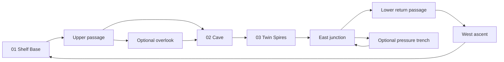
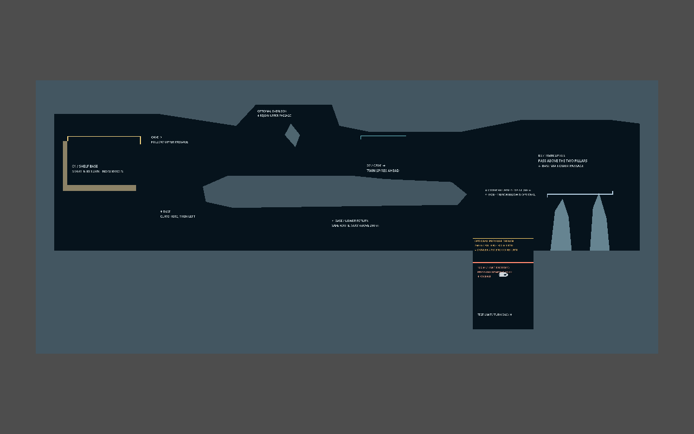
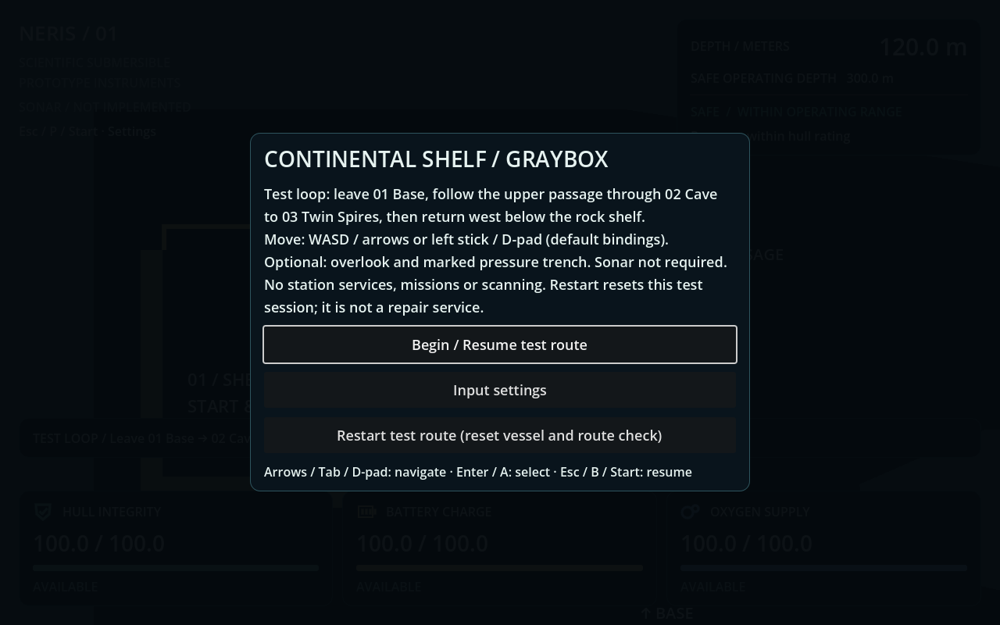
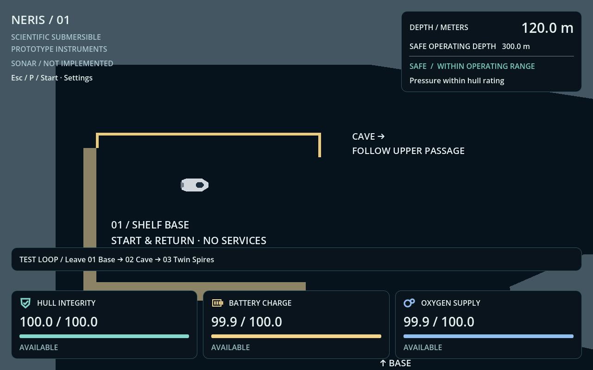
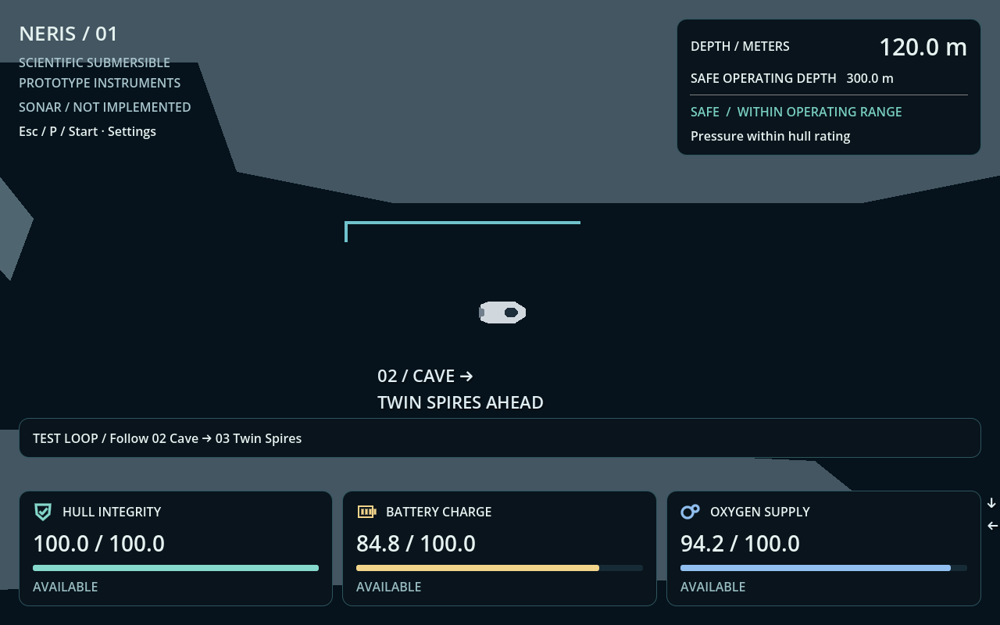
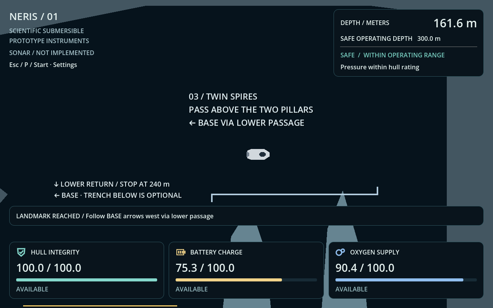
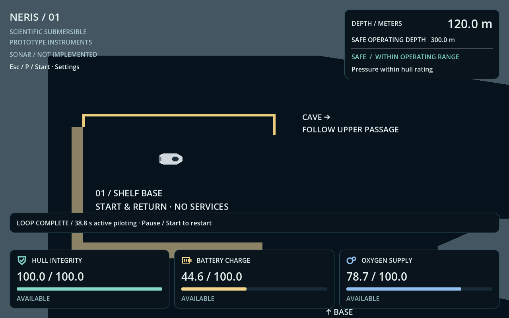
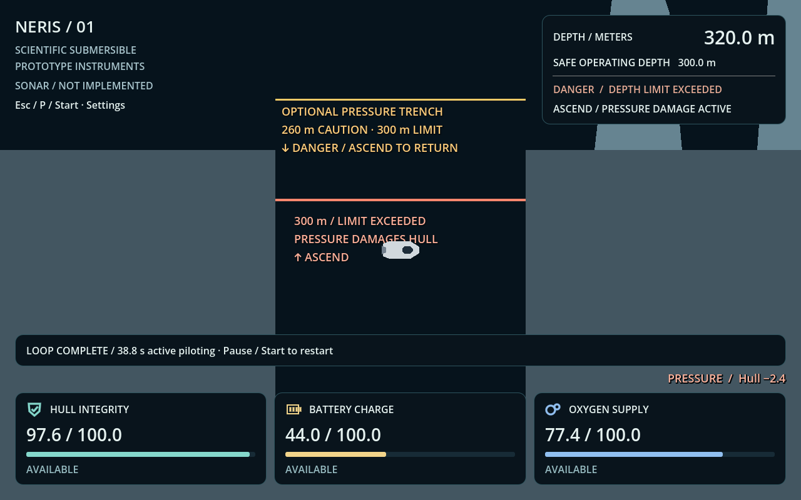

# BTA-014 continental-shelf graybox

The default scene is a playable, authored exploration test loop using Godot
**4.6.3.stable.official.7d41c59c4** and the unchanged BTA-010–013 vessel systems.
All world visuals are labeled placeholder geometry. This is not a vertical slice,
mission, narrative scene or functioning repair station.

## Launch and reset

From the repository root with Godot 4.6.3 standard edition on PATH:

```sh
godot --path .
# Optional developer resource controls, separate from the production HUD:
godot --path . -- --debug-controls
# Original movement/depth/resource/HUD testing composition:
godot --path . res://scenes/main/movement_prototype.tscn
```

The default opens a paused briefing. Use arrows/Tab and Enter or D-pad/stick and
A to Begin/Resume, open Input settings, or Restart test route. Pause (Escape/P/
controller Start by default) opens this menu anywhere. Escape/B/Start resumes.
Restart resets vessel resources, depth/collision clocks, velocity, HUD feedback,
route telemetry and camera to the safe base; saved input settings remain. It is
an explicit test-session reset, not a station service or game-over system.

Moving, coasting and braking use existing WASD/arrows or stick/D-pad actions.
Input settings preserve the existing explicit Save and unsaved-discard behavior.
The resource-test panel remains opt-in: `--debug-controls`, then Interact (E/A),
existing navigation/test buttons and Return to piloting. Both route/settings
menus and focused debug tests freeze simulation and route time.

## Authored layout

Region size: **4100×1800 authored units**. Positive X is east, positive Y is down.
The existing surface convention remains local Y=0, scale **0.25 m/unit**.



| Place | Local position / depth | Role |
| --- | --- | --- |
| Water-surface reference | (0,0) / 0 m | Authored datum, inside the bounded ceiling; not an exit |
| Station spawn | (420,480) / 120 m | Clear starting basin, gold guide bracket, NO SERVICES sign |
| Upper gate | (1200,480) / 120 m | Follow CAVE arrows east |
| Optional overlook | (1550–1850,240) / 60 m | Pass above the small suspended pillar; rejoin the cave route |
| Cave | (2350,480) / 120 m | Cyan guide bracket, enclosed passage above the central shelf |
| Eastern chamber | (3050,480) / 120 m | Opening into landmark chamber |
| Twin spires | (3500,650) / 162.5 m | Two solid light-gray pillars, pass above them to register the test visit |
| Lower east junction | (3100,970) / 242.5 m | Turn west for the safe lower return |
| Lower west ascent | (900,970) → (900,480) | BASE arrows upward, then west to station |
| Trench caution line | Y=1040 / 260 m | Optional only; prepare to ascend |
| Trench rating line | Y=1200 / 300 m | Strictly below this line exceeds the default rating |
| Deep test endpoint | (3080,1500) / 375 m | Clear vertical escape to the junction; solid floor at Y=1640 |

The required route goes over and then under the central shelf, never deeper than
242.5 m. Both passages can be retraced in either direction. The station has no
locked exit, docking requirement, interaction prompt or automatic replenishment.
The overlook returns to the upper route; the pressure trench is a broad vertical
spur with its exit directly above. There are no one-way drops, moving obstacles,
triggers that trap the vessel or gates requiring a future mechanic. Zero
resources retain the existing prototype's movement behavior; no game over is
added. Restart is always reachable through the test menu.

All filled terrain/platform silhouettes use the same authored polygon for
rendering and collision. Thin gold/cyan brackets, depth lines, labels and arrows
are navigation marks and intentionally nonsolid. Rocks use layer 1 / mask 2;
the vessel layer 2 / mask 1; test volumes layer 3 / mask 2 and cannot block motion.
Camera limits are (0,0)–(4100,1800), with the existing smooth follow preserved.

`scenes/regions/continental_shelf.tscn` owns all terrain outlines, depth resource,
spawn, test zones, signs and named route markers. `GrayboxRock` synchronizes its
editable outline into the visual and collision nodes. Route markers are authoring
and test aids, not runtime pathfinding. No world is procedurally generated.

## Acceptance evidence and automated checks

```sh
python3 tools/install_gut.py
python3 tools/validate_godot.py
python3 tools/run_tests.py
git diff --check
```

In the managed cloud environment first set:

```sh
export XDG_CACHE_HOME=/workspace/.cache
export XDG_DATA_HOME=/workspace/.local/share
export XDG_CONFIG_HOME=/workspace/.config
```

The unchanged GitHub Actions workflow runs those installation/validation/test
steps for PRs to main and pushes to main, verifies the pinned engine, and retains
import/parser/smoke logs and GUT JUnit/output in its 14-day artifact. Actionlint
also checks the unchanged workflow locally. Local results: **115/115 tests pass,
3,734 assertions, zero failures/errors/skips**; all **45 authored-script parser
checks**, import and startup smoke pass. The 98 existing tests remain enabled;
BTA-014 adds 17. Hosted evidence is reported in the pull request.

| Acceptance criterion | Evidence |
| --- | --- |
| Loads with all existing systems | New default-scene load/spawn/HUD tests; original fixture remains loadable; original 98 tests remain enabled |
| Safe spawn and paths | Real physics shape queries at spawn; continuous capsule casts with 2-unit margin over every required and optional route segment |
| Accurate closed boundaries | One outline drives both nodes; swept-body tests against west/east/ceiling/floor, trench floor and a spire; no penetration |
| Consistent depth and readable hazard | Datum/marker/transform tests, exact 260/300/over-300 boundaries, real pressure/HUD integration; labeled optional trench |
| Camera behavior | Authored limits, interior smoothing, station/east/trench clamp tests, instant camera reset to base |
| Complete exploration loop under ten minutes | Actual existing-input flight to spires then lower return and exact spawn, no position/velocity assignments; full flight **42.25 simulation seconds** in the local run |
| Resource reserves and no new survival tuning | Flight ends at **100 hull, about 44.7 battery and 78.9 oxygen**, no collision or pressure events; no return-to-base refill |
| Restart and accessibility | Keyboard/controller resume/settings/restart tests, preserved saved input mapping, pressure/menu pause/reset tests, menu and guide bounds at 800×600 |
| No fake completion | Unit tests for start-in-base, return-without-visit, visit/return order, one completion notification, invalid time and reset; timer step consistency at 30/60/120 |

The route counter is temporary test telemetry, never saved. It starts on leaving
the base test rectangle and stops on reentering it after visiting the landmark.
Its approximately 38.7-second result is shorter than the full 42.25-second flight
to the exact spawn, which is timed independently by the integration fixture.
This proves reachability under existing physics, not novice usability or a native
hardware performance target. The full prior movement/damage/resource/settings/
HUD suites run unchanged except explicit fixture paths.

## Manual playtest

1. Launch at 1280×800. Inspect the paused briefing, then select Begin/Resume with
   keyboard only. Check safe 120 m depth, full hull and slowly draining resources.
   Move around the gold-marked base basin without contacting the filled platform
   or western post. Release to coast, reverse to brake. No station service should
   trigger when crossing the base area.
2. Follow CAVE arrows east along the upper passage. Optionally climb into the
   overlook, pass around the small pillar and return down. Pass the cyan 02 CAVE
   bracket and continue east. The submarine must never clip through rock.
3. In the eastern chamber find the two pale solid spires. Pass above them through
   the marked 03 TWIN SPIRES area. Expect LANDMARK REACHED and a BASE instruction,
   with no collection, interaction, sonar, scan, reward or narrative event.
4. Turn west above the spires, descend at the open east junction (near X=3100) to
   the passage below the long central shelf, then follow BASE arrows west. Stay
   shallower than 260 m. At the west end ascend before turning left to base.
   Expect LOOP COMPLETE and active piloting time. Confirm resources were not
   restored by entering the station. The route should fit comfortably under ten
   minutes; record first-time route time, confusion and remaining resources.
5. Repeat with controller only: A to begin, stick/D-pad to pilot, Start for menu,
   D-pad/shoulders to navigate, A to select, B/Start to resume. Open Input settings,
   save a harmless binding change, return, restart and confirm it remains. Test
   keyboard navigation/restart as well. Buttons must remain legible at 800×600.
6. Optional hazard: from the eastern junction descend into the signed trench.
   Read the caution sign before Y=1040. Expect CAUTION at 260 m, still CAUTION at
   exactly 300 m, DANGER below 300 m and hull loss after existing pressure grace.
   Ascend straight up to return. Test both a harmless wall push and a severe hit;
   existing collision feedback and deduplication must remain intact.
7. Open the route menu during pressure exposure. Hull/resources, grace and route
   time must freeze. Restart: safe base position, zero velocity, full resources,
   SAFE HUD, cleared feedback/counters, reset route status and no long camera
   fly-back. This must work before the landmark, after it, after completion and
   while damaged. There is no game-over condition or automatic reset.
8. Resize through 800×600, 1280×800, 1920×1080 and a tall window. Confirm readable
   HUD/menu, visible landmarks around the vessel and a camera inside region
   limits. Test the optional developer resource panel separately; it must not
   appear at normal launch. Run the original movement fixture directly to verify
   the historical course remains available.

Physical controller, native Windows/macOS/Steam Deck, low-brightness displays,
novice navigation time and target-hardware performance still need manual testing.
Synthetic input and Linux software rendering do not establish platform support.

## Screenshots and reproduction

These are actual Godot 1280×800 renders of placeholder geometry. The screenshot
fixture flies the safe loop through existing InputMap actions. Only the isolated
hazard image and zoomed-out authoring overview reposition the vessel/camera;
they are labeled presentation setups and do not claim a second natural flight.

```sh
godot --path . --script res://tests/fixtures/capture_shelf.gd
```

A graphical display/OpenGL is required. Cloud inspection used Xorg dummy output,
X11 GL compatibility, Mesa llvmpipe and Dummy audio. The software driver's
unsupported VSync warning is expected; headless validation must remain clean.








