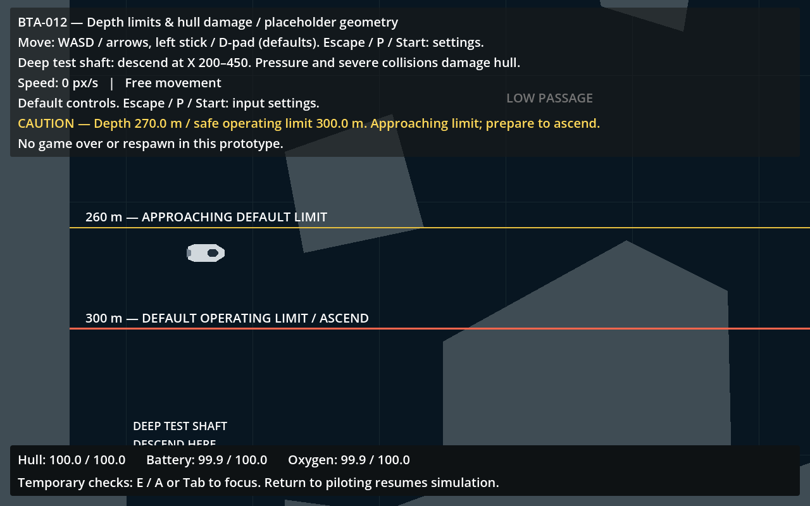
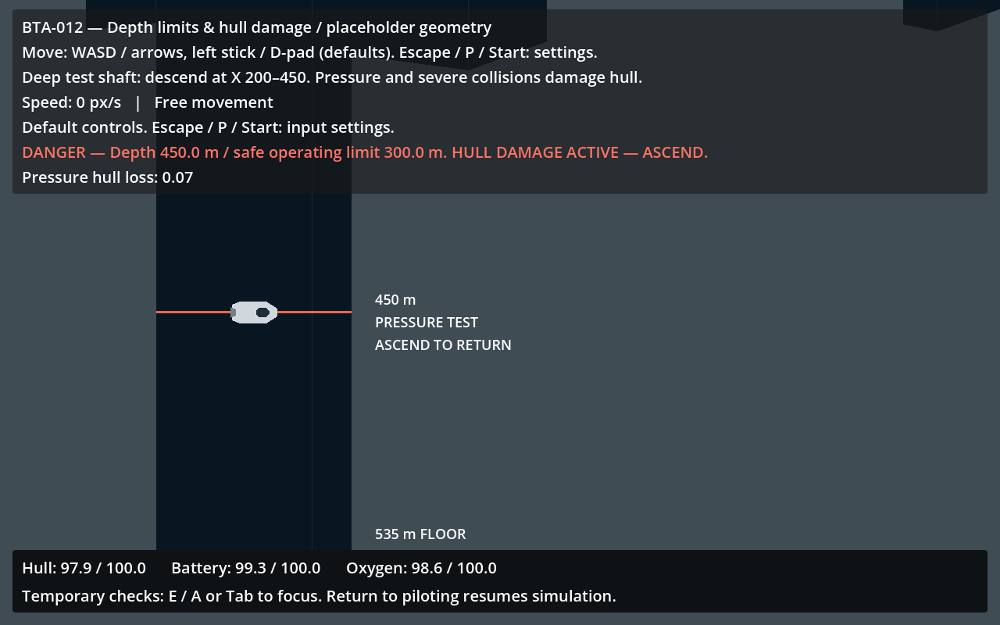

# BTA-012 depth limits and hull damage

> BTA-014: this historical course now launches with
> `godot --path . res://scenes/main/movement_prototype.tscn`. Add `-- --debug-controls`
> for resource-test controls. The default main scene is the [continental shelf](continental_shelf.md).

> BTA-013: the current HUD replaces temporary indicators. For resource test
> controls, launch `godot --path . -- --debug-controls` and press Interact (E/A).
> Earlier screenshots below show historical instrumentation. See [current HUD](submarine_hud.md).

## Defaults and coordinate reference

The authored mapping is resources/regions/prototype_depth_mapping.tres:

~~~text
local_position = depth_region.to_local(submarine.global_position)
depth_m = max(0, (local_position.y - water_surface_local_y) * meters_per_unit)
~~~

WaterSurfaceReference is at cave-local Y=0; that is 0 m. Positive Y goes deeper.
The scale is 0.25 meters per authored unit (one pixel in the unscaled prototype).
The ship center is the sample point. The closed cave ceiling sits below this
reference plane; it is an authoring datum, not a playable surface location.
Do not substitute raw global Y when placing a region elsewhere.

| Cave-local Y | Depth | Default state |
| --- | --- | --- |
| 0 or above | 0 m | SAFE |
| 520 (spawn) | 130 m | SAFE |
| 1040 | 260 m | CAUTION begins |
| 1200 | 300 m | CAUTION; no pressure damage at the exact limit |
| >1200 | >300 m | DANGER; pressure grace then damage |
| 1800 (shaft marker) | 450 m | Pressure test area |
| 2140 (shaft floor) | 535 m | Deep test floor |

The safe rating and damage rules are in resources/balance/prototype_damage.tres:
300 m safe operating depth, 40 m warning margin, 2 seconds pressure grace,
4 hull units/second pressure damage, impact threshold 150 px/s, impact multiplier
0.1, per-hit cap 20 hull, and 0.75 seconds collision cooldown.

World depth lines are labeled DEFAULT references for this fixture. If an author
changes the mapping/profile, update those authored markings too; the numerical
warning display always uses the current runtime rating/mapping.

## Behavior and reusable interface

SubmarineDamageSystem owns the pressure clock, warning state, collision latch and
cooldown. Hull changes call the existing SubmarineHullSystem.apply_damage with
pressure/collision source labels. Existing clamping/depletion/repair semantics
remain intact.

At the exact safe depth the vessel is safe from pressure. While deeper, the grace
countdown is shown, then HULL DAMAGE ACTIVE and ASCEND remain visible. A long
simulation step only charges elapsed time beyond grace. Returning to depth
<= the rating restores grace. A zero pressure rate explicitly disables loss and is labeled as disabled
in the warning display. Pressure rate is fixed while unsafe, not multiplied
by excess depth. It is bounded by configured rate and remaining hull.

Severe collision damage uses relative normal approach speed. Full default thrust
into a perpendicular wall at 240 px/s removes about 9 hull; a sufficiently large
hit is capped at 20. At or below 150 px/s there is no hit damage. Swept corner
contacts are aggregated, continued pushing is latched, and a cooldown prevents
rapid separate contacts from generating a burst. Suppressed impacts are not
replayed later.

The effective operating rating is available without an upgrade system:

~~~gdscript
var status: Error = submarine.damage_system.set_maximum_depth_m(450.0)
var current_rating: float = submarine.damage_system.get_maximum_depth_m()
~~~

This updates warnings/pressure thresholds, not world coordinates, hull capacity
or inventory. Invalid ratings are rejected; identical reapplication does not
refresh grace. Overrides are not saved. There is no hard positional depth clamp,
separate instant-death depth, game over or respawn.

Mapping/damage are typed Resources/components. Warning/depth/rating and actual
damage signals support other callers/views. The prototype displays text plus
color and a grace countdown; no critical cue relies on color or sound alone.
See [design decisions](../decisions/bta-012-depth-damage.md) for exact policies.

## Automated verification

From the repository root, using Godot 4.6.3 and pinned GUT 9.6.1:

~~~sh
python3 tools/install_gut.py
python3 tools/validate_godot.py
python3 tools/run_tests.py
~~~

Initialize cloud XDG paths from README when applicable. Existing Actions commands,
failure detection and 14-day log/JUnit artifact retention remain unchanged.

Local suite: **82 passed, 0 failures, 0 errors, 0 skipped**. All existing
movement/input/settings/resource tests remain, with the BTA-011 no-collision-
damage expectation intentionally replaced by a bounded single-hit/jitter test
for the new mechanic. New tests cover:

- Surface reference/scale, above-surface clamping, transformed regions and invalid
  mapping/coordinates/transforms.
- Warning boundaries/transitions, exact safe limit, fractional grace steps,
  returning to safety, bounded pressure loss, invalid rules and maximum-depth API.
- Impact thresholds/formula/cap, continuous-contact deduplication, cooldown
  boundaries, suppression without queued hits and hull clamping.
- Pressure and cooldown equivalence at 30/60/120 numerical steps per second.
- Actual piloting down the open shaft, resource/settings pause behavior,
  tangential/jitter immunity and corner aggregation.
- Actual pressure loss at 30/60/120 render caps with fixed 60-Hz physics.

Graphics checks use Xorg dummy display + Mesa llvmpipe and the actual Compatibility
renderer. Physical controller feel, native GPU performance, Windows/macOS and
Steam Deck behavior remain unverified. The dummy display's unsupported V-Sync
warning is separate from clean headless validation.

## Manual keyboard/controller playtest

~~~sh
godot --path .
~~~

1. At spawn, confirm about 130 m, SAFE and full hull. Move with WASD/arrows or
   left stick/D-pad (or saved bindings). Battery/oxygen and camera should work as
   before.
2. Descend near X=325 (spawn X=400 also fits the shaft). At Y=1040/depth 260 m,
   confirm CAUTION and numerical safe rating. At exactly 300 m, holding still
   must not drain hull from pressure. For exact boundary checks, set player Y
   and zero velocity through Godot's Remote inspector.
3. Continue past 300 m. Confirm DANGER, countdown and ASCEND. Ascend promptly
   before two unsafe seconds: no pressure hull loss should occur.
4. Descend through the opening between X=200 and X=450. At the marked 450 m test
   area, remain deeper than 300 m beyond grace. Hull must decline about four
   units per simulation second, while battery/oxygen continue independently.
   Return above 300 m: pressure stops and a future descent receives fresh grace.
5. While unsafe, open settings with Escape/P/Start (B recovery) or focus resource
   checks with Interact/E/A/Tab. The motor, pressure grace/damage, impact cooldown,
   and battery/oxygen ticks should stop. Refilling via test controls must not
   refresh pressure grace. Return to piloting and verify the clock resumes.
6. In shallow water near spawn, accelerate into the left wall. A full-speed
   perpendicular hit should remove about 9 hull. Continue pushing for several
   seconds: no repeated hit damage. Reverse away, wait at least 0.75 simulation
   seconds, and re-impact to demonstrate a new hit.
7. Approach a wall slowly or graze along it with high tangential speed. Below
   the inward threshold, hull must remain unchanged. Test a corner; multiple
   contacts must not multiply a single impact.
8. Use Test refill all as needed. Verify existing input remapping, numeric
   resources and test controls remain functional. At zero hull, the vessel still
   moves: no game-over or respawn mechanic is part of this milestone.
9. Compare the same descent/impact course with fixed 60-Hz physics under render
   caps, accounting for V-Sync/display limits:

~~~sh
godot --path . --max-fps 30
godot --path . --max-fps 60
godot --path . --max-fps 120
~~~

Damage timing must follow simulation seconds, with no new jitter hits at lower
render rates. Record hardware, observed FPS and subjective warning readability
for physical-device review.
