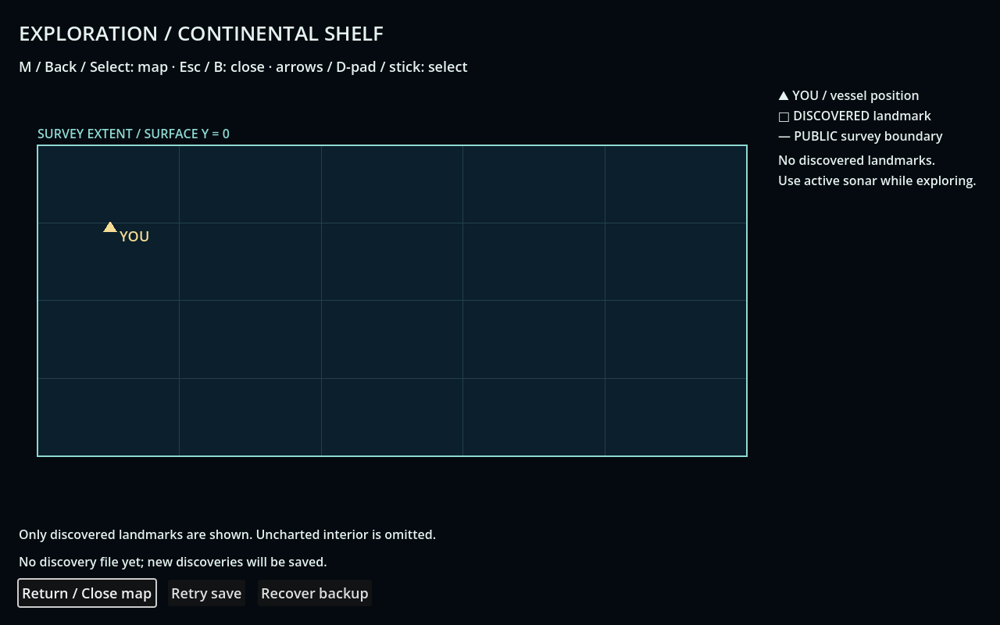
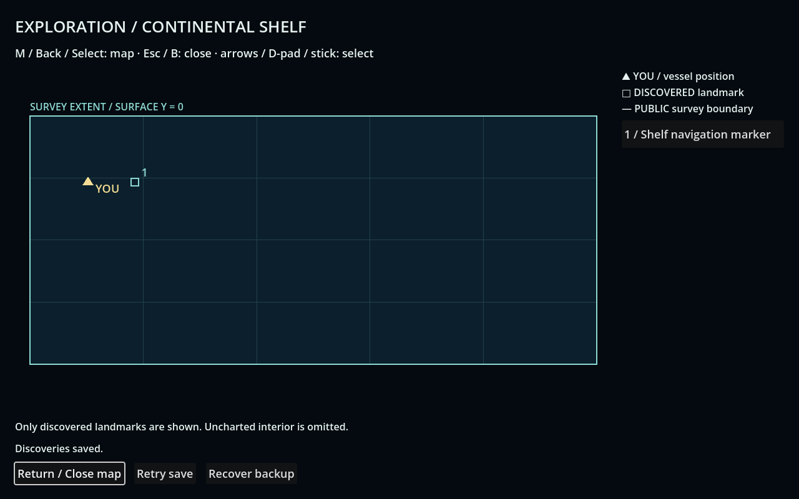
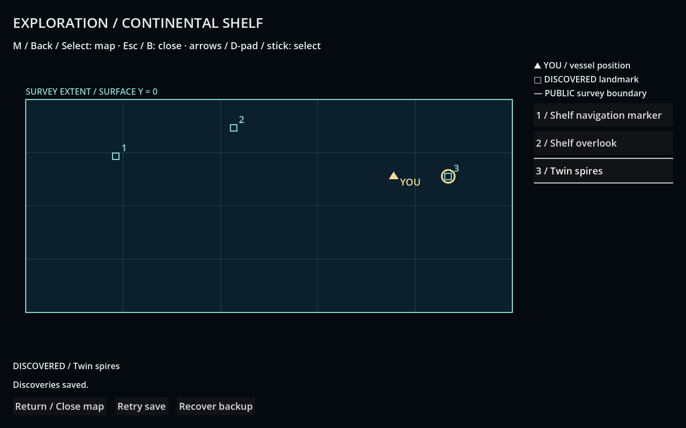
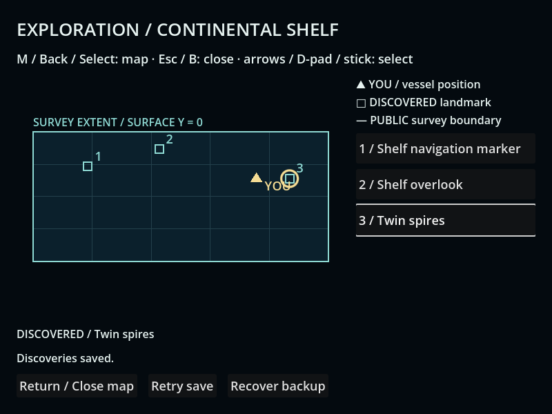
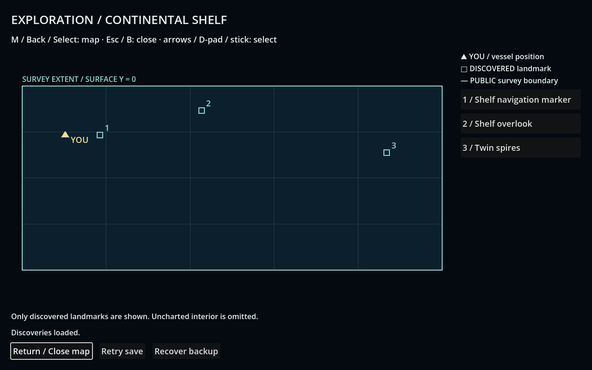

# BTA-023 verification and manual playtest

Use Godot **4.6.3.stable.official.7d41c59c4**, standard GDScript edition, from the
repository root. No new dependency or input action is required.

```sh
python3 tools/install_gut.py
python3 tools/validate_godot.py
python3 tools/run_tests.py
godot --path .
```

Focused tests after import:

```sh
godot --headless --path . --script res://addons/gut/gut_cmdln.gd \
  -gexit -gdisable_colors -gconfig= \
  -gtest=res://tests/unit/test_discovery_registry.gd,res://tests/unit/test_discovery_store.gd,res://tests/integration/test_discovery_map.gd
```

The unchanged PR/main GitHub Actions workflow installs checksum-pinned Godot 4.6.3
and GUT 9.6.1, imports, checks all authored scripts, smoke-starts the main scene,
runs all prior and new tests and always retains logs/JUnit for 14 days. Local logs
are in build/ci-logs. The PR records the actual corresponding Actions result.

Coverage includes authored stable IDs/duplicate definitions, initially hidden POIs,
idempotent discovery signals, copied metadata, validated whole-file restore,
atomic replacement/backup, missing/corrupt/incompatible/oversized/unknown-ID saves,
failed writes, explicit recovery preserving rejected/pending data, retry after
repair, exact wavefront arrival, echo expiry, out-of-range targets, passive/route
isolation, restart/reload, target removal, map secrecy/visibility/layout, remapping,
controller focus/select/close and equivalent 30/60/120-step results. Every previous
test remains intact; there are no skips or weakened acoustic-history assertions.

## Recorded local verification

- Godot 4.6.3.stable.official.7d41c59c4 import, **88 authored-script parser checks**, and main startup smoke passed.
- Complete GUT suite: **214/214 tests**, **7580 assertions**, zero failures/errors/skips and no leaked-node/resource errors. All previous 193 tests remain unchanged.
- Focused discovery suite: **21/21 tests**, 1900 assertions.
- Pinned GUT installation/checksum and unchanged GitHub Actions workflow actionlint passed.
- Actual rendered fixture exited 0 with BTA023_GRAPHICAL_HIDDEN_ARRIVAL_MAP_COMPACT_RELOAD_OK.
- The PR records the actual GitHub Actions run/result and retained artifact.

## Manual acceptance

1. Launch with godot --path . and open the map with **M / Back-Select**. These are
   the existing open_map defaults; Input settings can remap them. On a clean file,
   only YOU, the public survey extent and a grid appear. No undiscovered landmark
   labels, markers, counts, optional passages or trench outlines may appear.
2. Close with M/Back-Select or Escape/B/Start. Opening from briefing must return
   to briefing, while opening during piloting must resume piloting. Begin the
   route, allow passive contacts to appear, then inspect the map: they add nothing.
3. From base, ping with **F / controller X**. Immediately inspect/close the map
   before arrival: no discovery yet. Let the wave reach the shelf marker (~0.57
   simulation seconds), then open the map. Shelf navigation marker now appears;
   the out-of-range overlook and spires remain hidden. The cave-marker echo is
   deliberately not a permanent POI.
4. Wait beyond six-second temporary echo expiry. The shelf discovery remains on
   the map. Repeated pings do not duplicate its entry. Navigate with Tab/arrows
   or D-pad/stick, select with Enter/A and check full-name text and ring highlight.
5. Follow the existing safe route east. Ping near the optional overlook and Twin
   Spires to discover them. Complete the normal POI-to-base return route; no
   mission, reward, new resource cost, or sonar requirement was added.
6. Open the map while a pulse/contact countdown is active. Wait, then close:
   movement, battery/oxygen drain, damage and both sonar clocks stayed paused.
   Resize to **1280×800**, **800×600** and a larger window; all text/controls remain
   usable without a mouse or reliance on color alone.
7. Choose Restart test route. Vessel/echoes/passive contacts and route telemetry
   reset, but discovered map entries remain. Exit/relaunch: entries reload while
   temporary echo visibility and route progress do not.
8. With the game closed, preserve a copy of user://saves/discoveries.json, then
   replace its contents with malformed JSON (or change schema_version to 99).
   Relaunch and open the map: a visible status reports blocked loading/saving;
   the original file must remain unchanged. Newly found points remain in memory.
   **Retry save** after manually restoring a valid file. Alternatively, if a valid
   .bak exists, choose **Recover backup**: it preserves the rejected primary as
   .rejected and merges pending discoveries. A missing/bad backup or existing
   .rejected reports an error without deleting evidence. Keep your original copy.

For isolated manual sessions, set GameRoot.discovery_path in the inspector to a
separate user:// path. For a clean slate, close the game and move its discovery
file and .bak aside; Restart intentionally never erases permanent discoveries.
The Godot editor's Open User Data Folder locates user:// on each platform.

## Actual screenshots

These are actual Godot 4.6.3/X11/Mesa software renders. The fixture opens the map
through keyboard events, emits real active pings and checks arrival/discovery,
compact layout and persistence on a fresh scene. For the later landmarks it
relocates the observer to authored safe-route positions; it never directly marks
POIs discovered. It uses an isolated capture file, not the player's save.







Reproduce with an available X11 display:

```sh
godot --path . --display-driver x11 --rendering-method gl_compatibility \
  --audio-driver Dummy --script res://tests/fixtures/capture_discovery_map.gd
```

Expected exit 0 and BTA023_GRAPHICAL_HIDDEN_ARRIVAL_MAP_COMPACT_RELOAD_OK. The dummy
X11 driver reports only its known inability to change VSync mode. No new gameplay
or save errors are expected. See [API/design/save limitations](../decisions/bta-023-discovery-map.md).
Physical-controller, native Windows/macOS, hardware performance and screen-reader
playtesting remain manual; injected controller events and actual Linux rendering
are the verification performed here.
