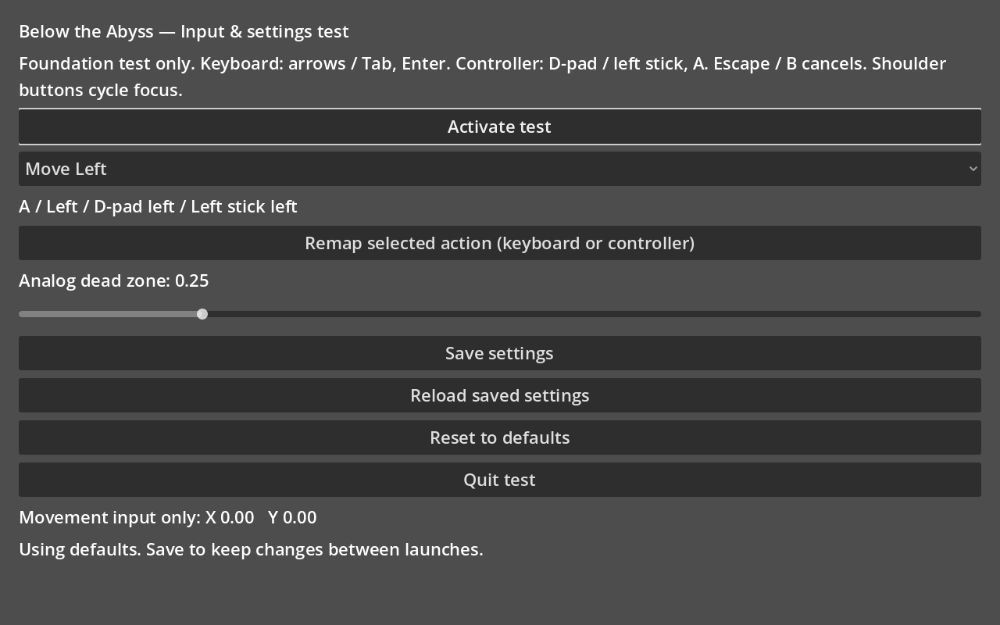

# BTA-004 input and settings verification

The main scene hosts an input/settings test menu. It implements no submarine
physics, sonar, survival, or other gameplay. Pause, sonar, light and map inputs
produce text feedback only. No new dependency or autoload singleton is added.

This screenshot was captured from Godot 4.6.3's Compatibility renderer using
Xorg's dummy display and Mesa software rendering. It is documentation, not game
art. The dummy display reports an unsupported V-Sync warning; headless validation
does not. This does not establish physical controller, native desktop GPU,
Windows, macOS, or Steam Deck behavior.

## Defaults and navigation

Actions are authored in project.godot and visible in the editor's Input Map.
Keyboard bindings use physical key positions. Controller names use Godot's
standard layout (A = bottom face, B = right face, X = left face, Y = top face);
printed device labels may differ.

| Action | Keyboard | Controller |
| --- | --- | --- |
| move_left/right/up/down | WASD and arrows | Left stick and D-pad |
| interact | E | A |
| sonar_ping | F | X |
| pause | Escape or P | Start/Menu |
| toggle_lights | L | Y |
| open_map | M | Back/Select |
| ui_left/right/up/down | Arrows | D-pad and left stick |
| ui_accept | Enter or Space | A |
| ui_cancel | Escape | B |
| ui_focus_next/prev | Tab / Shift+Tab | Right / left shoulder |

All menu controls have explicit, wrapping focus order, visible focus decoration,
22-pixel default text, and a scroll container that follows focus at small sizes.
The action selector uses a standard Godot popup. Left/right adjusts the
dead-zone slider; up/down or focus-next/previous leaves it.

Menu actions remain fixed recovery controls and are not remapped. Escape/B
cancels input capture, closes a selector popup, or returns focus to the first
control. Escape's cancel behavior takes precedence over pause feedback;
P or Start/Menu toggles that feedback. The scene tree is never paused.

The analog dead zone defaults to **0.25**, configurable from **0.10–0.90**.
InputMap applies it to movement and menu actions. Input.get_vector() uses the
movement actions' dead zones and limits diagonal input to unit length.
The movement readout displays this vector; it moves nothing. Reapplying settings
releases held actions to prevent stale pressed state.

## Remapping and persistence

1. Select a gameplay action and activate **Remap selected action**.
2. Press an unmodified physical key, a controller button, or move an axis past
   0.60 strength. Minor stick motion, key echoes and releases are ignored.
3. A binding used by another gameplay action is rejected, with a text explanation.
   Retry or cancel. Escape and controller B are reserved for capture cancellation.
   Modifier chords and mouse bindings are unsupported.
4. A new binding replaces the action's entire keyboard or controller group;
   the other device group's bindings are preserved. Replacing a movement
   controller binding replaces both its default D-pad and stick binding.
5. **Save settings** persists changes. **Reload saved settings** replaces memory
   only if the saved file is valid. **Reset to defaults** changes memory only
   until saved. Quit does not silently save.

SettingsStore owns the model and file I/O; InputBindings validates/applies maps;
the menu composes both. Model methods are set_deadzone, remap, save_settings,
load_settings, reset_defaults, and snapshot (a deep copy). Failed remaps and
loads preserve the previous valid model.

Settings live at user://settings.json. The editor's **Project → Open User Data
Folder** opens the relevant directory. The menu's exported settings_path supports
isolated tests or alternative local paths. No secrets are stored.

The version-1 JSON document has exactly these fields:

~~~json
{
  "schema_version": 1,
  "deadzone": 0.25,
  "bindings": {
    "...all nine gameplay actions...": [
      {"kind": "key", "code": 65},
      {"kind": "axis", "axis": 0, "direction": -1}
    ]
  }
}
~~~

This abbreviated example illustrates the shape, not a loadable full file.
Each action needs at least one key and one controller binding. Supported
descriptors are key/code, button/code, and axis/axis/direction. Codes must be
integer enum values in supported ranges; axis direction is -1 or 1. JSON numbers
are normalized to integer codes after validation. Unknown actions/fields/versions,
duplicates/conflicts, missing device groups, bad types/ranges, malformed JSON
and files over 64 KiB are rejected.

Saving writes and flushes a sibling .tmp file, then renames it over the target.
I/O errors are returned and shown in the menu; a failed save never reports
success. A missing/invalid file at startup uses defaults with a status message.
Loading never rewrites the file. Invalid/newer data remains unless the user
explicitly saves a replacement. Gameplay saves and migrations are outside this
input-preferences schema.

## Automated checks

From the repository root, with Godot 4.6.3 and Python 3.9+:

~~~sh
python3 tools/install_gut.py
python3 tools/validate_godot.py
python3 tools/run_tests.py
~~~

Initialize the cloud XDG paths documented in README when applicable. These are
the existing GitHub Actions commands. GUT 9.6.1 remains pinned. Tests use unique
temporary user://bta004-*.json paths and remove their own files; they do not read
or write real user settings.

Coverage includes round-trip/replacement saves, reload at menu creation,
malformed/oversized/unsupported settings, write failures, snapshot isolation,
keyboard/controller coverage, conflicts, device-group remapping, axis mapping,
dead zones, diagonal bounds, held-action cleanup and menu navigation.
Integration tests inject keyboard, gamepad-button and analog events into Godot
to exercise focus cycles, selector popup, slider, save/reset/reload,
capture/cancel/rejection and pause feedback. These are synthetic inputs,
not claims of physical hardware verification.

Existing import, authored-script parser, startup smoke checks and 14-day
log/JUnit artifacts remain operational. The opt-in failure demonstration still
returns exit 1 and stays outside normal test discovery:

~~~sh
python3 tools/run_tests.py --failure-demo
~~~

## Manual desktop verification

Launch the project or run the menu independently:

~~~sh
godot --path .
godot --path . res://scenes/ui/input_test_menu.tscn
~~~

1. **Keyboard only:** cycle every control with Tab/Shift+Tab and arrows; confirm
   visible wrapping focus. Activate the test with Enter. Open the selector,
   choose Sonar Ping with arrows/Enter, capture G, and save. F should no longer
   report sonar input; G should. E must be rejected as used by Interact.
   Escape must cancel capture. Restart and confirm G is loaded.
2. **Controller only:** connect a supported controller. Use D-pad/left stick to
   move focus, A to activate/select, B to cancel, and shoulders to cycle every
   control, including Quit. Select Sonar Ping, capture a free shoulder or stick
   direction, save, and restart. Confirm it persists while its keyboard binding
   remains usable.
3. **Dead zone:** adjust the slider with left/right or D-pad. Small stick drift
   should leave the movement readout at zero; stronger input produces values.
   Diagonal magnitude must stay at most one. Save, change, reload and confirm
   the saved value returns. Reset defaults and save.
4. **Pause/cancel:** P and Start/Menu toggle feedback only. Escape/B cancel
   captures/popups and restore focus. No simulation should pause or run.
5. **Invalid file:** back up settings, close the app, then replace the file with
   malformed JSON or schema_version 2. Relaunch: defaults and a load-status
   message should appear, while the invalid file stays untouched. Restore the
   backup afterward.
6. **Display/hardware:** check readable labels and focus at 1280×800 and a smaller
   window. Scrolling must follow keyboard/controller focus. Native device mapping,
   hotplug and non-US key positions require verification on the intended hardware.
