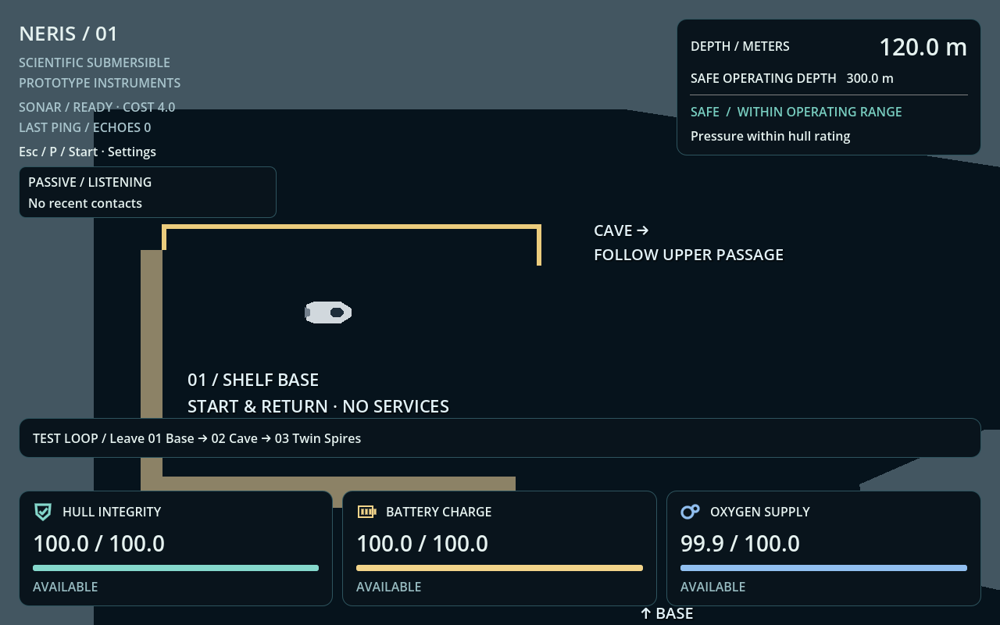
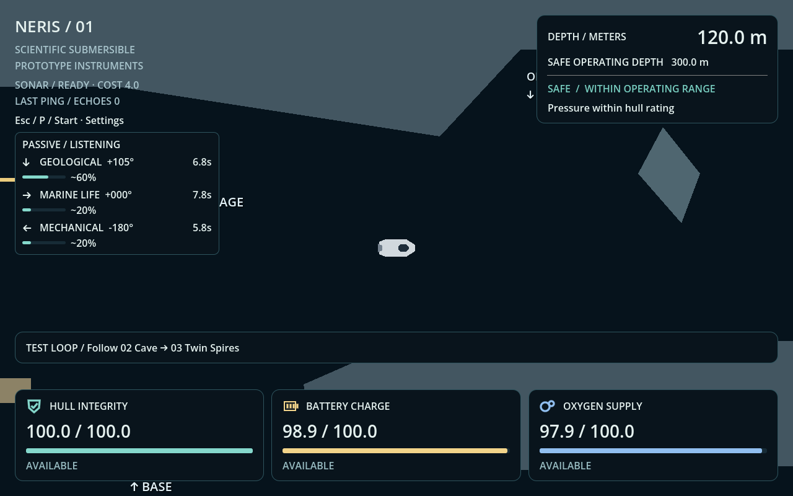
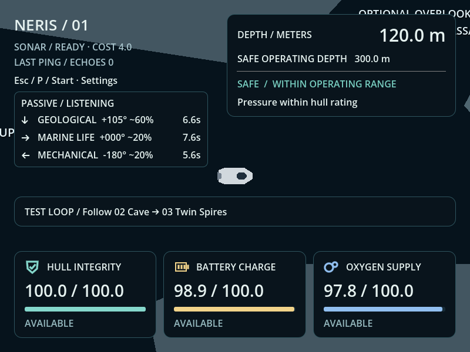
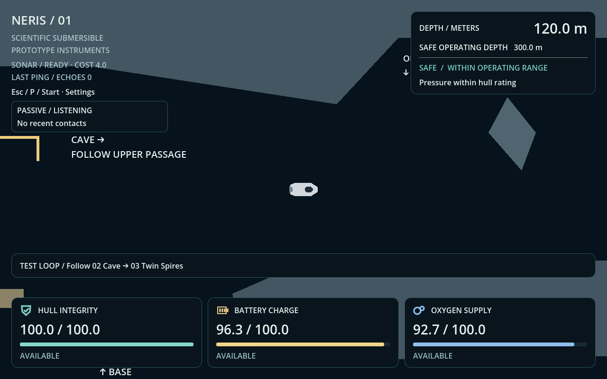

# BTA-022 verification and playtesting

## Run and inspect

Use Godot 4.6.3 (`4.6.3.stable.official.7d41c59c4`) from the repository root:

```sh
python3 tools/install_gut.py
python3 tools/validate_godot.py
python3 tools/run_tests.py
godot --headless --path . res://scenes/main/passive_sonar_example.tscn
godot --path .
```

The headless example prints one MECHANICAL contact, 0° relative bearing, approximate
60% strength, battery 100 and zero active pings; eight simulation seconds later
there are no contacts. It exits nonzero if these assertions fail. The isolated
scene uses the same bus, receiver, emitter, profiles and scheduler as the shelf.

The existing GitHub Actions PR/main workflow still installs checksum-pinned Godot
4.6.3 and GUT 9.6.1, imports, parses every authored script, smoke-starts the main
scene and runs the complete GUT suite. Passive tests are discovered by the same
runner; no new CI dependency or special skip was added. Logs/JUnit remain in the
existing always-uploaded 14-day artifact. Local logs are in `build/ci-logs/`.

## Recorded local results

- Godot `4.6.3.stable.official.7d41c59c4`: import, all authored-script parser checks and main startup smoke passed.
- Full GUT suite: **193/193 tests passed**, 5680 assertions, zero failures/errors/skips; all prior 171 tests retained.
- Both the original acoustic-contract example and the new passive example exited 0.
- Existing workflow passed actionlint; checksum-pinned GUT installation verified.
- Actual graphical fixture printed `BTA022_GRAPHICAL_CONTACTS_COMPACT_EXPIRY_OK`.
- No new dependencies, global singletons, input actions or workflow changes.

The PR records the corresponding GitHub Actions run and retained log artifact.

## Manual acceptance

1. Begin/Resume the shelf route using keyboard or controller. Without pressing
   F/controller X, observe PASSIVE / LISTENING and the station MECHANICAL contact
   after two simulation seconds. There is no expanding pulse or echo reveal;
   battery decreases only by existing idle consumption.
2. Pilot east through the cave. GEOLOGICAL and then MARINE LIFE ambience can be
   heard when eligible. Arrows and signed degree bearings describe the last heard
   origin relative to the vessel; strength is approximate and updates on sounds,
   not continuously. Categories and numbers remain readable without color.
3. Move beyond a source's range: no further event refreshes it. Its countdown
   reaches zero and it disappears after eight simulation seconds from its last
   event. Source removal in the editor/test fixture removes it immediately.
4. Pause with Escape/P/Start, then open settings. Existing contact expiry and
   ambient publication freeze. Resume and confirm they continue without a burst
   of wall-time catch-up. Resource-test debug mode also pauses the motor.
5. Press F/controller X. The independent active sonar still charges exactly its
   normal cost, obeys cooldown and reveals targets only at wavefront arrival.
   Ambient listening creates no active pulse and refreshes no active echo counter.
6. Restart the route. Contacts clear; machinery returns after two simulation
   seconds. Ping cooldown/resources/route reset as before, with fresh producer
   epoch IDs and the retained bus duplicate ledger.
7. Resize between 1280×800, 800×600 and a larger window. Check the passive panel,
   existing resource/depth/pressure instruments, active status and route controls.
   Compact rows retain category, bearing, percentage and expiry; vessel/route
   remain usable. Fly the existing POI-to-base loop using either input device.

## Actual rendered evidence

These are actual Godot/X11/Mesa software-rendered screenshots, not mockups.
The capture fixture places the observer at (1250,480) and makes sources one-shot
to show all three categories and natural expiry; it does not reveal targets.






With an X11 display available, reproduce them using:

```sh
godot --path . --display-driver x11 --rendering-method gl_compatibility \
  --audio-driver Dummy --script res://tests/fixtures/capture_passive_sonar.gd
```

Focused tests can also run directly after import:

```sh
godot --headless --path . --script res://addons/gut/gut_cmdln.gd \
  -gexit -gdisable_colors -gconfig= \
  -gtest=res://tests/unit/test_passive_sonar.gd,res://tests/unit/test_ambient_acoustics.gd,res://tests/integration/test_passive_sonar_prototype.gd
```

The focused suite covers reception/classification, raw range/strength/type filters,
relative/rotated/coincident bearings, quantization, duplicates, expiry boundaries,
source unregister/free, bounded contacts/publication, invalid settings, scheduling
at 1/30/60/120 steps, restart history, bus teardown, registration rollback, example,
real shelf resources/active isolation, route/settings/debug pause and HUD layout.
See [design/API decisions](../decisions/bta-022-passive-sonar.md) for tuning and
limitations. Physical controller and native Windows/macOS verification are pending
manual playtesting; automated checks run Linux headless and actual Linux X11.
