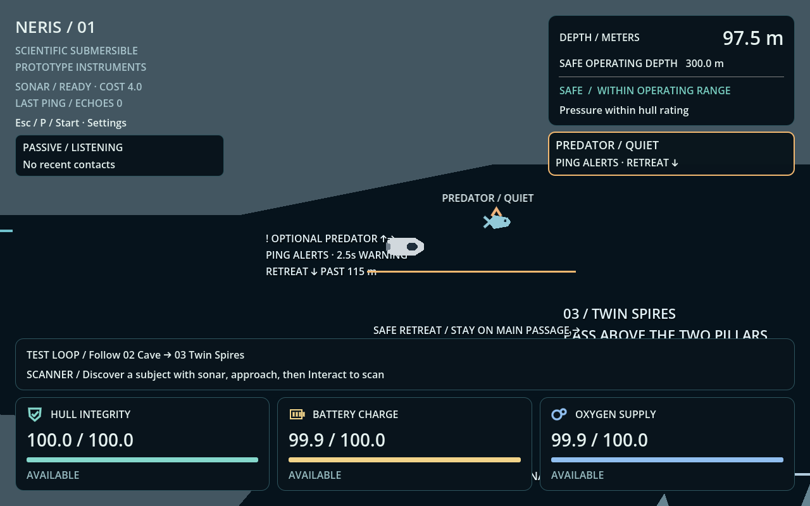
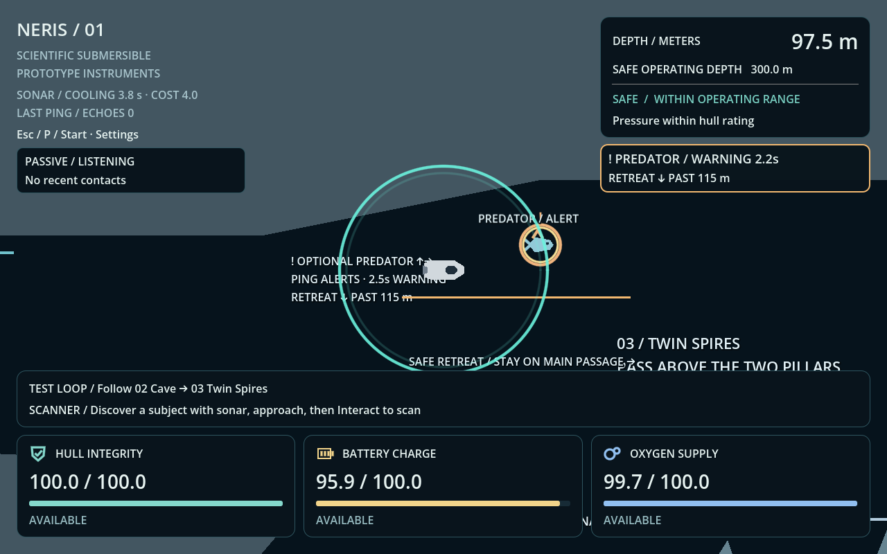
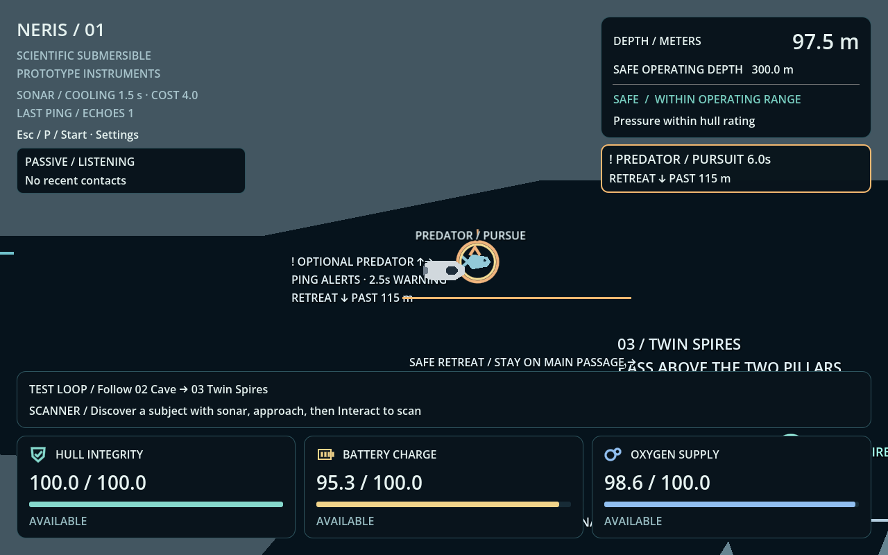
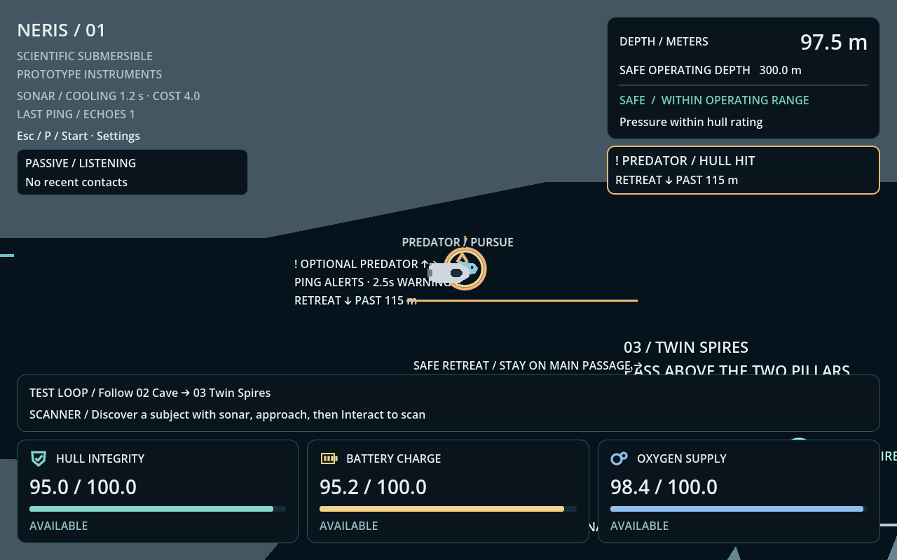
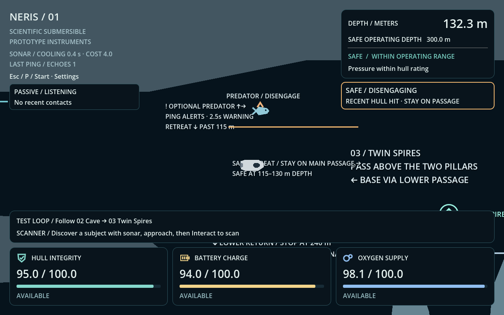
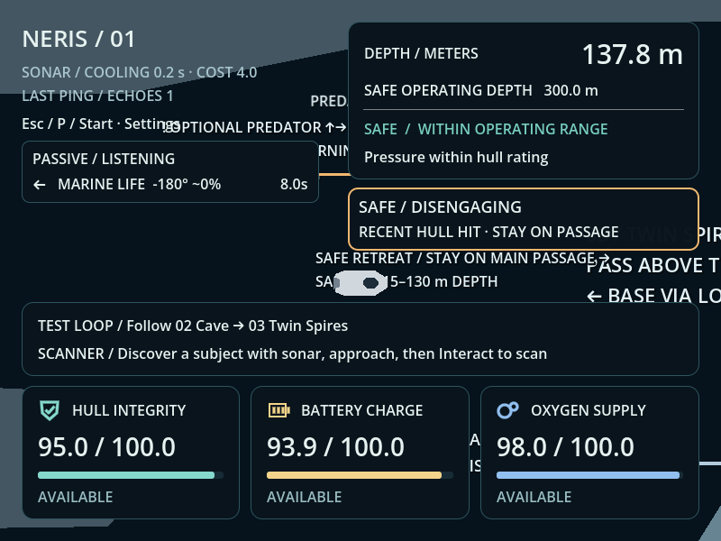
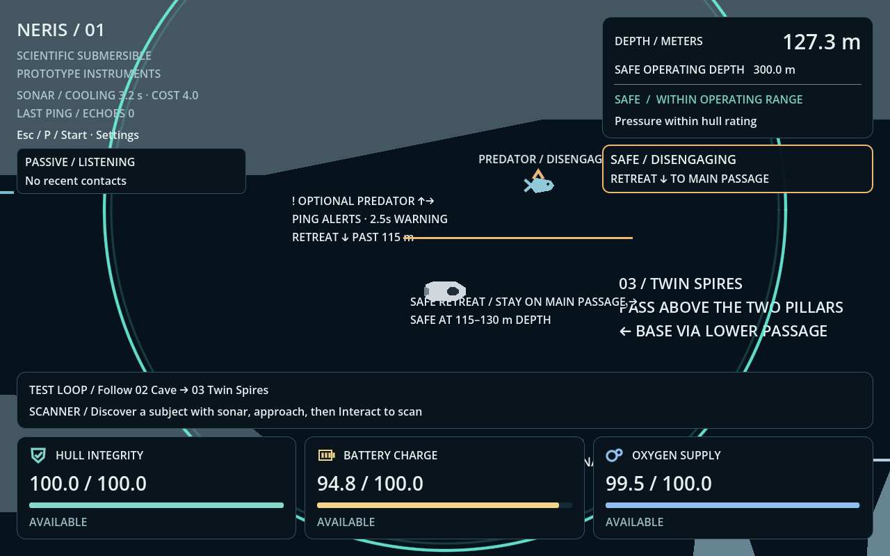

# BTA-031 verification and playable encounter

Use Godot **4.6.3.stable.official.7d41c59c4**, standard GDScript edition:

```sh
python3 tools/install_gut.py
python3 tools/validate_godot.py
python3 tools/run_tests.py
godot --path .
```

Focused tests after import:

```sh
godot --headless --path . --script res://addons/gut/gut_cmdln.gd \
  -gexit -gdisable_colors -gconfig= \
  -gtest=res://tests/unit/test_predator_state.gd,res://tests/integration/test_predator_encounter.gd
```

The existing PR/main Actions workflow still installs checksum-pinned Godot 4.6.3
and GUT 9.6.1, imports, parses all authored scripts, smoke-starts, runs the complete
suite and always retains logs/JUnit for 14 days. The test runner budget increases
from 180 to 240 seconds because the expanded real-physics suite reached the old
limit; no assertion, failure detection or test selection is removed. The workflow's
10-minute job limit is unchanged. Local logs are in build/ci-logs; the PR records
the actual corresponding GitHub Actions result and artifact.

Coverage includes eligible acoustic detection, silent passive listening, safe main-
passage pings, complete warning before aggression (including overlapping spawn),
duplicate/repeated sounds, exact pursuit limits, retreat/missing-target/blocked
exit, cooldown/radius/obstruction/clamping, inherited obstacle-safe motion, all
pauses, restart/history/permanent-record retention, 30/60/120-step state/motion/
damage consistency and HUD layout/focus. All prior tests remain; only the two main-
scene receiver-count expectations now include the predator (7 total / 3 after
removing active reveal targets). Acoustic event/history tests remain unchanged.

## Recorded local validation

- Godot 4.6.3.stable.official.7d41c59c4 import, **113 authored-script parser checks**, startup smoke: passed.
- Complete GUT suite: **285/285 tests passed**, **22623 assertions**, zero failures/errors/skips or leak errors; 160.403 seconds on the completed run.
- Focused new suite: **21/21 tests**, 5735 assertions; all previous 264 tests retained.
- Pinned GUT verification, unchanged workflow actionlint and diff checks passed.
- Actual graphical keyboard/controller fixture exited 0 with the trace and marker below.
- The PR records the corresponding actual Actions run and retained logs/JUnit artifact.

## Executed graphical playthrough

The actual Godot/X11/Mesa fixture placed the vessel at the optional entry pose,
then drove sonar and retreat through real input events. It did not force phases,
damage or escape positions. Its observed trace was:

| Sequence | Observed result |
| --- | --- |
| F activates sonar inside pocket | PREDATOR / WARNING, countdown and RETREAT ↓ PAST 115m; hull 100 |
| Remain through 2.5-second warning | PURSUE becomes active; one modest contact hit, hull 95 |
| Hold S for 37 physics frames, then release | Vessel reaches 128.95m at recorded escape; predator DISENGAGE, remains bounded above main passage |
| Continue outside after escape | Hull stays 95; no further contact damage |
| Restart and repeat, retreat with left-stick-down during warning | DISENGAGE before pursuit; hull 100 |

The fixture prints BTA031_KEYBOARD_WARNING, BTA031_KEYBOARD_PURSUIT_ESCAPE,
BTA031_CONTROLLER_WARNING_ESCAPE and BTA031_GRAPHICAL_WARNING_PURSUIT_DAMAGE_ESCAPE_CONTROLLER_OK,
then exits 0. Controller input is injected Godot joypad motion, not a claim of a
physical-controller test. This demonstrates a visible cause/warning, escape after
aggression, and damage-free early retreat without combat. An independent human
observer has not assessed understandability; the manual protocol below is provided
for that review rather than claiming an external playtest occurred.

## Manual protocol and acceptance

1. Run the normal shelf route. The required passage through the east chamber is
   at approximately 120m; pings there can reveal the spires without alerting the
   predator. Complete the original POI/base loop and both scientific scan targets
   without entering the new optional pocket. Harmless observer behavior is unchanged.
2. Before the spires, read the **OPTIONAL PREDATOR ↑** sign and non-solid entry
   line. Ascend into the pocket near authored (3060,390), about 97.5m. The HUD
   should say PREDATOR / QUIET. Proximity/passive listening alone must not attack.
3. Press **F/controller X** or your remapped sonar action. Normal battery cost,
   cooldown and wavefront remain. Read the predator warning/countdown and downward
   retreat cue; no hull damage may occur in the 2.5-second warning.
4. First try immediate retreat: thrust down with S/down arrow or left stick/D-pad
   until deeper than 115m. Brake with opposite thrust near the main passage.
   The HUD becomes SAFE / DISENGAGING; hull stays 100. There are no gates or body
   colliders that can trap the vessel. No weapon or upgrade is needed.
5. Restart, re-enter, ping and wait through warning. PURSUIT should be clearly
   labeled; contact costs 5 hull with a three-second cooldown. Retreat downward
   after pursuit starts. It ends when the player leaves the habitat, crosses the
   180-unit ping-origin leash/220-unit target-distance limit, the six-second pursuit
   expires or the path is blocked. Damage stops on disengagement. Repeated pings
   cannot restart warning/extend that episode; it returns and recovers.
6. Pause during warning, pursuit or cooldown using route menu, settings, map,
   research or existing debug controls. Wait, then resume: state/movement/damage
   timers must freeze, and paused receivers must ignore new sounds.
7. Restart while engaged: predator and vessel reset, but discoveries/research and
   existing acoustic history remain. Reload research/discovery files and use
   scanning/map/input remapping normally. No general save state was added.
8. Resize to 1280×800, 800×600 and a larger window. Read WARNING/PURSUIT/SAFE text,
   retreat cue and existing depth/resources/sonar instruments without relying on
   color. The warning panel must not cover the central vessel space or take focus.
9. In an isolated obstacle fixture, put a thin wall between target and predator.
   It must not cross terrain or damage through it; blocked navigation disengages
   and uses BTA-030 return/patrol recovery. The automated suite covers this case.

For human usability review, ask a player unfamiliar with the encounter to state
what alerted the predator and where they can retreat before pressing pause. Record
whether they escape without coaching and whether the main route feels optional.
This independent-human criterion remains pending; the agent-driven playthrough
above is the executed mechanical/graphical evidence.

## Actual screenshots / reproduction









With an available X11 display:

```sh
godot --path . --display-driver x11 --rendering-method gl_compatibility \
  --audio-driver Dummy --script res://tests/fixtures/capture_predator_encounter.gd
```

The fixture clears only its isolated capture discovery/research files, never default
player saves. Screenshots are actual renders, not mockups/final art. Dummy X11's
known VSync-setting warning is environmental; no gameplay/save errors are expected.
See [API/design/limitations](../decisions/bta-031-predator-encounter.md). Native
Windows/macOS, physical controllers, external human usability and target-hardware
performance have not been verified here.
