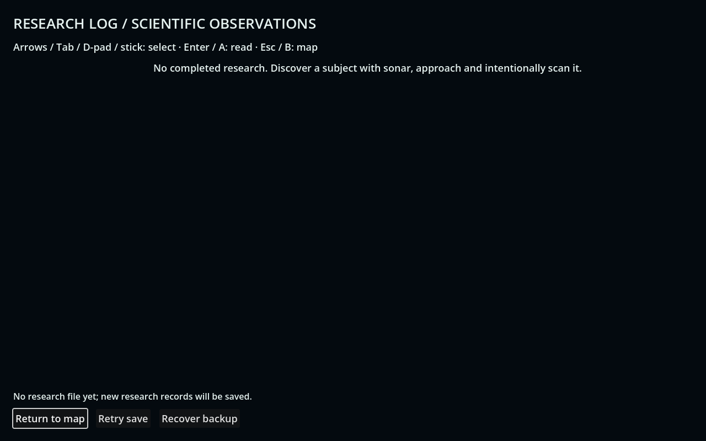
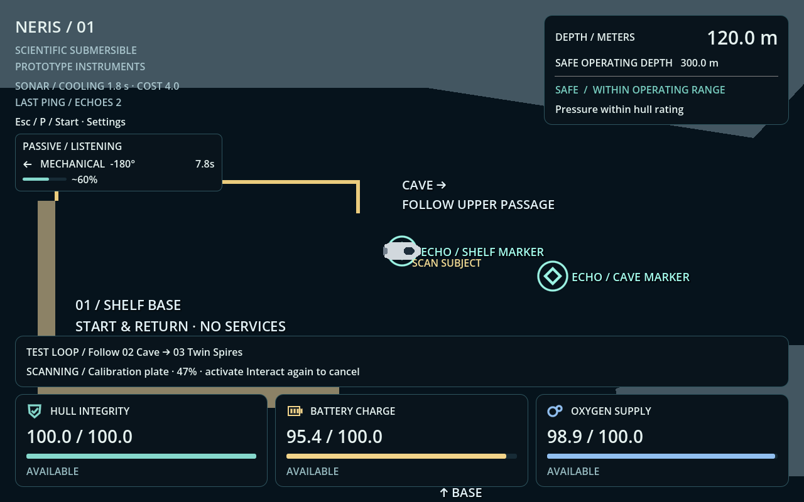
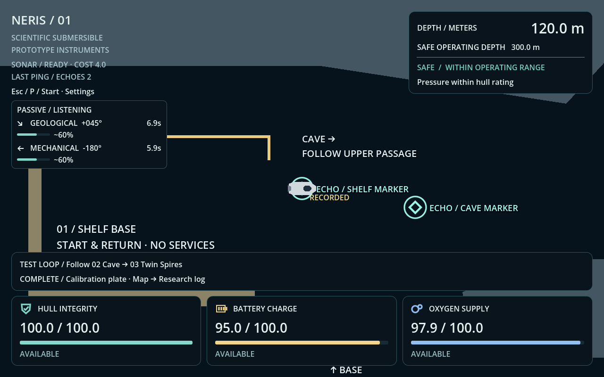
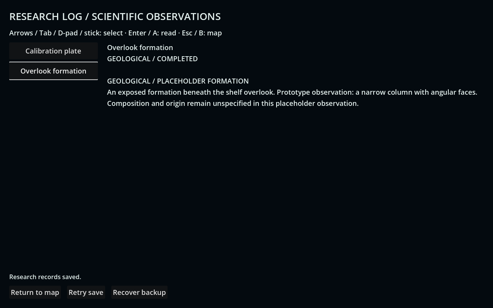
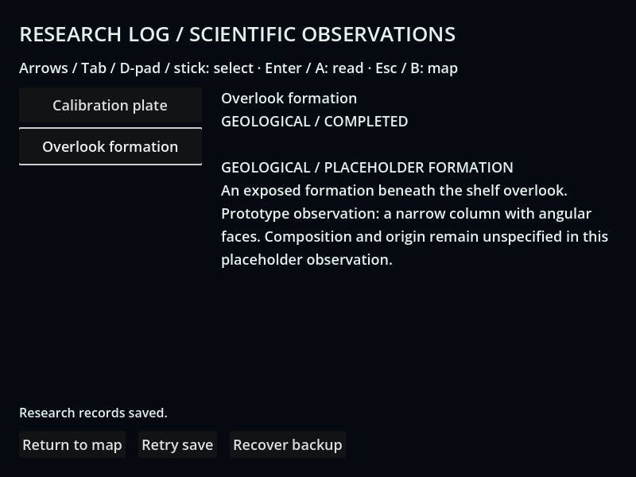
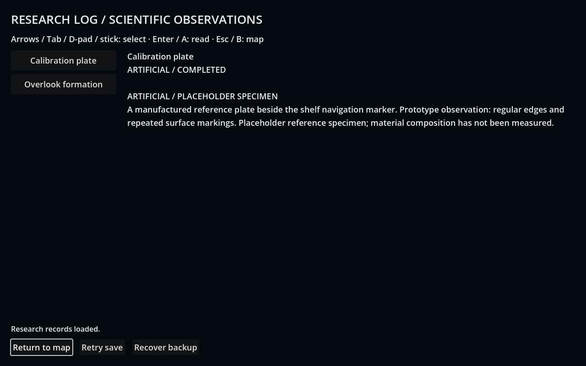

# BTA-024 verification and manual playtesting

Use Godot **4.6.3.stable.official.7d41c59c4**, standard GDScript edition:

```sh
python3 tools/install_gut.py
python3 tools/validate_godot.py
python3 tools/run_tests.py
godot --path .
```

Focused tests after import:

```sh
godot --headless --path . --script res://addons/gut/gut_cmdln.gd \
  -gexit -gdisable_colors -gconfig= \
  -gtest=res://tests/unit/test_scientific_scanner.gd,res://tests/unit/test_research_store.gd,res://tests/integration/test_scientific_scanning.gd
```

The unchanged pull-request/main GitHub Actions workflow installs checksum-pinned
Godot 4.6.3 and GUT 9.6.1, imports, validates every authored script, smoke-starts
the project and runs all old/new tests. Logs/JUnit are always retained for 14 days;
local logs are in build/ci-logs. The PR records the actual CI run and results.

New coverage includes prior discovery, inclusive radius/outside boundaries,
intentional activation/cancellation, removed/out-of-range interruption, exact
completion timing at 30/60/120 steps, deterministic target selection, invalid
profiles/time/bindings, idempotent completion/restore, whole-file validation,
atomic replacement/backup, corrupt/incompatible/oversized/unknown-ID files,
failed writes, explicit recovery preserving rejected/pending data, remapping,
controller/log navigation, modal pause, restart/reload, both specimen categories,
window layout and compatibility with movement, active/passive sonar and discoveries.
All previous automated tests remain unchanged.

## Recorded local results

- Godot 4.6.3.stable.official.7d41c59c4: import, **99 authored-script parser checks**, startup smoke passed.
- Complete GUT suite: **240/240 tests passed**, **7868 assertions**, zero failures/errors/skips, no leak errors. All prior 214 tests are unchanged.
- 26 new scientific-scanning/research unit/integration tests cover the cases above.
- Pinned GUT installation/checksum, existing workflow actionlint and git diff checks passed.
- Actual screenshot fixture exited 0 with BTA024_GRAPHICAL_INTENT_PROGRESS_COMPLETION_LOG_RELOAD_OK.
- The PR records the corresponding actual GitHub Actions result and retained logs.

## Manual acceptance

1. Run normal mode (`godot --path .`, without --debug-controls). Begin/Resume.
   Before discovery, Interact cannot start a scan; research log (M/Back-Select →
   Research log) contains no unknown names, descriptions or total-target count.
2. Ping F/controller X from base. Wait for the wavefront to reach the shelf marker
   (~0.57 simulation seconds). It becomes a permanent sonar discovery, but the
   research log stays empty. Passive listening and route completion do not scan.
3. Approach the artificial calibration-plate marker near (760,480), within 240
   world units (60m under the shelf scale). Press **E/controller A** once, using
   the existing remappable Interact action. Observe SCANNING/percentage in the
   route strip for three simulation seconds. Movement remains available; no
   extra energy or acoustic pulse is produced by the scanner.
4. Activate again before completion: CANCELLED, progress zero. Start again, then
   move outside the inclusive radius: INTERRUPTED, progress zero; re-entry alone
   does not resume. Discover/approach again and intentionally restart from zero.
5. While scanning, open map/research, settings or route pause. Wait, then resume:
   progress freezes instead of completing in wall time. Active/passive sonar,
   ambient emission, resource drain and damage remain paused as before.
6. Complete the scan. COMPLETE feedback appears, followed by RECORDED on the
   placeholder and ALREADY RECORDED on further attempts. Repeated activation or
   pings cannot add another record or emit another completion signal.
7. Open M/Back-Select → Research log, navigate with arrows/Tab/D-pad/stick and read
   with Enter/A. Only the completed plate record appears; B/Escape returns to
   map, then to the previous game/menu state. Resize between 1280×800, 800×600
   and a larger window; current descriptions/buttons/status remain readable.
8. Follow the existing upper passage to the overlook. Ping near (1750,480) to
   discover the overlook, then approach the geological formation at (1710,440).
   Activate Interact and remain within 240 units for four seconds. Read its
   separate geological observation. No reward, inventory sample or mission follows.
9. Restart the route during a partial scan: partial progress is cancelled. Restart
   after completion, then exit/relaunch: completed records and discoveries remain;
   no completion event is replayed and temporary echoes/route progress still reset.
10. On an isolated copy, close the game and preserve user://saves/research.json,
    then replace it with malformed JSON (or version 99). Relaunch and open the
    research page: it reports the failure, preserves the file and blocks writes.
    New completions remain in memory. Retry after manually restoring a valid file,
    or explicitly Recover backup if valid .bak exists. Recovery preserves the
    rejected primary as .rejected and merges pending records; an existing .rejected
    blocks another replacement. Bad/missing backups preserve originals/state.

GameRoot.research_path/discovery_path exports support isolated manual profiles.
Locate user:// via the editor's Open User Data Folder. Restart intentionally never
erases permanent research. For a clean test, close the game and move the isolated
research/discovery files and backups aside explicitly. Development mode preserves
E/A resource-test controls; use normal mode to exercise scanning input.

## Actual rendered evidence

The fixture uses real Godot rendering and keyboard actions. It relocates the
observer to authored specimen positions, but discovery uses real sonar wavefronts
and research completion uses real Interact activation/progress, not direct registry
marking. All files are isolated from the player's normal saves.








Reproduce with an available X11 display:

```sh
godot --path . --display-driver x11 --rendering-method gl_compatibility \
  --audio-driver Dummy --script res://tests/fixtures/capture_scientific_scanning.gd
```

Expected exit 0 and BTA024_GRAPHICAL_INTENT_PROGRESS_COMPLETION_LOG_RELOAD_OK.
Dummy X11 reports its known inability to change VSync mode; no gameplay/save errors
are expected. [Design/API/save limitations](../decisions/bta-024-scientific-scanning.md)
include distance-only eligibility, single-writer files and pending native-platform/
physical-controller/screen-reader/hardware testing. These screenshots are actual
Linux/X11/Mesa software renders, not mockups or final artwork.
