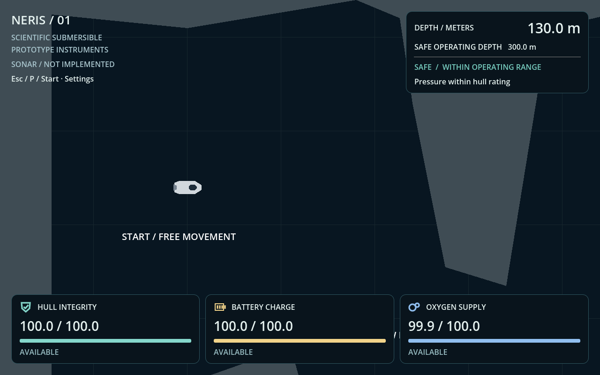
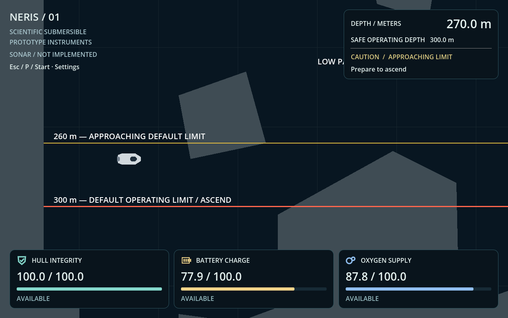
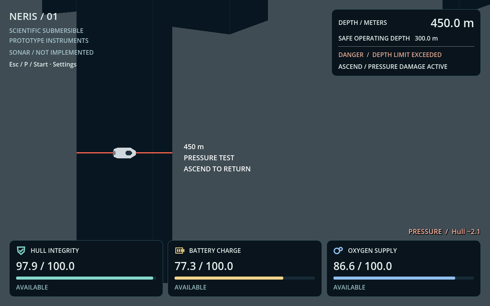
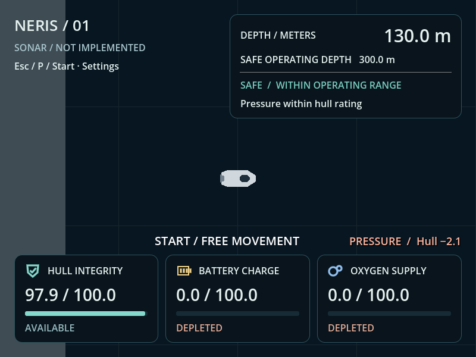
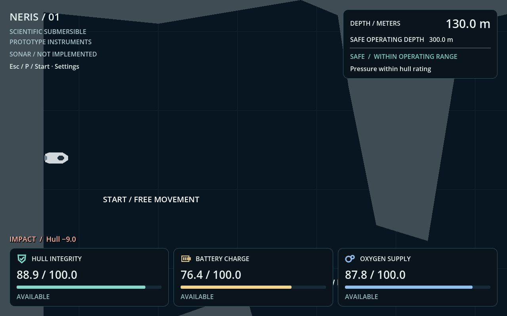
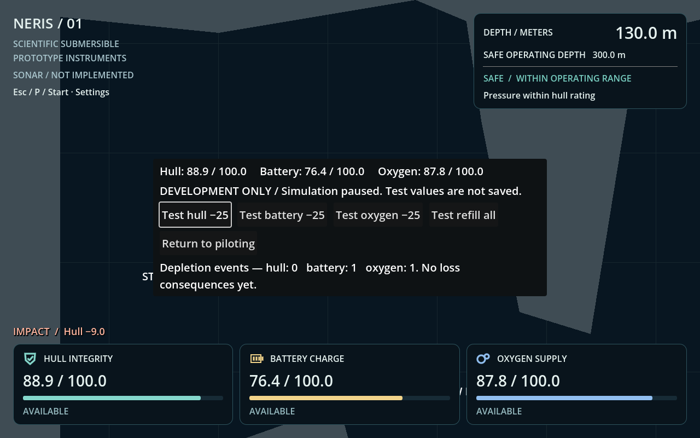

# BTA-013 HUD verification

Use Godot **4.6.3.stable.official.7d41c59c4**, standard edition. This HUD uses the
existing BTA-011/BTA-012 APIs, with no gameplay, balance or workflow changes.

## Run and verify

From the repository root:

```sh
godot --version
python3 tools/install_gut.py
python3 tools/validate_godot.py
python3 tools/run_tests.py
godot --path .
# Explicit development mode, with the original resource-test requests:
godot --path . -- --debug-controls
```

In the managed cloud environment, first set writable paths:

```sh
export XDG_CACHE_HOME=/workspace/.cache
export XDG_DATA_HOME=/workspace/.local/share
export XDG_CONFIG_HOME=/workspace/.config
```

GitHub Actions runs the same installer, validator and full test runner on every
PR to main and push to main. It requires the exact checksum-verified Godot
version, imports, parses every authored script, runs startup smoke and discovers
all test suites. No existing check is removed or relaxed. Its retained
`godot-validation-<run_id>-<attempt>` artifact contains engine/import/parser/
smoke logs, GUT output and JUnit/summary files (14 days).

## Read-only integration contract

Instantiate `scenes/ui/submarine_hud.tscn` under a CanvasLayer. Once it and the
three initialized components are ready, call:

```gdscript
hud.bind_sources(resources, hull, damage)
```

The sources are `SubmarineResourceSystem`, `SubmarineHullSystem` and
`SubmarineDamageSystem`. Binding returns OK or ERR_INVALID_PARAMETER, accepts
rebinding, snapshots initial values and disconnects former signals. A HUD without
sources explicitly says INSTRUMENTS DISCONNECTED. Freeing a source does the same
on the next presentation frame. The HUD never calls mutation APIs.

| Display | Authoritative API / signal |
| --- | --- |
| Hull | hull / max_hull, hull_changed |
| Battery | battery / max_battery, battery_changed |
| Oxygen | oxygen / max_oxygen, oxygen_changed |
| Depth | depth_m, depth_changed |
| Safe operating rating | get_maximum_depth_m(), maximum_depth_changed |
| SAFE / CAUTION / DANGER | warning_state, warning_changed |
| Grace / active pressure | grace_remaining_seconds and pressure_damage_per_second, sampled |
| Impact / pressure feedback | collision_damage_applied / pressure_damage_applied, actual loss |

Changed-value signals drive both numbers and bars immediately, including zero
and refill transitions; no polling is required for resources. Since depletion is
stateful, a HUD bound after a depletion still shows DEPLETED, without needing to
replay its one-shot event. The existing depletion signals/counters remain intact
in the development overlay. Source values remain in native units; bars normalize
to capacity, so alternative profiles work without assuming 100 units.

## Automated coverage and results

The HUD unit suite covers pre-bind snapshots, immediate signal updates, custom
capacities, all warning boundaries, rating changes, grace and disabled pressure,
initial/live depletion, positive refills, separate feedback lifetimes and
pressure aggregation, repeated binds, old-source disconnection, and freed sources.

The integration suite covers real movement-driven drain/depth updates, settings
pause, pressure feedback, production/debug separation, developer depletion/refill
and keyboard/controller request paths. Existing resource tests retain complete
synthetic keyboard/controller navigation, including zero values and returning to
piloting. Existing movement, damage, resources and settings suites stay enabled.
Layout tests resize a real SubViewport through 1280×800, 800×600, 1920×1080,
800×1000 and back, in all three warning states. They verify bounds, unclipped
text at 16+ pixels, ignored input, no focus, and an unobstructed central area.

Local verification: **98/98 tests passed, 3,499 assertions, zero failures,
errors or skips**. Godot import, **35 authored-script parser checks**, startup
smoke, actionlint and `git diff --check` pass. All 82 prior tests remain enabled;
BTA-013 adds 16 tests. Hosted CI evidence is recorded in the pull request.

## Manual playtest

1. Launch normally at 1280×800. Expect hull 100.0/100.0, battery and oxygen near
   100 and slowly draining, depth 130.0 m, safe rating 300.0 m and SAFE text.
   Confirm each resource has a named icon, numeric value/capacity and a bar.
   Sonar must say NOT IMPLEMENTED. There must be no resource-test buttons.
2. Pilot with WASD/arrows, then left stick/D-pad. Release to coast. The HUD must
   not steal focus; Interact must not pause normal piloting. Open settings with
   Escape/P/Start and return using keyboard or controller. Resources and pressure
   grace freeze while the existing settings menu is open.
3. Descend from spawn between world X=200–450 through the existing shaft.
   At 260 m, expect CAUTION / APPROACHING LIMIT and Prepare to ascend. At 300 m
   it remains CAUTION; strictly deeper it says DANGER / DEPTH LIMIT EXCEEDED,
   ASCEND and a two-second grace countdown. After grace, expect PRESSURE DAMAGE
   ACTIVE, decreasing hull number/bar and PRESSURE feedback. Ascend and confirm
   DANGER→CAUTION→SAFE; the event message expires after 2.5 seconds, with the
   reduced hull still visible. Messages must be readable without distinguishing
   any colors. No game over or respawn is expected.
4. At spawn, thrust left into the closed wall. A full-speed normal hit costs
   approximately 9 hull and shows IMPACT / Hull −9.0. Keep pushing: jitter must
   not create repeated hits. Return into open space. Confirm feedback expires
   while the resulting hull reading remains correct. Pressure and impact use
   separate feedback labels if events arrive close together.
5. Relaunch with `--debug-controls`. Expect the clearly named DEVELOPMENT MODE
   banner. E/controller A (or remapped Interact) opens the separate test panel;
   the simulation stops and the HUD remains visible. Use arrows/Tab/Enter or
   D-pad/stick/A to activate each −25 request until depleted. Each gauge must
   show 0.0, an empty bar and persistent DEPLETED text. Refill all: full values
   and AVAILABLE return. Return to piloting: panel hides, focus releases and
   simulation resumes. The debug operations must not be available at normal
   launch. No test values are saved.
6. Resize to 800×600, 1280×800, 1920×1080 and a tall window, then back. Top and
   bottom instruments stay on screen; the center remains clear. Small windows
   hide secondary identity text rather than shrink the font. The OS minimum
   window is 800×600. Also inspect the debug panel's wrapped controls at 800×600.
7. Inspect on a physical controller and intended target displays at low brightness.
   Automated input is synthetic; software rendering is not Steam Deck or native
   Windows/macOS/GPU certification.

## Reproducible screenshots

These are actual Godot renders of the existing placeholder cave. The presentation
fixture deliberately sets depth/resource values through domain APIs, advances real
physics and captures the viewport. It is excluded from normal test discovery and
is not a gameplay scene. No third-party or generated images are used.

```sh
godot --path . --script res://tests/fixtures/capture_hud.gd
```

A graphical display/OpenGL is required. The cloud check used Xorg dummy output
and Mesa llvmpipe via X11, GL compatibility and Dummy audio. Only the software
display's unsupported VSync warning is expected; headless validation must be
clean. The capture command overwrites the six screenshots below.








This is a styled prototype interface. Future localization, scalable-text settings,
physical device checks and final illustrated art remain their own work. Sonar,
new survival mechanics, creatures, missions, upgrades and later milestones are
not implemented.
