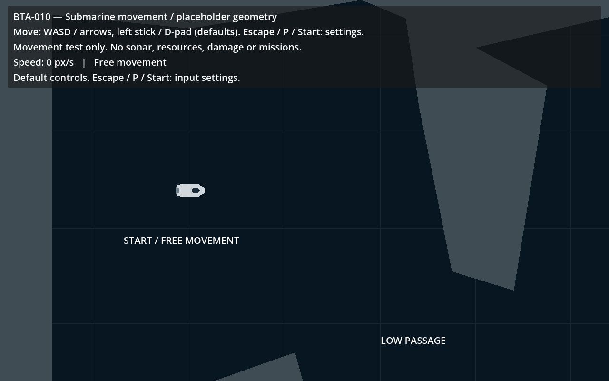

# BTA-010 submarine movement prototype

This is a movement/collision test cave, not a production region or vertical slice.
Walls, obstacles, grid and submarine are authored placeholder geometry. The hull
has a fixed visual orientation and a symmetric collision capsule; artwork,
animation, buoyancy, gravity, collision/depth damage and sonar are absent.
BTA-011 now composes resource components and temporary numeric indicators with
this prototype; see [resource verification](submarine_resources.md). Depletion
consequences are not implemented. The speed/contact text remains test instrumentation.

## Launch and controls

From the repository root:

~~~sh
godot --path .
~~~

The main scene now boots the prototype. Default movement is WASD/arrows or a
controller's left stick/D-pad. Horizontal and vertical input combine through
Input.get_vector(), preserving saved dead zones and proportional stick strength
without diagonal speed boosts.

The existing pause action (P or Start/Menu by default) opens input settings.
Escape and controller B are fixed recovery shortcuts even after pause is remapped. Opening stops velocity and disables the motor at its current
position; it does not introduce a global pause/game-state system. Use keyboard
Tab/arrows/Enter or controller D-pad/stick/A/shoulders to remap controls and adjust
dead zones. Save, then select **Return to movement**. Returning reloads saved
settings and discards unsaved edits. Failed loads retain the last valid profile
and report the error. Settings files retain the BTA-004 schema and safeguards.

The independent input test menu remains runnable:

~~~sh
godot --path . res://scenes/ui/input_test_menu.tscn
~~~

Sonar, interaction, lights and map actions have no gameplay effect in the cave.
Close the application window/F8 in the editor to exit. Physical controller face
labels may differ from Godot's standard A/B/X/Y notation.

## Movement and collision model

- scenes/player/submarine.tscn is a reusable CharacterBody2D with a horizontal
  capsule (64×32 pixels), placeholder polygons and a following Camera2D.
- SubmarineController reads the existing four movement actions on physics ticks,
  delegates velocity response to SubmarineMotion, and uses move_and_slide().
  MOTION_MODE_FLOATING treats floors and ceilings like any other wall.
- resources/balance/prototype_motion.tres supplies acceleration **600 px/s²**,
  maximum speed **240 px/s**, and neutral damping **3 s⁻¹**. Tune this Resource in
  the inspector; duplicate it for independently tuned instances. Runtime motion
  never mutates the authored Resource.
- With thrust, velocity approaches the analog-scaled target by acceleration ×
  elapsed seconds. Full acceleration from rest takes about 0.4 seconds; a full
  reversal brakes existing momentum before accelerating in the opposite direction.
- Without thrust, velocity decays by exp(-damping × delta), then snaps to rest
  below 0.5 px/s. At full speed this coasts about 80 pixels and settles in roughly
  2.1 seconds. Zero damping intentionally disables passive drag.
- Velocity magnitude is capped, including diagonal/oversized input. The motor
  does not normalize away partial analog input.
- Physics runs at a fixed **60 Hz**, independent of rendering. Physics
  interpolation is enabled for the moving body. Camera smoothing runs on physics
  ticks at speed 5 and is constrained to the 2400×1600 cave bounds.
- Layer 1 is static cave geometry; layer 2 is the submarine. Swept collision
  motion blocks walls, preserves sliding, and explicitly removes residual inward
  velocity. Small outward components from floating-point contact normals are
  permitted. Contact signals report the normal and relative approach speed;
  they do not cause damage.

The test cave is an authored scene with closed outer bounds, an overhang, a low
passage, a sloped obstacle, a column and a nearby rock. Visible solid polygons
match their collision polygons. The spawn at (400, 520) is tested for overlap.
No procedural world, missions, checkpoints, region progression or future
milestone content is implemented.

## Automated verification

Use the pinned Godot 4.6.3 and GUT 9.6.1 from the repository root:

~~~sh
python3 tools/install_gut.py
python3 tools/validate_godot.py
python3 tools/run_tests.py
~~~

Initialize cloud XDG paths from README when applicable. The existing Actions
workflow runs these commands, including import, individual authored-script parser
checks, startup smoke and GUT. Logs and JUnit output retain the existing 14-day
artifact policy. No CI checks are removed.

BTA-010 result: **39 passed, 0 failed, 0 errors, 0 skipped**, including all 24
foundation tests (the main-scene sample now checks the prototype hierarchy).
New tests cover:

- Acceleration, reversal, exponential damping, stopping, analog speed targets,
  diagonal limits and configurable motion parameters.
- Matching velocity response at 30/60/120 numerical steps per second.
- Actual CharacterBody2D wall blocking/contact signals, diagonal sliding,
  corner blocking and a 12-pixel-thick wall at 1200 px/s with 30 physics ticks.
- Fixed-60-Hz travel at 30/60/120 render caps, allowing at most 5 pixels for the
  terminal observation tick; this is not a claim of bit-identical collision paths.
- Authored-cave spawn clearance/boundary blocking, smooth camera following,
  saved controls/dead zones and stopping/returning from the embedded settings menu.

Frame-cap tests restore the previous engine configuration and release injected
actions. File tests use temporary settings paths and do not overwrite user
preferences. Continuous physics can differ slightly when changing the physics
tick rate itself; the supported prototype runtime remains fixed at 60 Hz.

The screenshot was captured with Xorg dummy display + Mesa llvmpipe, using the
actual Compatibility renderer. A graphical smoke check also moved the submarine
310 pixels over 90 physics-frame observations and opened/returned from settings.
The software display reports unsupported V-Sync; headless validation does not.
This establishes rendered startup and scripted movement, not physical controller
feel, native GPU performance, native Windows/macOS behavior or Steam Deck support.

## Manual playtesting

1. Start with defaults (or back up user://settings.json before resetting).
   Navigate left/right/up/down, then diagonally. Verify a gradual start,
   controllable reversal, bounded diagonal speed and a short coast after release.
2. Use a physical controller. Compare light stick deflection with full deflection,
   check dead-zone drift, and repeat the course using only the D-pad. Verify
   remapped keyboard/controller bindings by saving through the embedded menu,
   returning, and restarting the app.
3. From the start, travel right toward the overhang. Hold thrust into its face:
   the capsule must remain outside the wall. Add downward thrust to slide beneath
   it, then traverse the low passage between overhang and shelf.
4. Continue right toward the sloped obstacle. Push diagonally along both sloped
   faces and test corners. Reverse away from a contact: there should be no stored
   wall-directed momentum or unexplained snap through geometry.
5. Traverse toward the far column and return to the start. Inspect ceiling,
   floor and left/right bounds. The submarine should never cross a visible solid.
6. Watch the camera through starts, stops and reversals. It should follow
   smoothly, retain readable surroundings, and stop scrolling at room edges.
7. Compare rendering at 30, 60 and 120 FPS with fixed 60-Hz physics:

~~~sh
godot --path . --max-fps 30
godot --path . --max-fps 60
godot --path . --max-fps 120
~~~

Repeat a straight run and the same wall-sliding route. Compare time to reach top
speed, stopping distance, camera smoothness and wall penetration; do not change
physics tick settings for this comparison. V-Sync/display refresh may further
limit observed FPS. Use the profiler or Debugger monitors for actual frame rate.

8. While moving, open settings with Escape/P/Start. The submarine must stop and
   remain stationary during editing. Return using the menu button; movement
   should resume only after fresh input. Standalone settings tests still expose
   their own feedback-only pause behavior.

Record subjective handling feedback and hardware/display details during review.
No external physical-device playtest or performance target is claimed here.
