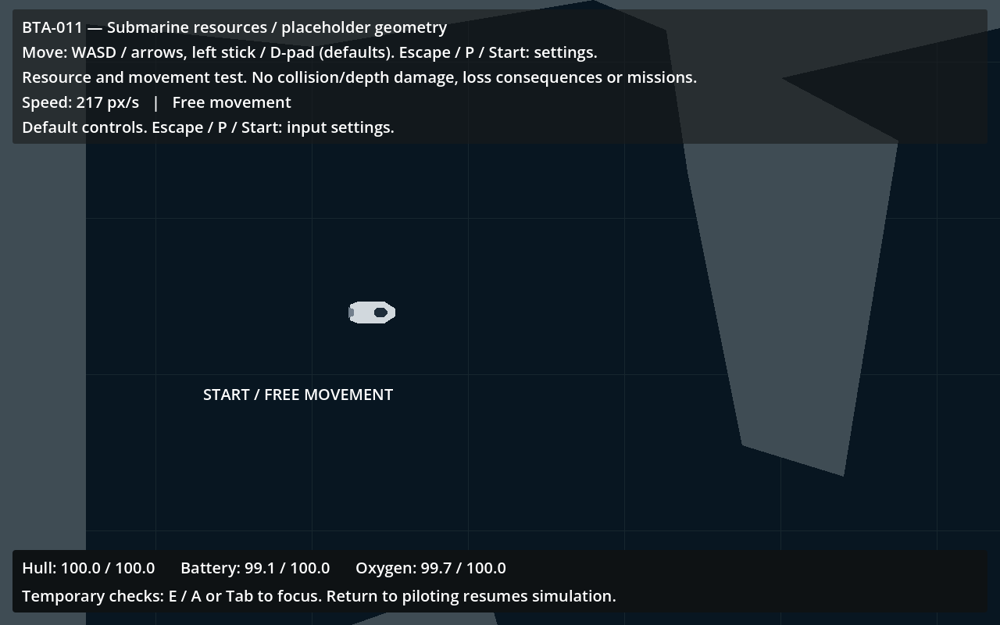
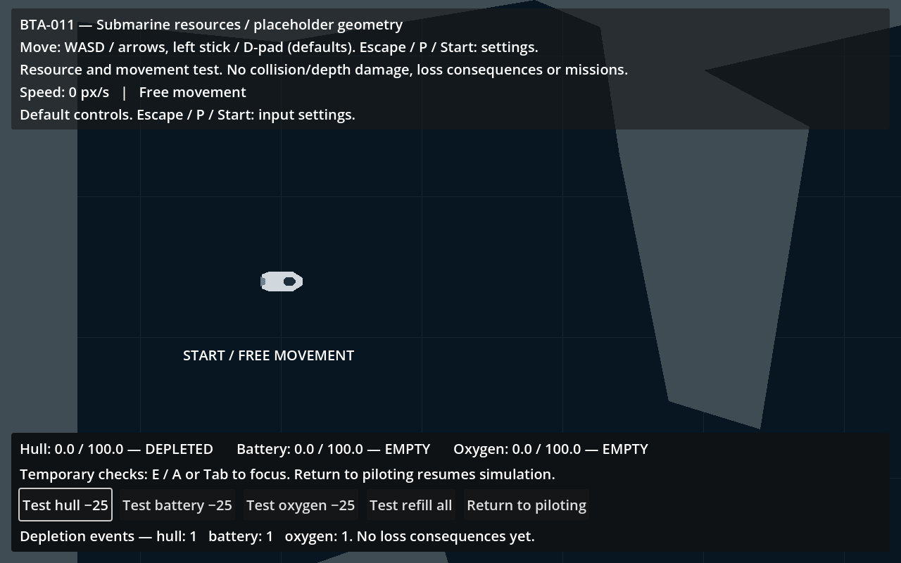

# BTA-011 submarine resources

The prototype now composes hull, battery and oxygen components with the existing
movement controller. These numeric indicators and explicit test buttons are
temporary verification tools. BTA-012 now supplies pressure and severe-impact
damage through these interfaces; see [depth/damage verification](depth_damage.md).
There is no creature, mission, upgrade, station, production HUD, game-over or respawn system.
Movement remains usable at zero resources so the BTA-010 test course is preserved.

## Profile and runtime ownership

The authored Resource is resources/balance/prototype_resources.tres, using typed
SubmarineResourceConfig. Each submarine starts full:

| Property | Default | Meaning |
| --- | --- | --- |
| max_hull | 100 | Hull capacity |
| max_battery | 100 | Battery capacity |
| max_oxygen | 100 | Oxygen capacity |
| battery_idle_drain_per_second | 0.25 | Battery units per simulation second |
| battery_thrust_drain_per_second | 1.5 | Additional battery units per second at full thrust |
| oxygen_drain_per_second | 0.5 | Oxygen units per simulation second |

At half thrust, battery drain is 0.25 + 1.5 × 0.5 = 1 unit/second. Full diagonal
input is capped at full thrust, not charged twice. Coasting uses the idle rate;
holding thrust against a wall still consumes thrust battery. Hull has no passive
drain in this resource component; the BTA-012 damage component supplies hull
loss separately. These values are prototype tuning, not final balance.

SubmarineResourceSystem and SubmarineHullSystem are child Nodes in the reusable
submarine scene. They own separate runtime values through a BoundedResource
helper; the shared profile holds no current values. configure(profile) validates
all capacities/rates, snapshots the parameters and starts the component full.
Reconfiguration is an explicit reset, not an upgrade or migration mechanism.
Invalid profiles return ERR_INVALID_PARAMETER and preserve the previous state.
An invalid exported profile at scene startup reports a Godot error.

Capacities must be positive and finite; drain rates must be nonnegative and
finite. Editing an authored profile after configuration does not silently alter
existing runtime state; configure it explicitly to apply/reset.

## Consumption and refill contracts

On the submarine's ResourceSystem child:

- try_consume_battery(amount) and try_consume_oxygen(amount) return bool. A cost
  exceeding the available value fails without taking a partial payment.
- consume_battery(amount) and consume_oxygen(amount) saturate at zero and return
  the actual amount removed. Passive drains use this form.
- restore_battery(amount) and restore_oxygen(amount) saturate at capacity and
  return the actual amount added.
- advance(delta, thrust_strength) consumes idle/thrust battery and oxygen for
  elapsed simulation seconds. It is called from the existing motor's fixed
  physics tick, not from a rendering callback. External thrust strengths above
  one are capped; negative/nonfinite time or strength is rejected with an Error.

On the HullSystem child:

- apply_damage(amount, source_id) removes up to the remaining hull and returns
  the actual loss. last_damage_source records the last effective caller-supplied
  StringName, not a runtime scene instance ID.
- restore_hull(amount) adds up to capacity and returns the actual repair.

Negative, NaN and infinite transfer amounts are rejected: numeric transfers
return 0, discrete costs return false, and no value or signal changes. Zero-cost
attempts succeed without change; zero transfers are silent. No API can use
negative consumption to refill a value.

All current values stay in [0, maximum]. Finite assignments in the internal pool
clamp to that range. Endpoint rounding is snapped within min(1e-8, capacity ×
1e-9) units to prevent fractional drain residuals from postponing depletion.
No-op changes emit nothing. Numeric transfer results describe that operation,
even when a signal observer subsequently refills the same pool.

Resources drain only while the motor's physics processing is active. Input
settings and focused test controls stop movement and resource ticks together.
Resource depletion itself does not change propulsion, apply hull damage, hide
the vessel, reset the scene or change the existing settings schema. State is not saved;
restarting creates a new full vessel.

## Signals and indicators

The battery/oxygen component emits battery_changed(current, maximum) and
oxygen_changed(current, maximum), plus battery_depleted and oxygen_depleted.
Hull emits hull_changed(current, maximum) and vessel_destroyed.

Each configure call publishes an initial current/maximum snapshot. Subsequent
change signals occur only for actual value changes. Depletion fires once on a
positive-to-zero transition, after that change notification. Repeated empty
consumption is silent. Restoring a positive stored value rearms the next
depletion event. vessel_destroyed is a notification only in this milestone.

PrototypeResourcePanel subscribes to those signals and initializes from current
values. While piloting it stays compact, showing numbers and EMPTY/DEPLETED text.
Focusing resource checks expands the buttons and cumulative event counts. Its buttons emit test requests; MovementPrototype routes them through
the domain interfaces. The indicator script does not directly change game state.

## Automated verification

From the repository root, with Godot 4.6.3 and pinned GUT 9.6.1:

~~~sh
python3 tools/install_gut.py
python3 tools/validate_godot.py
python3 tools/run_tests.py
~~~

Initialize cloud XDG paths as described in README when applicable. Existing
Actions commands and 14-day log/JUnit artifacts are unchanged.

BTA-011 validation snapshot: **63 passed, 0 failures, 0 errors, 0 skipped**, including all 39
existing tests. New suites cover finite/clamped values, actual transfers,
insufficient discrete costs, zero/invalid amounts, fractional endpoints,
depletion/refill/rearming, signal parameters/counts, independent vessel state,
invalid profiles, large finite inputs and 30/60/120-step drain equivalence.
Prototype integration covers movement/drain, settings suspension, zero-resource
movement, numeric indicators and keyboard/controller test-panel operation. BTA-012 extends the suite with damage-source coverage and
updates the wall-contact expectation for severe impacts.

Screenshots and graphical drain/depletion/refill/movement checks use the actual
Compatibility renderer on Xorg dummy display + Mesa llvmpipe. That display emits
an unsupported V-Sync warning. This is separate from clean headless validation;
it does not establish native GPU, physical controller, Windows/macOS or Steam
Deck behavior.

## Manual verification

~~~sh
godot --path .
~~~

1. With default controls, move using WASD/arrows or left stick/D-pad. In safe
   water without severe impacts, hull should stay at capacity. Oxygen should decrease at 0.5 units/second and battery decrease faster
   during thrust than when idle. Check the existing cave course and smooth camera.
2. Press Interact (E/controller A by default) or Tab to focus the temporary test
   buttons. Focus must be visible; the motor and drains must stop. Navigate with
   Tab/arrows or controller D-pad/stick; Enter/A activates.
3. Activate **Test hull −25** four times from full. Hull reaches zero, DEPLETED
   appears and the hull event counter becomes one. Activate again: it must stay
   zero and the counter must not repeat. This is explicit test damage; cave
   impacts/pressure now have their own BTA-012 sources in the cave.
4. Use **Test battery −25** and **Test oxygen −25** until EMPTY. Each depletion
   counter should increment once; excess consumption must not go negative.
5. Select **Test refill all**. All three values must return to their capacities.
   Deplete again: event counters must each increment a second time. Partial
   refills are supported by the domain APIs; this button demonstrates a full refill.
6. Select **Return to piloting**. Focus is released; fresh movement input resumes
   simulation. Deplete all three again and return: movement should still work,
   with no game-over/reset or automatic damage.
7. While moving, open input settings with Escape/P/Start (B is also recovery).
   Verify resource values freeze while editing. Save and return; the original
   bindings/dead-zone and movement behavior should still work, with drains resumed.
8. Compare rates at fixed 60-Hz physics under different rendering caps:

~~~sh
godot --path . --max-fps 30
godot --path . --max-fps 60
godot --path . --max-fps 120
~~~

At idle, ten simulation seconds should consume about 2.5 battery and 5 oxygen;
at full thrust, about 17.5 battery and 5 oxygen. Use an unobstructed direction
or hold thrust against a wall. Avoid focusing test controls during this timed
comparison. Render refresh/V-Sync may further limit the observed FPS.

9. Restart the prototype and confirm fresh full pools and zero event counts.
   No gameplay save/load or station refill behavior is claimed.
